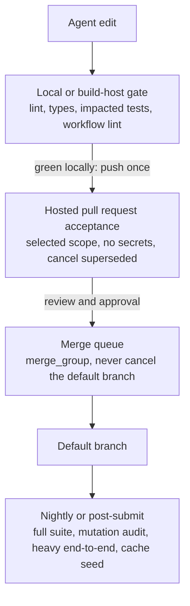

# CI for agentic engineering

Coding agents iterate fast and open many small pull requests. If every
tentative edit starts a hosted pipeline, continuous integration (CI) cost and
queue time grow with agent retries instead of with merged work. This playbook
keeps iteration local, spends hosted minutes on independent merge evidence,
and sets the selection, caching, flake, cost, and security rules for an
agent-driven repository.

It replaces the earlier *Local-first CI with hosted acceptance* draft and
keeps that draft's local gate, workflow lint, pinning, and runner-isolation
controls.

## Sources

All sources were accessed and checked on **2026-11-25**. Prices, runner
types, and tool versions describe that date; recheck them before budgeting or
pinning.

- [Techniques for Improving Regression Testing in Continuous Integration Development Environments (Google, 2014)](https://research.google/pubs/techniques-for-improving-regression-testing-in-continuous-integration-development-environments/)
- [Taming Google-Scale Continuous Testing (Google, 2017)](https://research.google/pubs/taming-google-scale-continuous-testing/)
- [Flaky Tests at Google and How We Mitigate Them](https://testing.googleblog.com/2016/05/flaky-tests-at-google-and-how-we.html)
- [Where Do Our Flaky Tests Come From?](https://testing.googleblog.com/2017/04/where-do-our-flaky-tests-come-from.html)
- [Predictive Test Selection (arXiv:1810.05286)](https://arxiv.org/abs/1810.05286)
- [Engineering at Meta: Predictive test selection](https://engineering.fb.com/2018/11/21/developer-tools/predictive-test-selection/)
- [Engineering at Meta: Probabilistic flakiness](https://engineering.fb.com/2020/12/10/developer-tools/probabilistic-flakiness/)
- [TDAD: Test-Driven Agentic Development – Reducing Code Regressions in AI Coding Agents via Graph-Based Impact Analysis](https://arxiv.org/abs/2603.17973)
- [GitHub Docs: Managing a merge queue](https://docs.github.com/en/repositories/configuring-branches-and-merges-in-your-repository/configuring-pull-request-merges/managing-a-merge-queue)
- [GitHub Docs: Workflow syntax](https://docs.github.com/en/actions/reference/workflows-and-actions/workflow-syntax)
- [GitHub Docs: Events that trigger workflows](https://docs.github.com/en/actions/reference/workflows-and-actions/events-that-trigger-workflows)
- [GitHub Docs: Dependency caching reference](https://docs.github.com/en/actions/reference/workflows-and-actions/dependency-caching)
- [GitHub Docs: GitHub Actions billing](https://docs.github.com/en/billing/concepts/product-billing/github-actions)
- [GitHub Docs: Actions runner pricing](https://docs.github.com/en/billing/reference/actions-runner-pricing)
- [GitHub Changelog: Update to GitHub Actions pricing](https://github.blog/changelog/2025-12-16-coming-soon-simpler-pricing-and-a-better-experience-for-github-actions/)
- [GitHub Docs: Secure use reference](https://docs.github.com/en/actions/reference/security/secure-use)
- [GitHub Docs: Self-hosted runners](https://docs.github.com/en/actions/concepts/runners/self-hosted-runners)
- [GitHub Docs: Compromised runners](https://docs.github.com/en/actions/concepts/security/compromised-runners)
- [GitHub Docs: Dependabot alerts](https://docs.github.com/en/code-security/concepts/supply-chain-security/dependabot-alerts)
- [GitHub Docs: Dependabot on GitHub Actions runners](https://docs.github.com/en/code-security/concepts/supply-chain-security/dependabot-on-actions)
- [act: unsupported functionality](https://nektosact.com/not_supported.html), [usage](https://nektosact.com/usage/index.html)
- [pre-commit](https://pre-commit.com/), [Lefthook](https://lefthook.dev/)
- [actionlint checks](https://github.com/rhysd/actionlint/blob/main/docs/checks.md)
- [zizmor audit rules](https://docs.zizmor.sh/audits/), [usage](https://docs.zizmor.sh/usage/)
- [dorny/paths-filter advisory GHSA-7hc6-8hq5-9q2m](https://github.com/dorny/paths-filter/security/advisories/GHSA-7hc6-8hq5-9q2m)
- [tj-actions/changed-files advisory GHSA-mrrh-fwg8-r2c3](https://github.com/advisories/GHSA-mrrh-fwg8-r2c3)
- [pinact](https://github.com/suzuki-shunsuke/pinact)
- [Renovate GitHub Actions manager](https://docs.renovatebot.com/modules/manager/github-actions/)
- [Dagger pricing](https://dagger.io/pricing/)
- [Bazel remote caching](https://bazel.build/remote/caching), [Gradle build cache](https://docs.gradle.org/current/userguide/build_cache.html)
- [Develocity Predictive Test Selection guide](https://docs.develocity.ai/2026.3/guides/predictive-test-selection/)
- [pytest-split](https://github.com/jerry-git/pytest-split), [testmon](https://www.testmon.org/)

## At a glance

| Question | Rule |
| --- | --- |
| Where should coding agents catch defects first? | Locally or on a dedicated build host, through the repository's one gate script. Push once the gate is green; use hosted CI for evidence local tools cannot produce. |
| How do you stop parallel agents multiplying the hosted CI bill? | Gate before pushing, cancel superseded pull request runs, select affected scopes with fail-closed routing, and merge jobs when per-job rounding costs more than parallelism saves. |
| Can a local emulator prove a workflow is safe to merge? | No. `act` ignores concurrency, `job.permissions`, `job.timeout-minutes`, and deployment environments, and has no OpenID Connect (OIDC) URL ([act](https://nektosact.com/not_supported.html)). |
| How should CI select tests as the suite grows? | Start with path or module routing; add test impact analysis or predictive selection when full runs exceed the feedback budget ([arXiv:1810.05286](https://arxiv.org/abs/1810.05286), [arXiv:2603.17973](https://arxiv.org/abs/2603.17973)). |
| How do you keep the default branch green when agents merge many small pull requests? | Use a merge queue with `merge_group` triggers and bounded batching ([GitHub](https://docs.github.com/en/repositories/configuring-branches-and-merges-in-your-repository/configuring-pull-request-merges/managing-a-merge-queue)). |
| How should CI handle flaky tests? | Track flakiness per test, cap retries, and quarantine chronic flakes out of the blocking gate with an owner and a deadline ([Google](https://testing.googleblog.com/2016/05/flaky-tests-at-google-and-how-we.html), [Meta](https://engineering.fb.com/2020/12/10/developer-tools/probabilistic-flakiness/)). |
| How do you measure hosted CI cost honestly? | Sum rounded whole-minute job durations across all attempts per merged pull request, not workflow wall time ([GitHub](https://docs.github.com/en/billing/reference/actions-runner-pricing)). |
| Where do secrets and write permissions belong in agent pull request workflows? | Nowhere in untrusted validation. Keep `permissions: contents: read`, run tests without secrets, and run any self-hosted runner as a disposable single-job machine ([GitHub](https://docs.github.com/en/actions/reference/security/secure-use)). |

## Decision guide

Support levels in section 8 use this scale. **Strong**: two or more
independent primary sources support the claim. **Single source**: one primary
source does. **Contested**: credible primary sources disagree or the trade-off
depends on scale. Thresholds and budgets marked *Own experience* are starting
defaults from the author's practice, not sourced figures; tune them to your
repository.

### 1. Gate locally, prove independently

Keep one canonical gate script, for example `scripts/gate.sh`, so local
machines, build hosts, hooks, and hosted CI run the same checks without
workflow YAML drifting from it.

Takeaway: agents spend cheap local cycles while iterating; hosted runners
spend minutes only on reviewed, locally verified candidates and on merge-queue
integration.

#### When hosted CI must still run

A local gate catches most code defects but cannot produce independent merge
evidence. Keep hosted CI for:

1. **Merge proof the agent cannot fabricate.** Required status checks are
   recorded by the forge against the commit SHA, not reported by the agent.
2. **Event, permission, and ruleset behaviour.** `act` cannot reproduce
   GitHub permissions, concurrency groups, environments, timeouts, or OIDC
   ([act](https://nektosact.com/not_supported.html)).
3. **Target operating system and clean-room parity.** A macOS laptop run does
   not prove Linux behaviour or the absence of local state and credentials.
4. **Cross-pull-request integration.** Two pull requests that each pass on an
   older base can break when merged together. Only a merge queue or a
   post-submit run tests the combined commit.

#### One tool per job

Pick one tool for each job. Two tools for one job add maintenance, not
redundancy.

| Job | Default | Alternative | Choose the alternative when |
| --- | --- | --- | --- |
| Run application tests | The project gate script (`pytest`, `gradlew`, `pnpm`) | `act` on one allowlisted, secretless Linux job | You are debugging action wiring, not application logic ([act usage](https://nektosact.com/usage/index.html)). |
| Commit and push hooks | The repository's gate script | `pre-commit` or Lefthook, never both | Managing many isolated tool runtimes is a measured burden; have the hook call the gate ([pre-commit](https://pre-commit.com/), [Lefthook](https://lefthook.dev/)). |
| Workflow syntax check | `actionlint`, with ShellCheck when installed | None | Not applicable ([actionlint](https://github.com/rhysd/actionlint/blob/main/docs/checks.md)). |
| Workflow security audit | `zizmor --offline`; record any online run | None | Not applicable ([zizmor](https://docs.zizmor.sh/usage/)). |
| Skip irrelevant optional workflows | Native `paths` and `paths-ignore` | `dorny/paths-filter` at a patched SHA, outputs used as booleans only | A required aggregate check must always report while expensive child jobs skip ([GitHub](https://docs.github.com/en/actions/reference/workflows-and-actions/workflow-syntax)). |
| Pin third-party actions to SHAs | `pinact` (`pinact run --check`, or `pinact run --fix=false --no-api` offline) | Ratchet | The estate spans CI systems beyond GitHub Actions ([pinact](https://github.com/suzuki-shunsuke/pinact)). |
| Keep pins current | Dependabot for `github-actions`, grouped weekly, no auto-merge | Renovate, after reviewing its AGPL-3.0 licence and hosting | You need cross-ecosystem grouping or custom regex managers ([Dependabot](https://docs.github.com/en/code-security/concepts/supply-chain-security/dependabot-on-actions), [Renovate](https://docs.renovatebot.com/modules/manager/github-actions/)). |
| Portable pipeline code | Gate script plus project runners | Dagger | Measured duplication between local and CI pipelines justifies maintaining pipeline code ([Dagger](https://dagger.io/pricing/)). |

### 2. Select tests in stages

Running every test on every small pull request stops scaling. Google
researchers paired lightweight regression test selection before submit with
test prioritization after submit ([Elbaum et al., 2014](https://research.google/pubs/techniques-for-improving-regression-testing-in-continuous-integration-development-environments/)),
and found that very few tests ever fail ([Memon et al., 2017](https://research.google/pubs/taming-google-scale-continuous-testing/)).
Meta's predictive test selection trained a gradient-boosted decision-tree
model on historical outcomes. In production it halved the infrastructure cost
of testing changes while still reporting over 95% of individual test failures
and over 99.9% of faulty changes, running about a third of the tests that
transitively depend on the modified code ([arXiv:1810.05286](https://arxiv.org/abs/1810.05286),
[Engineering at Meta](https://engineering.fb.com/2018/11/21/developer-tools/predictive-test-selection/)).

| Stage | Mechanism | When to adopt | Fail-closed rule |
| --- | --- | --- | --- |
| **1. Path or module scope** | Native `paths` on optional workflows, or a classifier step in the job that picks `smoke`, `core`, or `full` | Now, on multi-component or documentation-heavy repositories | Unknown paths, new root configuration, workflow edits, or a missing diff select `full`. Do not put native `paths` on a required workflow: a skipped workflow leaves its required checks pending and blocks the merge ([GitHub](https://docs.github.com/en/actions/reference/workflows-and-actions/workflow-syntax)). |
| **2. Coverage or graph impact analysis** | Tool-level dependency tracking: `pytest-testmon`, Gradle task inputs, or a code-to-test map such as TDAD | Suites over about 2 to 3 minutes locally or 5 minutes in pull request CI (*Own experience*) | Run the full suite on the default branch, in the merge queue, or nightly, so missed dependencies surface quickly ([testmon](https://www.testmon.org/), [arXiv:2603.17973](https://arxiv.org/abs/2603.17973)). |
| **3. Predictive selection** | A model trained on build and test history, such as Develocity Predictive Test Selection or Meta's design | Large repositories with thousands of tests and many commits a day | Always run directly affected tests and a full post-submit run, and track the escape rate ([Develocity](https://docs.develocity.ai/2026.3/guides/predictive-test-selection/), [arXiv:1810.05286](https://arxiv.org/abs/1810.05286)). |

**Watch the rounding cost of selector jobs.** GitHub rounds each job up to
the nearest whole minute ([GitHub](https://docs.github.com/en/billing/reference/actions-runner-pricing)),
so a separate change-detection job that runs for a few seconds bills a full
minute on every pull request. When one runner does the validation, run the
classifier as the first step of that job.

### 3. Caching, sharding, and merge queues

#### Caching with a trust boundary

- **Content-addressed build caches** such as the Bazel remote cache and the
  Gradle build cache reuse outputs when task inputs are unchanged, across
  local machines, build hosts, and CI ([Bazel](https://bazel.build/remote/caching),
  [Gradle](https://docs.gradle.org/current/userguide/build_cache.html)).
- **Dependency cache keys** include the operating system, architecture,
  runtime version, and the lockfile hash ([GitHub](https://docs.github.com/en/actions/reference/workflows-and-actions/dependency-caching)).
- **Trust boundary.** GitHub lets a pull request restore caches from its base
  branch and scopes caches a pull request creates to that pull request
  ([GitHub](https://docs.github.com/en/actions/reference/workflows-and-actions/dependency-caching)).
  Save shared caches only from trusted default-branch runs, and never feed a
  cache or artifact built from untrusted code into a privileged release job
  ([GitHub](https://docs.github.com/en/actions/reference/security/secure-use)).
  Do not cache virtual environments, credentials, or test receipts that would
  skip verification.

#### Shard only when it beats the rounding cost

- Split a suite into parallel shards, for example by recorded duration with
  [pytest-split](https://github.com/jerry-git/pytest-split), only when one
  runner exceeds the wall-clock budget (about 5 minutes, *Own experience*).
- Each shard adds runner start-up, checkout, dependency restore, and another
  rounded minute. For example, 8 minutes of tests with 1 minute of setup
  bill 9 minutes on one runner but 12 minutes as four shards. Shard to buy
  wall-clock time, not to cut minutes.

#### Merge queues for parallel agent work

Two pull requests that each pass against an older default branch can break it
when merged back to back. A GitHub merge queue tests temporary
`gh-readonly-queue/` branches that combine the base branch with the queued
pull requests ahead of the candidate ([GitHub](https://docs.github.com/en/repositories/configuring-branches-and-merges-in-your-repository/configuring-pull-request-merges/managing-a-merge-queue)):

- Add `merge_group` next to `pull_request` in every required workflow;
  without it, queued pull requests wait for checks that never run
  ([GitHub](https://docs.github.com/en/actions/reference/workflows-and-actions/events-that-trigger-workflows)).
- Set the minimum and maximum group size and the wait time to batch small
  agent pull requests; a group of 2 to 5 is a reasonable start
  (*Own experience*).
- Cancel superseded pull request runs with
  `cancel-in-progress: ${{ github.event_name == 'pull_request' }}`. Never
  cancel runs on the default branch.

### 4. Govern flaky tests

Flaky tests cost agents more than slow tests do. An agent cannot easily tell
a flake from a regression, so it edits code to chase a failure that is not
there.

- At Google, about **1.5%** of test runs reported a flaky result, almost
  **16%** of tests had some flakiness, and about **84%** of observed
  pass-to-fail transitions involved a flaky test ([Google, 2016](https://testing.googleblog.com/2016/05/flaky-tests-at-google-and-how-we.html)).
- Flakiness grows with test size. Over one week across about 4.2 million
  tests, **0.5%** of small, **1.6%** of medium, and **14%** of large tests had
  at least one flaky run ([Google, 2017](https://testing.googleblog.com/2017/04/where-do-our-flaky-tests-come-from.html)).
- Meta scores flakiness on a scale, the Probabilistic Flakiness Score,
  because every real test is flaky to some degree; the useful question is how
  flaky ([Meta](https://engineering.fb.com/2020/12/10/developer-tools/probabilistic-flakiness/)).

**Operating rules** (thresholds are *Own experience*):

1. **Track the flake rate per test**, not only the build pass rate.
2. **Cap automatic retries at one or two**, and log every pass on retry as a
   flake event. Silent retries hide real concurrency bugs.
3. **Quarantine automatically** when a test crosses a flake threshold, for
   example more than 2% over 50 runs. Keep quarantined tests running in a
   non-blocking lane with a named owner and a 14-day fix-or-delete deadline.
4. **Push flaky end-to-end coverage down** to small deterministic tests where
   possible.

### 5. Cost per merge, time budgets, and honest baselines

#### GitHub Actions pricing snapshot (2026-11-25)

The GitHub pricing reference lists **USD 0.002/min** for Linux 1-core,
**USD 0.006/min** for Linux 2-core x64, **USD 0.005/min** for Linux 2-core
arm64, **USD 0.010/min** for Windows 2-core, and **USD 0.062/min** for macOS
3- or 4-core runners ([GitHub](https://docs.github.com/en/billing/reference/actions-runner-pricing)).
GitHub cut hosted-runner prices by up to 39% on 2026-01-01. It had announced
a USD 0.002/min platform charge for self-hosted runners from 2026-03-01, then
postponed it in an update to the same changelog on 2025-12-17
([GitHub Changelog](https://github.blog/changelog/2025-12-16-coming-soon-simpler-pricing-and-a-better-experience-for-github-actions/)).
Self-hosted runner use remains free in GitHub billing
([GitHub](https://docs.github.com/en/billing/concepts/product-billing/github-actions));
hardware, patching, and incident response stay with the operator. A macOS
minute costs about ten times a Linux 2-core minute, so run Linux in hosted CI
and check macOS locally unless a release needs cross-platform proof.

#### Time and cost budgets (*Own experience*)

| Tier | Wall-clock budget | Hosted rounded minutes | Scope |
| --- | --- | --- | --- |
| Local fast gate | 60 s inner loop, 3 min full local gate | 0 | Format, lint, types, affected unit and contract tests |
| Hosted pull request acceptance | 5 min median, 10 min 95th percentile | 5 to 8 per pull request | Selected scope, one Linux job where practical, hard `timeout-minutes` |
| Hosted merge or default branch | 10 min | 10 per merge | Merge-queue validation, or a cache seed when the pull request already validated the exact tree |
| Nightly or scheduled | 25 min | A daily cap | Full suite, mutation audit, heavy end-to-end, dependency checks |

#### Honest cost accounting

Cost per merged pull request is the sum of rounded whole-minute job durations
across all runs and retries on that pull request, plus its merge run. Before
you claim a saving, separate three quantities:

| Quantity | How to count it | Common error |
| --- | --- | --- |
| **Observed use** | Rounded whole minutes across all jobs and attempts | Using workflow wall time or dropping failed retries |
| **Avoided retries** | Comparable hosted runs that local checks demonstrably prevented | Crediting runs that would never have happened |
| **Already-paused work** | Heavy workflows disabled before the change | Counting an existing pause as a new saving |

### 6. Trust boundaries and agent-specific CI controls

Agents raise three CI risks: many pull requests, untrusted or prompt-injected
pull request content, and accidental secret exposure.

| Boundary | Rule | Why |
| --- | --- | --- |
| **Workflow code** | Run `actionlint` and `zizmor --offline` on every workflow change, and keep negative fixtures locally. | Valid YAML can still hold script injection, broad tokens, or unsafe triggers ([actionlint](https://github.com/rhysd/actionlint/blob/main/docs/checks.md), [zizmor](https://docs.zizmor.sh/audits/)). |
| **Third-party actions** | Pin every third-party action to a full 40-character commit SHA with `pinact`; review the owner, the release-to-commit match, and advisories separately. | `dorny/paths-filter` had a filename-escaping flaw fixed in 3.0.4 and 4.0.3 ([GHSA-7hc6-8hq5-9q2m](https://github.com/dorny/paths-filter/security/advisories/GHSA-7hc6-8hq5-9q2m)). Attackers retagged `tj-actions/changed-files` versions to a malicious commit ([GHSA-mrrh-fwg8-r2c3](https://github.com/advisories/GHSA-mrrh-fwg8-r2c3)). Dependabot raises alerts only for actions pinned by semantic version, not by SHA ([GitHub](https://docs.github.com/en/code-security/concepts/supply-chain-security/dependabot-alerts)). |
| **Permissions and secrets** | Default to `permissions: contents: read`. Give pull request test jobs no deployment or cloud secrets, and avoid `pull_request_target` checkouts of untrusted code. | A prompt-injected or faulty pull request can exfiltrate any secret its runner can read ([secure use](https://docs.github.com/en/actions/reference/security/secure-use), [compromised runners](https://docs.github.com/en/actions/concepts/security/compromised-runners)). |
| **Review pipelines** | Keep automated review read-only and separate from merge authority. A reviewer emits findings, never an approval of its own work or a direct push. | It stops an agent approving its own diff or weakening a gate ([Autonomy and approval gates](practices/agentic-sre/autonomy-and-approval.md)). |
| **Self-hosted runners** | Do not run a persistent self-hosted runner in an operator's account. If a dedicated runner is approved, use one disposable Linux machine per job, with no operator home directory, SSH agent, cloud CLI profile, or Docker socket. | Self-hosted runners do not need a clean instance for each job, so state carries over unless you remove it ([self-hosted runners](https://docs.github.com/en/actions/concepts/runners/self-hosted-runners)). GitHub recommends just-in-time runners that perform at most one job ([secure use](https://docs.github.com/en/actions/reference/security/secure-use)). A private repository is not a sandbox. |
| **Local emulation (`act`)** | Allowlist one explicit secretless job and run it in a disposable workspace with no ambient credentials. | `act` runs workflow steps on your machine, so mounted credentials turn a workflow bug into a leak ([act](https://nektosact.com/usage/index.html)). |

### 7. Tool versions and licences (2026-11-25)

Release metadata read from GitHub on **2026-11-25**. Recheck before pinning.

| Tool | Latest release | Licence | Disposition |
| --- | --- | --- | --- |
| `nektos/act` | v0.2.98 (2026-11-16) | MIT | Optional diagnostic for one secretless Linux job |
| `pre-commit` | v4.7.0 (2026-10-13) | MIT | Defer unless multi-runtime hooks are a measured pain |
| `evilmartians/lefthook` | v2.2.3 (2026-11-24) | MIT | Defer unless replacing ad hoc hooks with one runner |
| `rhysd/actionlint` | v1.7.12 (2026-03-30) | MIT | Adopt in the local gate |
| `zizmorcore/zizmor` | v1.33.1 (2026-11-22) | MIT | Adopt in the local gate |
| `dorny/paths-filter` | v4.0.3 (2026-08-05) | MIT | Conditional: patched SHA pin, boolean outputs only |
| `suzuki-shunsuke/pinact` | v5.0.2 (2026-10-25) | MIT | Adopt for SHA pinning |
| `sethvargo/ratchet` | v0.12.0 (2026-07-18) | Apache-2.0 | Reject as a duplicate unless the estate spans CI systems |
| `renovatebot/renovate` | 44.261.2 (2026-11-24) | AGPL-3.0 | Defer; review the licence and hosting model |
| `dependabot/dependabot-core` | v0.405.0 (2026-11-16) | MIT (the service is separate) | Preferred weekly grouped Actions updater, no auto-merge |
| `actions/runner` | v2.338.2 (2026-10-26) | MIT (the control plane is separate) | Keep hosted runs bounded; self-host only on disposable machines |
| `dagger/dagger` | v0.21.12 (2026-11-17) | Apache-2.0 (the cloud service is separate) | Defer until pipeline duplication is measured |

### 8. Evidence and support

| Claim | Support | Sources | Notes and limits |
| --- | --- | --- | --- |
| Selective testing before submit, with fuller testing after, cuts CI cost while keeping defect detection | **Strong** | [Elbaum et al.](https://research.google/pubs/techniques-for-improving-regression-testing-in-continuous-integration-development-environments/), [Memon et al.](https://research.google/pubs/taming-google-scale-continuous-testing/), [arXiv:1810.05286](https://arxiv.org/abs/1810.05286), [Engineering at Meta](https://engineering.fb.com/2018/11/21/developer-tools/predictive-test-selection/) | Google and Meta independently; Meta reports half the cost with over 99.9% of faulty changes still caught. |
| Flaky tests dominate pass-to-fail noise and grow with test size | **Strong** | [Google, 2016](https://testing.googleblog.com/2016/05/flaky-tests-at-google-and-how-we.html), [Google, 2017](https://testing.googleblog.com/2017/04/where-do-our-flaky-tests-come-from.html), [Meta](https://engineering.fb.com/2020/12/10/developer-tools/probabilistic-flakiness/) | The size figures are weekly shares of tests with at least one flaky run. |
| Local workflow emulation cannot certify GitHub security or merge controls | **Single source** | [act](https://nektosact.com/not_supported.html) | The `act` documentation lists the unsupported features. |
| Third-party actions are supply-chain inputs, and SHA pins get no Dependabot alerts | **Strong** | [GHSA-7hc6-8hq5-9q2m](https://github.com/dorny/paths-filter/security/advisories/GHSA-7hc6-8hq5-9q2m), [GHSA-mrrh-fwg8-r2c3](https://github.com/advisories/GHSA-mrrh-fwg8-r2c3), [Dependabot alerts](https://docs.github.com/en/code-security/concepts/supply-chain-security/dependabot-alerts), [secure use](https://docs.github.com/en/actions/reference/security/secure-use) | Two advisories plus GitHub's own documentation. |
| Each job rounds up to a whole minute; 2026 hosted prices fell by up to 39%; self-hosted use stays free | **Strong** | [Runner pricing](https://docs.github.com/en/billing/reference/actions-runner-pricing), [Actions billing](https://docs.github.com/en/billing/concepts/product-billing/github-actions), [Changelog](https://github.blog/changelog/2025-12-16-coming-soon-simpler-pricing-and-a-better-experience-for-github-actions/) | Read on 2026-11-25. |
| Merge queues catch cross-pull-request breaks under concurrent merges but need `merge_group` triggers | **Single source** | [Merge queue](https://docs.github.com/en/repositories/configuring-branches-and-merges-in-your-repository/configuring-pull-request-merges/managing-a-merge-queue), [Events](https://docs.github.com/en/actions/reference/workflows-and-actions/events-that-trigger-workflows) | GitHub documentation. Batch size trades latency against minutes, and at low pull request volume serial merges may be enough. |
| A code-to-test impact map reduces agent regressions before CI | **Single source** | [arXiv:2603.17973](https://arxiv.org/abs/2603.17973) | TDAD cut regressions by 70% (6.08% to 1.82%) for Qwen3-Coder 30B on 100 SWE-bench Verified instances. |
| Self-hosted runners need per-job isolation, even for private repositories | **Strong** | [Self-hosted runners](https://docs.github.com/en/actions/concepts/runners/self-hosted-runners), [secure use](https://docs.github.com/en/actions/reference/security/secure-use), [compromised runners](https://docs.github.com/en/actions/concepts/security/compromised-runners) | GitHub's threat model; the specific machine design is operating practice. |

### 9. Limits

- Prices, runner types, and tool versions describe **2026-11-25**. Recheck
  the official documentation before budgeting or pinning.
- Predictive selection needs historical build and failure data. Small
  repositories with fast suites gain more from path scoping and build caching.
- No CI configuration removes the cost of bloated, over-mocked, or flaky
  tests. Pair this playbook with [Testing in agentic engineering](testing-in-agentic-engineering.md).

## Checklist

- [ ] Keep one canonical gate script that local runs, build hosts, hooks, and hosted CI all call.
- [ ] Run `actionlint` and `zizmor --offline` on every workflow change; pin every third-party action to a full commit SHA.
- [ ] Set `permissions: contents: read`, a hard `timeout-minutes`, and pull-request-only `cancel-in-progress`.
- [ ] Keep pull request validation secretless; never run untrusted code with deployment secrets or on a persistent operator runner.
- [ ] Use fail-closed scope selection, and run it as a step in the validation job rather than as a separate short job.
- [ ] Restore caches on pull requests and save shared caches only from trusted default-branch runs.
- [ ] Add `merge_group` triggers and a merge queue once concurrent agent pull requests break the default branch.
- [ ] Track flake rates per test, cap retries at one or two, and quarantine chronic flakes with an owner and a deadline.
- [ ] Measure rounded job minutes per merged pull request, and separate observed use, avoided retries, and already-paused workflows.

## Rules of thumb

- Catch defects locally or on a build host; push once, and spend hosted minutes on independent merge proof.
- One gate script owns the check list; workflow YAML selects scope and does not repeat test commands.
- Every extra job pays a whole-minute ceiling; split jobs only when parallelism earns it.
- A full SHA pins a commit, not a safety review, and Dependabot does not alert on SHA pins.
- Never cancel runs on the default branch; always cancel superseded pull request runs.
- Quarantine flaky tests before agents spend tokens debugging them.
- A private repository is not a sandbox; never put a persistent runner in an operator account.
- Count cost per merged pull request in rounded minutes across all retries, not best-case wall time.

<!-- playbook-skills:v1:begin -->
<!-- Generated by scripts/playbook_index.py from the skills front matter. Do not edit by hand. -->
## Skills that put this into practice

These agent skills turn the rules above into steps an agent follows.
A skill without a link is not published; only its id and summary are public.

- `apply-playbooks`: Finds the playbooks that apply to a change, turns their key rules into acceptance criteria, and records in the pull request which rules the change followed.
- `spec-delivery-loop`: Turns an approved specification into a verified change through a plan, the smallest coherent change, focused tests, a gate, independent review and bounded repair.
- [`correct`](https://github.com/cursor/plugins/tree/main/pstack/skills/correct): Turns a mistake that agents keep repeating into a structural guard, such as a type, lint rule, CI check or test, proven against a real past instance.
<!-- playbook-skills:v1:end -->

## Claim review

- [x] Every figure traces to a cited source or is labelled Own experience.
- [x] Every factual claim stays within the cited evidence.
- [x] Evidence limits and qualifiers remain explicit.

## Privacy review

- [x] No employer material.
- [x] No customer material.
- [x] No private-repository material.
- [x] No trace material.
- [x] No transcript material.

<!-- unslop-writing:passed -->
