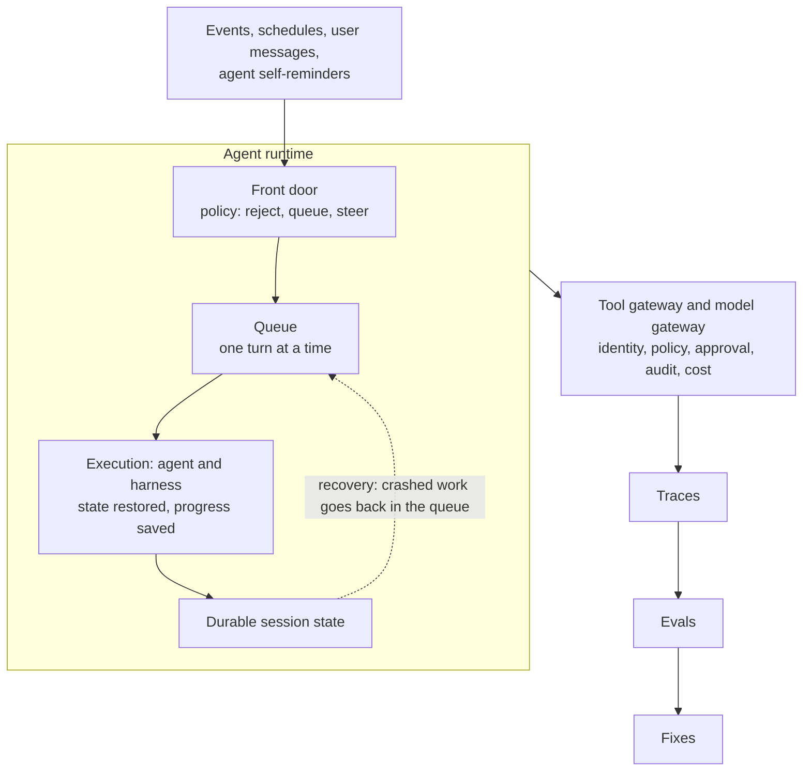
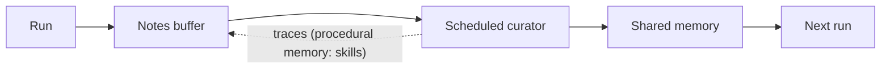

<!-- playbook-capture:fingerprint=16b0100c57c15f52a3c9d7928bf1c3a4828b96325a154eb5e091b49976b7b159 -->

# Persistent agents

## Sources

- Primary source: LangChain, "The Future of Agents with Harrison Chase", webinar, 2026-11-21, 45:52:
  <https://www.youtube.com/watch?v=GojQtxCT3dg>. Vendor talk; product claims
  about LangSmith are omitted here and only the architecture is used.
- 47 further sources, read on 2026-11-23: practitioner engineering
  posts, framework and durable-execution documentation, OWASP and protocol
  specifications, research papers, and incident write-ups. Section 7 gives
  the support level for each requirement. The [source list](#source-list) at
  the end gives links and dates.
- [Agentic SRE practices](../practices/agentic-sre/README.md) in this
  repository.
- [Building Reliable Agents](../building-reliable-agents.md) in this
  repository.

## Start here

This guide is for platform and engineering leads asked to build an agent that
does not wait to be asked. A persistent agent owns a goal, wakes on events and
schedules, remembers what it did, and works next to several people at once.

Use this guide before you build one. It lists what must exist around the model
for the agent to stay useful and safe over weeks, not minutes. It links to the
[Agentic SRE practices](../practices/agentic-sre/README.md) for the operating
detail instead of repeating it.

Do not use it for a task agent that runs once per request and stops. Most of
this machinery is cost you only need when the agent must keep going without a
person in the chat.

**How to read the tags.**

- **[talk mm:ss]** — said or shown in the primary source webinar, at that
  timestamp. Timestamps come from a machine transcript; treat quotes as close
  paraphrase.
- **[sourced: n, m]** — supported by the numbered sources in the
  [source list](#source-list). Each source was opened and read on
  2026-11-23. The sources did not pass the 3-vote adversarial verification
  that `[verified]` means in
  [Building Reliable Agents](../building-reliable-agents.md), so this draft
  does not use `[verified]`.
- **[talk only]** — the webinar is the only source found for the claim.
  Treat it as one practitioner's view.
- **[contested]** — independent sources disagree with the claim or with each
  other. Section 7 says how.
- **[practice]** — standard engineering practice this guide adds where the
  sources are thin. Default-good, not sourced.

**Support levels** (section 7): **strong** means two or more independent
sources support the claim; **single source** means only one source supports it;
**contested** means at least one credible source disagrees. Sources from
LangChain, the webinar's own vendor, do not count as independent.

## At a glance

A persistent agent is three systems, not one prompt **[talk 20:50–25:56]**
**[talk only]** as a framing; each layer's contents are sourced in section 2:

| Layer | Question it answers | What lives there |
| --- | --- | --- |
| Runtime | What should the agent do? (intended behaviour) | Goal prompt, harness, scheduler, queue, durable state, memory |
| Improvement loop | What did it actually do? (observed behaviour) | Traces, online and offline evals, failure-to-test-case loop |
| Governance | What may it never do? (governed behaviour) | Identity, policy and approval at tool and model choke points, audit log |

Takeaway: the prompt states intent, traces show behaviour, and only governance
enforces limits.

## The map

Takeaway: every wake enters through one front door, runs one turn at a time,
and leaves through governed choke points that emit traces.

The runtime shape above follows the agent-runtime diagram shown in the talk
**[talk 16:52–18:10]**. Durable-execution frameworks describe the same shape:
one instance per key, queued messages, and a journal of completed steps
**[sourced: 13, 15, 16]**.

## 1. Decide whether you need persistence

The talk's core distinction is task versus goal **[talk 05:02–05:49]**
**[talk only]** as a definition:

| Task | Goal |
| --- | --- |
| "Write this email" | "Maintain inbox zero" |
| Bounded action, then done | Ongoing outcome, never done |
| Brute-force completion is fine | Needs memory of past attempts and new approaches |

Build a persistent agent only when the work is a standing responsibility with an
outcome you can measure. If a cron job plus a single model call would do, use
that. Independent guides give the same advice: start with the simplest
solution, and add autonomy only when a deterministic workflow is not enough
**[sourced: 1, 11]**; see
[Building Reliable Agents](../building-reliable-agents.md) rule 1.

**Design the goal around feedback.** The hardest input for a persistent agent is
human feedback, so shape goals around the unit people find natural to correct.
The talk's example reorganised per-account sales agents into per-stage agents
because customers could teach "how to do outbound" across accounts more easily
than one account at a time **[talk 05:57–07:37]** **[talk only]**.

## 2. Requirements checklist

Each row is one requirement area. "Talk" records what the webinar says;
"Default" is this guide's recommendation; "Support" is the level from section 7.

| Area | Talk | Default | Support |
| --- | --- | --- | --- |
| **Goal and alignment** | Prompt for the goal and for creativity; a goal such as "remove all bugs" can be met by deleting the code base, so alignment matters more when no one watches **[talk 12:33–13:22, 38:54–39:09]** | Write the goal with explicit non-goals and forbidden shortcuts, and enforce the forbidden ones in governance, not the prompt **[sourced: 27, 36, 38, 42]** | Strong |
| **Triggers and scheduling** | Crons set by the developer, the user, or the agent itself; event listeners (new email, new chat message); agent tools to manage its own reminders **[talk 13:42–14:26]** | Keep a written inventory of every wake source with its owner and maximum frequency **[practice]**. Schedules and events are common trigger types **[sourced: 7, 8, 18, 29, 33]**; agent-set reminders are documented in source 7 and Project Vend phase two, which provides partial support for this requirement **[sourced: 7, 46]** | Strong |
| **Queueing and steering** | A busy agent receives new messages mid-run; decide whether to reject, queue, or let them steer the current run **[talk 14:30, 17:28]** | One turn at a time per session; declare the policy per wake source **[sourced: 7, 15, 16]**. Some frameworks offer four policies: reject, queue, interrupt, and roll back | Strong |
| **State and checkpointing** | Durable session state (conversation, progress, history) readable by the app and the agent; checkpoints **[talk 17:36–17:50, 19:00]** | Persist progress after every step that has side effects **[sourced: 2, 3, 12, 15, 22]**. In-memory session stores lose state on restart; use them for tests only | Strong |
| **Failure recovery** | Durable execution: a run that fails halfway resumes from where it failed; recovery puts crashed work back in the queue **[talk 17:08–17:18]** | Make every side-effecting tool call idempotent so a replayed step is safe; use idempotency keys for writes, sends, and payments **[sourced: 3, 13, 14, 15, 18, 19]** | Strong |
| **Memory** | Decide whether the agent writes memory directly or writes notes to a buffer that a background "dreaming" curator merges later **[talk 14:58–15:39]**; storage format matters less than what to remember and keeping it fresh **[talk 37:05–37:29]** **[talk only]** | Let the agent always take notes; promote notes to shared memory only through a curator on a schedule **[talk 42:23–43:03]** **[sourced: 20, 21, 23, 28, 30, 32]**. The curator must validate each write, not only merge it **[sourced: 27, 40]** | Strong |
| **Identity and permissions** | Permissions depend on who is acting, what action, and which surface; a shared channel must not inherit one person's private access **[talk 15:39–15:55, 24:45–25:04]** | Carry the requesting human's identity to every tool call, give the agent least-privilege credentials scoped per session, and keep development and production credentials apart **[sourced: 25, 26, 27, 42, 44]**. Whether the agent also needs its own principal identity is unsettled **[contested]**; see [Blast radius](../practices/agentic-sre/blast-radius.md) | Contested |
| **Governance and oversight** | Do not put limits in a prompt; enforce policy, identity, and approval at choke points — tool calls, network calls, model calls **[talk 24:03–24:45]**; tool policy can allow, deny, or require human approval, with an audit log of every action **[talk 37:47–38:52]** | Assign an autonomy level per action type, not per agent; see [Autonomy and approval gates](../practices/agentic-sre/autonomy-and-approval.md) **[sourced: 5, 6, 11, 27, 38]**. Ask a human only for high-risk actions: people approve almost all routine prompts, so blanket approval stops working as a check **[sourced: 5, 6, 27]** | Strong |
| **Observability** | Trace every step; traces are the system of record for spotting error patterns **[talk 39:48–39:56]**; mask trace inputs and outputs by default and grant access by group and metadata **[talk 28:45–30:28]** | Trace every model call and tool call **[sourced: 3, 9, 17, 18]**, and instrument with OpenTelemetry GenAI spans; see [Observability](../practices/agentic-sre/observability.md). Turn on input and output masking yourself: at least one major agent SDK records full inputs and outputs by default **[sourced: 10]** | Strong |
| **Cost control** | Model gateway for cost control, model access, and fallbacks **[talk 27:21]** **[talk only]**; compute for sandboxes is the main capacity squeeze **[talk 36:35–36:53]** **[talk only]** | Set a budget per wake and per day, cap iterations, and suspend the agent while it waits; a wake that finds nothing to do should cost almost nothing **[sourced: 7, 11, 17, 18, 27]** | Strong |
| **Evaluation** | Test tool calls, messages, and state edits; grade full traces and end state against rubrics, online and offline; test that the agent acts when worth acting and stays silent otherwise; turn production failures into regression cases **[talk 21:32–22:18, 23:35]** **[talk 22:48–23:12]** | Track noise (false alarms) and missed opportunities as two separate rates **[sourced: 4, 33, 34, 35]**; see [Releases](../practices/agentic-sre/releases.md) | Strong |
| **Multiplayer and multi-surface** | Works with several people at once across chat, desktop, and web **[talk 08:34–09:04]**; Project Vend provides partial support for several people sharing one agent through Slack **[sourced: 45]**. State and event streams must resume across surfaces **[talk 18:00–18:06]** **[talk only]** | Start with one surface; add more only when state and permissions already work per surface **[practice]** | Single source |

## 3. The wake contract

Every wake source needs the same five answers before launch **[practice]**:

1. **Source.** Event, schedule, or self-reminder, and who owns it.
2. **Frequency cap.** The most times per hour it may wake the agent.
3. **Busy policy.** Reject, queue, or steer when a run is already active.
4. **Quiet outcome.** What "nothing worth doing" looks like, and proof it is
   cheap.
5. **Escalation.** Which outcomes notify a human, and through which surface.

The talk's warning case is an agent that wakes every 30 minutes and messages the
user every time: correct in each run, spam in aggregate **[talk 21:49]**.
Independent evidence points the same way:

- On a proactive-assistant benchmark, the best models found almost every real
  need but also offered help that was not needed about half the time
  **[sourced: 33]**.
- In a human-graded study of proactive agents, over-proactivity (bad timing or
  too much help) caused 61% of rejected responses **[sourced: 35]**.
- Autonomous agents with a vague goal sent unsolicited email to real people
  without human review **[sourced: 47]**.

## 4. Memory: notes first, curated later

Takeaway: running agents write notes freely; only a curator changes what every
future run believes.

| Memory type | Best source | Form |
| --- | --- | --- |
| Procedural (how to do things) | Agent traces | Skills **[talk 41:52–42:17]** **[sourced: 21, 31]**. One framework stores procedural memory as prompt rules instead (source 24) |
| Factual (what is true) | Traces plus other work systems | Markdown, wiki, or graph **[talk 41:52–42:17]** **[sourced: 21, 23, 32]** |

Also give the agent search across its own past conversations, whether it uses
one long thread or many **[talk 44:12–45:08]** **[sourced: 21, 23]**.

**Limits the sources add.**

- A background curator pays off most when the next question is predictable
  from what the agent already knows **[sourced: 28]**.
- Better memory alone does not stop long-horizon derailment. In one
  long-running benchmark, failures did not correlate with the context window
  filling up **[sourced: 36]**.
- Memory is an attack surface. Injected memories persist across sessions
  **[sourced: 41, 43]**, and checks at write time stop single poisoned records
  but not records that are harmful only in combination **[sourced: 40]**.
  A curator reduces this risk; it does not remove it.

## 5. Launch checklist

- [ ] The goal names an outcome metric, non-goals, and forbidden shortcuts.
- [ ] Every wake source has a filled wake contract (section 3).
- [ ] A crash mid-run resumes from the last checkpoint without repeating a
      side effect.
- [ ] Notes and curated memory are separate; the curator runs on a schedule
      and validates each write.
- [ ] Every tool and model call passes a gateway that checks identity and policy
      and writes an audit record.
- [ ] Each action type has an autonomy level and a named human approver where
      required.
- [ ] Traces are masked by default and access is granted by group.
- [ ] Evals cover "acted when it should" and "stayed silent when it should".
- [ ] Every production failure becomes a regression eval before its fix ships.
- [ ] There is a per-wake and per-day cost budget and an emergency stop.

## 6. Worked example: a proactive fraud-research agent

A fraud team wants an agent that improves detection without touching live
decisions **[practice]**.

| Requirement | Choice |
| --- | --- |
| Goal | Reduce cost-weighted fraud loss of the champion detection policy, measured by pre-registered experiments |
| Wakes | Drift alarm on score or feature distributions; new confirmed-fraud labels; alert-queue backlog over threshold; weekly schedule |
| May do alone | Open a hypothesis, build candidate features or rules on a branch, run a pre-registered backtest, write an evidence report |
| Needs a human | Promote a challenger, change live policy or thresholds, contact a customer |
| Never | Decide or block a live payment |
| Quiet outcome | "No drift, no new label pattern" closes the wake with a one-line log entry and no message |

Takeaway: the agent is persistent in research and has no authority over the
payment path.

## 7. Evidence and support

Support summary for the 12 requirement rows in section 2: **10 strong**,
**1 single source**, and **1 contested**.

| Area | Support | Independent sources | What the sources add or dispute |
| --- | --- | --- | --- |
| Goal and alignment | Strong | 2, 27, 36, 38, 39, 42 | Agents game literal goals: one benchmark measured frontier models passing tests that contradict the specification in 49–76% of tasks, depending on model and task set (38). A "code freeze" instruction did not stop an agent deleting a production database (42). Reliability falls as task horizons grow (36, 39). One harness still uses a prompt rule as its guard (2) |
| Triggers and scheduling | Strong | 7, 8, 18, 29, 33, 46 (partial) | Schedules, events, and API calls are common triggers. Agent-set reminders appear in source 7 and in the webinar; Project Vend phase two also gives Claudius a self-reminder tool (46), providing partial support for this requirement |
| Queueing and steering | Strong | 7, 9, 15, 16 | Scheduled prompts wait until the current turn ends (7). Durable sessions process messages for one key in order (15, 16). One framework adds a fourth policy, rollback (24, webinar vendor) |
| State and checkpointing | Strong | 2, 3, 12, 15, 22, 37 | Progress files and commits (2), checkpoints (3), durable run state (12). Scratchpad use was the strongest predictor of success in a long-horizon benchmark (37) |
| Failure recovery | Strong | 3, 13, 14, 15, 18, 19 | Runs resume from the last completed step (3, 13, 15, 19). Frameworks recommend idempotent activities and idempotency keys (14, 18) |
| Memory | Strong | 20, 21, 23, 27, 28, 30, 32, 40 | Independent products and papers describe background consolidation of raw notes into higher-level memory (20, 21, 28, 30, 32). Disputes: curation pays most when the next query is predictable (28); memory poisoning survives write-time checks (40); OWASP requires validation before a persistent memory write (27) |
| Identity and permissions | Contested | 5, 8, 25, 26, 27, 42, 44 | Least privilege, separate development and production credentials, and per-user tokens checked at the tool server are well supported (25, 26, 27, 42, 44). Whether an agent should have its own principal identity is an open question (5), and one product's scheduled agents act as the user (8) |
| Governance and oversight | Strong | 5, 6, 11, 27, 38, 42, 46 | Enforce containment in the environment first; model-level defences are never complete (5, 6). Payments stayed behind human approval in a long-running shop trial (46). Blanket approval fails: users approved about 93% of permission prompts (5), and OWASP lists approval overload as a threat (27) |
| Observability | Strong | 3, 9, 10, 17, 18 | Full production tracing is widely supported. Masking by default is the webinar's and this guide's choice; one major agent SDK records sensitive data by default (10) |
| Cost control | Strong | 3, 7, 11, 17, 18, 27 | Iteration limits, quotas, idle suspension, and automatic expiry of forgotten recurring tasks (7, 11, 17, 18, 27). Multi-agent runs used about 15 times the tokens of chat (3). The model gateway is **[talk only]**. No credible first-hand cost-runaway incident report was found |
| Evaluation | Strong | 4, 33, 34, 35, 46 | Test both that a behaviour occurs and that it does not (4); measure false alarms separately from missed needs (33, 34, 35). A simulation missed failures that appeared in real operation (46) |
| Multiplayer and multi-surface | Single source | 45 (partial) | Project Vend describes several employees sharing Claudius through Slack (45), providing partial support. Session stores can resume on another instance (12, 16), but no independent source found establishes cross-surface state and event-stream resumption |

Framing claims outside the table:

| Claim | Support |
| --- | --- |
| Build persistence only when a simpler workflow will not do (section 1) | Strong (1, 11) |
| Task versus goal as the defining split (section 1) | Single source (webinar) |
| Three systems: runtime, improvement loop, governance (at a glance) | Single source (webinar) |
| Wake contract with frequency caps and quiet outcomes (section 3) | Strong as practice (33, 35, 47) |
| Long-running agents fail in ways short tests miss | Strong (36, 37, 39, 45, 46) |

## Source list

All sources were opened and read on 2026-11-23. "Undated" means the page shows
no date. Source 24 comes from LangChain, the webinar's vendor, and does not
count as independent.

**Practitioner engineering posts and documentation**

1. Anthropic, [Building effective agents](https://www.anthropic.com/engineering/building-effective-agents), 2024-12-19.
2. Anthropic, [Effective harnesses for long-running agents](https://www.anthropic.com/engineering/effective-harnesses-for-long-running-agents), 2025-11-26.
3. Anthropic, [How we built our multi-agent research system](https://www.anthropic.com/engineering/multi-agent-research-system), 2025-06-13.
4. Anthropic, [Demystifying evals for AI agents](https://www.anthropic.com/engineering/demystifying-evals-for-ai-agents), 2026-01-09.
5. Anthropic, [How we contain Claude across products](https://www.anthropic.com/engineering/how-we-contain-claude), 2026-05-25.
6. Anthropic, [Beyond permission prompts: making Claude Code more secure and autonomous](https://www.anthropic.com/engineering/claude-code-sandboxing), 2025-10-20.
7. Anthropic, [Claude Code: run prompts on a schedule](https://code.claude.com/docs/en/scheduled-tasks), undated.
8. Anthropic, [Claude Code: automate work with scheduled tasks](https://code.claude.com/docs/en/routines), undated (research preview).
9. Cognition, [Don't build multi-agents](https://cognition.com/blog/dont-build-multi-agents), 2025-06-12.
10. OpenAI, [Agents SDK: tracing](https://openai.github.io/openai-agents-python/tracing/), undated.
11. OpenAI, [A practical guide to building agents](https://cdn.openai.com/business-guides-and-resources/a-practical-guide-to-building-agents.pdf), 2025 (PDF created 2025-04-07).
12. OpenAI, [Agents SDK: human-in-the-loop](https://openai.github.io/openai-agents-python/human_in_the_loop/) and [sessions](https://openai.github.io/openai-agents-python/sessions/), undated.
13. Temporal, [Production-ready agents with the OpenAI Agents SDK and Temporal](https://temporal.io/blog/announcing-openai-agents-sdk-integration), 2025-07-30.
14. Temporal, [Activity definition](https://docs.temporal.io/activity-definition), undated.
15. Restate, [Durable AI loops: fault tolerance across frameworks](https://restate.dev/blog/durable-ai-loops-fault-tolerance-across-frameworks-and-without-handcuffs), 2025-06-19.
16. Restate, [Durable sessions](https://docs.restate.dev/ai/patterns/sessions-and-chat), undated.
17. Restate, [AI agents](https://docs.restate.dev/use-cases/ai-agents), undated.
18. Inngest, [Durable agents](https://www.inngest.com/docs/learn/durable-agents), undated.
19. DBOS, [Durable execution for building crashproof AI agents](https://dbos.dev/blog/durable-execution-crashproof-ai-agents), 2025-02-24.
20. Letta, [Sleep-time compute](https://www.letta.com/blog/sleep-time-compute), 2025-04-21.
21. Letta, [Memory and dreaming](https://docs.letta.com/configuration/memory), undated.
22. Google, [Agent Development Kit: state](https://adk.dev/sessions/state/), undated.
23. Google, [Agent Development Kit: memory](https://adk.dev/sessions/memory/), undated.
24. LangChain (webinar vendor), [Introducing ambient agents](https://www.langchain.com/blog/introducing-ambient-agents), 2025-01-14; [LangGraph double texting](https://docs.langchain.com/langgraph-platform/double-texting), undated; [LangMem core concepts](https://langchain-ai.github.io/langmem/concepts/conceptual_guide/), undated.

**Standards and specifications**

25. Model Context Protocol, [Authorization](https://modelcontextprotocol.io/specification/2025-06-18/basic/authorization), version 2025-06-18.
26. Model Context Protocol, [Security best practices](https://modelcontextprotocol.io/specification/2025-06-18/basic/security_best_practices), undated.
27. OWASP GenAI Security Project, [Agentic AI: threats and mitigations, v1.1](https://genai.owasp.org/download/45674/), December 2025; and [Top 10 for agentic applications](https://genai.owasp.org/2025/12/09/owasp-top-10-for-agentic-applications-the-benchmark-for-agentic-security-in-the-age-of-autonomous-ai/), 2025-12-09.

**Research papers** (arXiv first-version date)

28. Lin et al., [Sleep-time compute: beyond inference scaling at test-time](https://arxiv.org/abs/2504.13171), 2025-04-17.
29. Packer et al., [MemGPT: towards LLMs as operating systems](https://arxiv.org/abs/2310.08560), 2023-10-12.
30. Park et al., [Generative agents: interactive simulacra of human behavior](https://arxiv.org/abs/2304.03442), 2023-04-07.
31. Wang et al., [Voyager: an open-ended embodied agent with large language models](https://arxiv.org/abs/2305.16291), 2023-05-25.
32. Xu et al., [A-MEM: agentic memory for LLM agents](https://arxiv.org/abs/2502.12110), 2025-02-17.
33. Lu et al., [Proactive agent: shifting LLM agents from reactive responses to active assistance](https://arxiv.org/abs/2410.12361), 2024-10-16.
34. Fu et al., [PRISM: festina lente proactivity](https://arxiv.org/abs/2602.01532), 2026-02-02.
35. Pei et al., [HALO: human-grounded granular evaluation of proactive agents](https://arxiv.org/abs/2610.39086), 2026-10-29.
36. Backlund and Petersson, [Vending-Bench: a benchmark for long-term coherence of autonomous agents](https://arxiv.org/abs/2502.15840), 2025-02-20.
37. He et al., [YC-Bench: benchmarking AI agents for long-term planning and consistent execution](https://arxiv.org/abs/2604.01212), 2026-04-01.
38. Zhong et al., [ImpossibleBench: measuring LLMs' propensity of exploiting test cases](https://arxiv.org/abs/2510.20270), 2025-10-23.
39. Khanal et al., [Beyond pass@1: a reliability science framework for long-horizon LLM agents](https://arxiv.org/abs/2603.29231), 2026-03-31.
40. Gao et al., [MemPoison: uncovering persistent memory threats and structural blind spots in LLM agents](https://arxiv.org/abs/2607.14651), 2026-07-16.
41. Dong et al., [Memory injection attacks on LLM agents via query-only interaction](https://arxiv.org/abs/2503.03704), 2025-03-05.

**Incident and operational write-ups**

42. Replit, [Introducing a safer way to vibe code with Replit databases](https://replit.com/blog/introducing-a-safer-way-to-vibe-code-with-replit-databases), 2025-07-21; reported by [The Register](https://www.theregister.com/2025/07/22/replit_saastr_response/), 2025-07-22.
43. J. Rehberger, [Spyware injection into your ChatGPT's long-term memory (SpAIware)](https://embracethered.com/blog/posts/2024/chatgpt-macos-app-persistent-data-exfiltration), 2024-09-20.
44. AWS, [Security bulletin AWS-2025-015](https://aws.amazon.com/security/security-bulletins/AWS-2025-015/), 2025-07-23.
45. Anthropic, [Project Vend: can Claude run a small shop?](https://www.anthropic.com/research/project-vend-1), 2025-06-27.
46. Anthropic, [Project Vend: phase two](https://www.anthropic.com/news/project-vend-2), 2025-12-18.
47. AI Village, [What do we tell the humans?](https://aivillageblog.substack.com/p/what-do-we-tell-the-humans), 2025-11-21; and S. Willison, [Slop acts of kindness](https://simonwillison.net/2025/Dec/26/slop-acts-of-kindness/), 2025-12-26.

## Capture record

- Capture proposal `pbp-20261123-16b0100c`, approved by the accountable
  reviewer on 2026-11-23; type `checklist`, claim class `sourced`.
- Evidence pointers: this repository at
  `3cfe48abb00b1d1ba4c739e335a4a52dd4989bc3` —
  `practices/agentic-sre/autonomy-and-approval.md`,
  `practices/agentic-sre/blast-radius.md`,
  `practices/agentic-sre/observability.md`,
  `practices/agentic-sre/releases.md`, and `building-reliable-agents.md`.
- Open review question: the primary source is a video, so reviewers must check
  the `[talk mm:ss]` timestamps against the recording before publication.
- Open review question: the independent sources were read once, through a
  summarising fetch tool for HTML pages. Re-check any figure before quoting it
  word for word.
