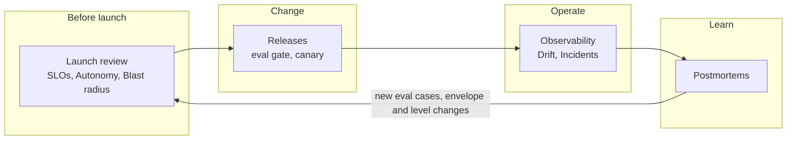

# Agentic SRE practices

Site reliability engineering (SRE) practices for running products that use AI
agents or large language models. Each page is a short, link-heavy operating
practice. The build-time guidance lives in
[Building Reliable Agents](../../building-reliable-agents.md); these pages
link to its sections instead of repeating them.

## Start here

1. Read [SLOs and error budgets](slos-and-error-budgets.md) to decide what
   "working" means.
2. Read [Autonomy and approval gates](autonomy-and-approval.md) and
   [Blast radius](blast-radius.md) to decide what an agent may do.
3. Use [Launch review](launch-review.md) as the sign-off that pulls the other
   pages together.

## Map

Takeaway: postmortems feed evals and autonomy decisions back into the next
release.

## Practices

| Practice | Skill topics | What it covers |
| --- | --- | --- |
| [Autonomy and approval gates](autonomy-and-approval.md) | `agent-autonomy-levels`, `agent-toil-budget` | L0 to L4 levels per action type, promotion with evidence, automatic demotion, approval toil |
| [Blast radius](blast-radius.md) | `tool-blast-radius` | Tool inventory, distinct identities, envelopes, dry run, circuit breakers, emergency stop |
| [SLOs and error budgets](slos-and-error-budgets.md) | `agent-slo-design`, `agent-capacity-and-cost` | Named SLIs, consequence tiers, multiwindow burn-rate alerting, budget policy, capacity |
| [Observability](observability.md) | `trace-based-slis` | SLIs computed from OpenTelemetry GenAI and MCP spans |
| [Releases](releases.md) | `eval-gated-releases` | Per-slice eval gates, baselines, shadow evals, canaries, fault qualification |
| [Drift](drift.md) | `drift-and-quality-monitoring` | Sampling, calibrated judges, label tiers, drift signals |
| [Incidents](incidents.md) | `agent-incident-response` | Human commander, read-only investigation, runbook contract, mitigation first |
| [Postmortems](postmortems.md) | `agent-postmortems` | Blameless factors across prompts, models, tools, and gates; every postmortem adds an eval |
| [Launch review](launch-review.md) | `agentic-product-reliability-review` | Pre-build and pre-launch sign-off across all practices |

## Skills

Each practice has an agent-executable form: a topic guide in the
[`agent-reliability`](../../skills/agent-reliability/SKILL.md) skill, published
in this repository under `skills/`. The skill's entry point routes an agent
to one topic guide. The copy here is a one-way export from the author's
private source, so a direct edit here would be overwritten by the next export;
see [the skills directory](../../skills/README.md).

| Topic | Guide | Practice |
| --- | --- | --- |
| `agent-autonomy-levels` | [guide](../../skills/agent-reliability/references/agent-autonomy-levels/guide.md) | [Autonomy and approval gates](autonomy-and-approval.md) |
| `agent-capacity-and-cost` | [guide](../../skills/agent-reliability/references/agent-capacity-and-cost/guide.md) | [SLOs and error budgets](slos-and-error-budgets.md) |
| `agent-incident-response` | [guide](../../skills/agent-reliability/references/agent-incident-response/guide.md) | [Incidents](incidents.md) |
| `agent-postmortems` | [guide](../../skills/agent-reliability/references/agent-postmortems/guide.md) | [Postmortems](postmortems.md) |
| `agent-slo-design` | [guide](../../skills/agent-reliability/references/agent-slo-design/guide.md) | [SLOs and error budgets](slos-and-error-budgets.md) |
| `agent-toil-budget` | [guide](../../skills/agent-reliability/references/agent-toil-budget/guide.md) | [Autonomy and approval gates](autonomy-and-approval.md) |
| `agentic-product-reliability-review` | [guide](../../skills/agent-reliability/references/agentic-product-reliability-review/guide.md) | [Launch review](launch-review.md) |
| `drift-and-quality-monitoring` | [guide](../../skills/agent-reliability/references/drift-and-quality-monitoring/guide.md) | [Drift](drift.md) |
| `eval-gated-releases` | [guide](../../skills/agent-reliability/references/eval-gated-releases/guide.md) | [Releases](releases.md) |
| `tool-blast-radius` | [guide](../../skills/agent-reliability/references/tool-blast-radius/guide.md) | [Blast radius](blast-radius.md) |
| `trace-based-slis` | [guide](../../skills/agent-reliability/references/trace-based-slis/guide.md) | [Observability](observability.md) |

## Credits

- The skill format follows
  [mawero83/google-sre-skills](https://github.com/mawero83/google-sre-skills)
  (MIT). No text from that project is reproduced here.
- Concepts draw on Google's
  [SRE books](https://sre.google/books/) and the
  [AI in SRE](https://sre.google/resources/practices-and-processes/ai-engineering-reliable-operations/)
  page. This work is not affiliated with Google.
- SRE Workbook content is licensed CC BY-NC-ND 4.0. These pages restate its
  figures as facts in original wording and cite the source.
- Each page lists its own primary sources. All wording is original.
