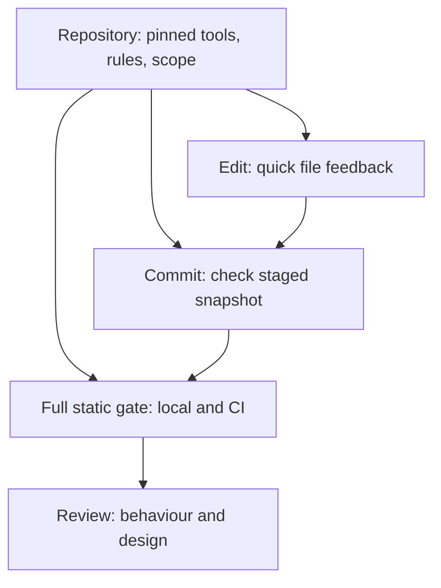

# Code style and static analysis: enforce the rules early

Style and type defects should reach the author before expensive review.
Put the rules in repository-owned commands, return quick feedback after edits,
and reject failing source snapshots before delivery.

Audience: engineers and technical leads setting standards for maintained code,
including code written by agents.

Skill: none yet.

This page defines engineering policy. Tool choices are recommended defaults;
keep justified existing choices. Timing targets are adoption targets, not
measured results. This page supplies no hook implementation and claims no
production outcomes. All examples are synthetic.

## Sources

Primary documentation consulted on 2026-11-26. Check the documentation and help
for the pinned tool version before copying a command.

- [Ruff linting, rule selection, fixes, and suppressions](https://docs.astral.sh/ruff/linter/).
- [Prettier and linters](https://prettier.io/docs/integrating-with-linters)
  and [ESLint CLI](https://eslint.org/docs/latest/use/command-line-interface).
- [TypeScript CLI and project options](https://www.typescriptlang.org/docs/handbook/compiler-options.html).
- [pre-commit](https://pre-commit.com/): staged-file checks and temporary
  handling of unstaged changes. A manager still needs installation and testing.
- [Detekt baselines](https://detekt.dev/docs/introduction/baseline/),
  [Scalafmt](https://scalameta.org/scalafmt/docs/installation.html),
  [Scalafix](https://scalacenter.github.io/scalafix/), and
  [google-java-format](https://github.com/google/google-java-format).
- [Clippy usage](https://doc.rust-lang.org/clippy/usage.html),
  [gofmt](https://pkg.go.dev/cmd/gofmt), and [go vet](https://pkg.go.dev/cmd/vet).
- [ClangFormat](https://clang.llvm.org/docs/ClangFormat.html) and
  [Clang-Tidy](https://clang.llvm.org/extra/clang-tidy/).
- [swift-format](https://github.com/swiftlang/swift-format),
  [SwiftLint](https://realm.github.io/SwiftLint/index.html),
  [.NET formatting](https://learn.microsoft.com/en-us/dotnet/core/tools/dotnet-format),
  and [RuboCop CLI](https://docs.rubocop.org/rubocop/latest/usage/cli_reference.html).
- [Dart formatting](https://dart.dev/tools/dart-format),
  [Astro checking](https://docs.astro.build/en/reference/cli-reference/#astro-check),
  [ShellCheck](https://www.shellcheck.net/), and
  [markdownlint-cli2](https://github.com/DavidAnson/markdownlint-cli2).
- [SQLFluff](https://docs.sqlfluff.com/en/stable/),
  [Terraform validation](https://developer.hashicorp.com/terraform/cli/commands/validate),
  and [Buf lint](https://buf.build/docs/lint/).

## At a glance

Takeaway: the repository owns the rules; each layer checks a declared scope,
and the full gate covers edits that bypass hooks.

| Check | Question it answers | Limit |
| --- | --- | --- |
| Formatter | Does layout match the chosen style? | Does not prove correctness |
| Linter | Does code violate selected static rules? | Only enabled rules and inspected files are covered |
| Type or compile check | Is code consistent with types and build context? | Does not prove runtime behaviour |
| Architecture check | Do dependencies obey component boundaries? | Needs explicit boundary rules |
| Test | Does executed behaviour meet the contract? | Static checks remain necessary |

## Decision guide

### Define the repository contract

Record the following beside the repository's gate instructions:

| Field | Required detail |
| --- | --- |
| Owner | Who reviews rule changes, exclusions, and exceptions |
| Tools | One owner per formatting, linting, and typing responsibility; compatible pinned versions |
| Runtime | Supported language, SDK, compiler, and operating-system versions |
| Commands | Explicit repair command, fast check, staged check, and full non-mutating static gate |
| Scope | Maintained source, tests, scripts, hooks, configuration, and nested packages |
| Exclusions | Generated, vendor, build output, and immutable files; name their validation owner |
| Severity | Which diagnostics block delivery, including warnings |
| Debt | Reviewed baseline mechanism, owner, reason, and review date |

Preserve working tools and the existing hook manager. A manager schedules
commands; it does not define another set of rules. Keep formatting rules out
of a linter when they conflict with the formatter. Pin plugins and build
integrations as well as the executable. Bootstrap dependencies explicitly
before enabling offline hooks.

A configuration file is insufficient evidence of enforcement. Verify the
invocation, inspected scope, exit status, hook activation, and required CI
result. A script named `lint` needs a working configuration and a caller.

### Choose a language baseline

**Required** means deterministic formatting and zero unsuppressed diagnostics
at the chosen blocking severity. **Ratchet** permits reviewed existing debt,
rejects new debt, and requires removal of resolved allowances. **Selective**
means enabling rules with demonstrated value for the maintained code.
These levels can apply to different parts of the same language policy.

| Language or artifact | Formatter | Lint or analysis | Type or compile check | Strictness |
| --- | --- | --- | --- | --- |
| Python | Ruff format | Ruff check with `E,F,I,B,UP`, adjusted for runtime and formatter compatibility | One of mypy or Pyright with project configuration | Required format/lint; strict new packages; ratchet legacy types |
| TypeScript / TSX | Prettier | ESLint recommended TypeScript/React rules; type-aware rules at project scope | `tsc --noEmit` or build mode for project references | Required `strict`; ratchet additional unchecked-index and optional-property checks |
| JavaScript / Astro / MDX / CSS | Prettier with required parsers/plugins | ESLint JS/React/Astro where applicable; deliberate CSS/prose rules | Astro checker for `.astro`; TypeScript for typed modules; selective `checkJs` | Required configured checks; selective JS typing |
| Kotlin / Gradle Kotlin DSL | ktlint | Detekt standard bug/coroutine rules and selected complexity/domain rules | Kotlin compilation through the build | Required new-code style; ratchet legacy debt; warnings as errors after inventory |
| Java | google-java-format or palantir-java-format | Checkstyle for non-conflicting style rules or Error Prone for bug patterns | Project compilation; selected compiler warnings with `-Werror` after measuring debt | Required formatter/compiler; selective analysis; ratchet warnings |
| Scala | scalafmt | Selected Scalafix semantic rules | Scala compiler through the supported build | Required formatting/types; selective semantic rules without forced compiler upgrades |
| Rust | rustfmt | Clippy | `cargo check` | Required formatting and selected Clippy warnings as errors; ratchet legacy debt |
| Go | gofmt | `go vet` plus staticcheck or a configured golangci-lint set | `go build` for supported packages/targets | Required formatting/vet/build; selective extra rules |
| C / C++ | clang-format | clang-tidy with the real compilation database | Supported compiler/build targets | Required format/build; selective tidy rules and warnings; ratchet legacy debt |
| Swift | swift-format | SwiftLint with overlapping format rules disabled | Swift package or Xcode project build | Required format/build; selected blocking lint; ratchet debt |
| C# / .NET | `dotnet format` | Roslyn analyzers configured in the project and `.editorconfig` | `dotnet build` with reviewed warnings as errors | Required formatting/build; ratchet existing warnings before enforcing the chosen set |
| Ruby | RuboCop layout rules | RuboCop lint and selected style rules | `ruby -c` checks syntax; keep an existing Sorbet/Steep check if adopted | Required selected cops and syntax; Ruby syntax is not static typing |
| Dart / Flutter | `dart format` | `dart analyze` or `flutter analyze` with explicit `analysis_options.yaml` | Analyzer plus target build where required | Required diagnostics; ratchet only with a reviewed mechanism |
| Shell | shfmt | ShellCheck after shell syntax check | `bash -n` for Bash; use the declared shell for other dialects | Required errors/warnings; narrow reasoned suppressions |
| Markdown | Existing formatter optional | markdownlint-cli2; narrow prose and link checks | Not applicable | Required structural rules; selective line length and HTML exceptions |
| JSON / YAML / workflows | Existing formatter | Schema validation; actionlint and authorized offline zizmor for workflows | Real consumer validation where practical | Required syntax/schema; selected security rules |
| SQL | SQLFluff with actual dialect and templater | SQLFluff parse/basic rules; selected style rules | Existing schema/migration validation | Required parse/basic rules; applied migrations stay immutable |
| Terraform | `terraform fmt -check` | `terraform validate`; optional configured TFLint | Validation after explicit dependency preparation | Required native checks; selective provider rules |
| OpenAPI / GraphQL | Existing formatter | Adopted Spectral/Redocly rules; GraphQL schema/document validation | Existing generated-contract and drift checks | Required contract validity and drift checks |
| Protocol Buffers | Adopted formatter or Buf format | Selected Buf lint rules for owned schemas | Existing protoc and generated-binding checks | Required owned contract checks; compatibility only for real consumer promises |

Operational scripts and hooks need deliberate coverage. Set Python's target
version to the oldest supported interpreter. Exclude generated code from
hand-formatting; retain generator validation and drift checks. Do not force
strict typing onto generated JavaScript merely to match maintained sources.

#### Separate file feedback from project checks

The examples below assume pinned dependencies are already available. Paths,
project names, build tasks, and executables are synthetic placeholders to
replace with repository-owned selections. A “full gate” cell lists operations
the repository's static command must perform; semicolons separate operations
in prose, not a fail-safe shell implementation. No row is an install recipe.

| Language | Fast per-file feedback | Full gate operations |
| --- | --- | --- |
| Python | `ruff format --check src/sample.py`; `ruff check src/sample.py` | Ruff format/check on maintained roots; configured mypy or Pyright project |
| TypeScript / JavaScript | `prettier --check src/sample.ts`; configured `eslint src/sample.ts` | Prettier and ESLint on all maintained roots; `tsc --noEmit -p tsconfig.json` or supported reference build; `astro check` when applicable |
| Kotlin | Pinned `ktlint src/Sample.kt` in check mode | Build-owned ktlint check and Detekt tasks; affected compilation and dependency closure, full required modules in CI |
| Java | `google-java-format --dry-run --set-exit-if-changed src/Sample.java` | Formatter on maintained Java; configured Checkstyle/Error Prone tasks; build-owned compiler with reviewed `-Xlint` and `-Werror` policy |
| Scala | Pinned `scalafmt --test src/Sample.scala` | `sbt scalafmtCheckAll`; configured Scalafix check and compile tasks |
| Rust | `rustfmt --check --edition 2021 src/sample.rs` with the project's actual edition/config | `cargo fmt --all -- --check`; `cargo clippy --workspace --all-targets --locked --offline -- -D warnings`; `cargo check --workspace --all-targets --locked --offline` |
| Go | `gofmt -l sample.go`; wrapper rejects nonempty output | gofmt over maintained files with nonempty-output rejection; `go vet ./...`; selected `staticcheck ./...` or golangci-lint; `go build ./...` |
| C / C++ | `clang-format --dry-run --Werror src/sample.cpp`; scoped `clang-tidy -p build src/sample.cpp` only if within budget | clang-format checks on maintained sources/headers; clang-tidy over translation units using `compile_commands.json`; configured build targets |
| Swift | `swift-format lint --strict Sources/Sample.swift`; `swiftlint lint --strict Sources/Sample.swift` for the pinned CLI | swift-format lint on maintained roots; configured SwiftLint; `swift build` or the required Xcode build |
| C# / .NET | `dotnet format App.sln --include src/Sample.cs --verify-no-changes --no-restore` if within budget | `dotnet format App.sln --verify-no-changes --no-restore`; `dotnet build App.sln --no-restore -warnaserror` with configured Roslyn analyzers |
| Ruby | `bundle exec rubocop lib/sample.rb`; `ruby -c lib/sample.rb` | `bundle exec rubocop`; syntax checks for maintained Ruby; existing project type checker if present |
| Dart | `dart format --output=none --set-exit-if-changed lib/sample.dart` | Same format check on maintained roots; project `dart analyze` or `flutter analyze` |
| Shell | `bash -n scripts/sample.sh`; `shfmt -d scripts/sample.sh`; configured `shellcheck scripts/sample.sh` | Syntax, shfmt and source-aware ShellCheck on maintained scripts with declared shell dialects |

File formatters need the same configuration as the full gate. A standalone
Rust formatter must use the project edition and configuration; it is not a
substitute for workspace checking. Select supported Cargo feature combinations
and targets explicitly. Do not enable every feature when features conflict.
clang-tidy needs the real include paths, defines, and compiler flags from
`compile_commands.json`; header changes expand to affected translation units.

`gofmt -l` reports filenames; the wrapper must convert nonempty output into
failure and also preserve tool errors. `go fmt` mutates files, so it is not
the gate's check command. For Go, Swift, .NET, and other tools that can resolve
dependencies implicitly, prepare dependencies separately and enforce offline
execution in hooks. A command that needs missing dependencies defers or fails
explicitly according to its layer.

### Use three enforcement layers

1. **After an edit:** a trusted adapter calls the repository's formatter and
   quick linter for touched files. Return the path, rule, location, and repair
   command. Missing repository opt-in produces one actionable setup notice;
   it never claims that lint passed. Do not guess tools from extensions or
   execute discovered scripts in untrusted directories.
2. **Before a commit:** check formatting and lint against the staged snapshot.
   Run types once per affected project or module and its dependency closure.
   Use the existing Git hook manager. A failure rejects the commit and names
   the repair command. A whole-project check is safer than an unproven scope.
3. **Before delivery:** run one non-mutating static command near the start of
   the aggregate local gate, before expensive tests and automated review.
   CI calls the same definition with its full required scope. Preserve tests,
   security checks, architecture checks, and generation validation.

Project typing requires project context. Passing staged TypeScript filenames
to `tsc` can bypass `tsconfig.json`; use the configured project instead.
Mypy, Kotlin, Scala, Clippy, Roslyn, and compilation checks also need their
import, package, or build context. A file lint result cannot claim those checks.

Harness adapters must verify the installed version's event and feedback
contract. Prove loading, firing, extraction of every touched path, diagnostic
visibility, timeout behaviour, and recursion prevention in isolated fixtures.
A successful shell exit or stdout line does not establish model-visible
feedback. If a harness cannot inject diagnostics after edits, use a documented
supported feedback channel or report that limitation. Do not claim coverage
from a configuration entry alone.

Shell writes and external tools can bypass file-tool events. Git hooks can
also be absent or bypassed. Check the resulting snapshot in the full gate,
and require the CI result before merge.

### Budget the fast path

Start with these policy targets, then measure representative cold and warm
runs before setting project timeouts:

| Layer | Initial target | Bounds and fallback |
| --- | --- | --- |
| Edit | Warm p95 below two seconds | One active checker per workspace; bounded pending work and diagnostics; no network, installation, or full build |
| Common scoped commit | Warm completion below 30 seconds | Project-aware checks with prepared dependencies; expand uncertain scope |
| Full gate | Project-owned time and peak-memory budgets | Complete required static scope with bounded workers and explicit resource limits |

Record cold startup separately. Coalesce repeated events without losing the
latest file state. Cap pending paths and fall back to a declared broader check
when the queue limit is reached. Report omitted diagnostic counts and a command
to obtain the complete result. Keep full diagnostics in a bounded artifact.

If a semantic check cannot meet the edit budget, defer it to the staged or
full gate and say so. If compilation exceeds the commit budget, retain it as
a required full-gate check and label the commit result's narrower scope.
A timeout is incomplete evidence. Kill and reap the task-owned checker;
do not leave accumulating background processes. Measure latency and peak
memory as described in [Performance and memory](performance-and-memory.md).

### Format safely

- Use one formatter owner for each file type. Permit only reviewed safe
  formatting fixes after an edit; semantic auto-fixes need separate review.
- Keep commit and CI checks non-mutating. Never auto-stage files or re-stage
  whole files after formatting. Preserve partially staged and unstaged work.
- Validate the index snapshot through an isolated snapshot or a tested hook
  manager that preserves unstaged work. Test restoration on failure as well
  as success; checking the working tree alone is insufficient.
- Validate paths against the authorized repository. Handle multi-file patches,
  spaces, renames, deletions, nested packages, and generated/vendor exclusions.
- Prevent formatter-triggered recursion. Before applying delayed formatting,
  compare the current file digest with the event's digest; discard stale work.
  Serialize writes so an older result cannot overwrite a newer edit.
- Keep applied migrations immutable. Validate them without rewriting their
  bytes; apply formatting policy to new migrations before application.

### Ratchet debt and exceptions

Store reviewed allowances by stable diagnostic fingerprint with occurrence
count, rule, owner, reason, and review date. Prefer native baselines when they
can meet the policy; add a small comparator only when needed. Avoid line-number
identity alone, which changes under unrelated edits.

The gate rejects new fingerprints and increased counts. It also rejects stale
allowances: remove an entry or reduce its count when a defect is fixed. A
comparator that only rejects increases leaves an allowance available for a
later reintroduction. Prove the comparator with add, duplicate, fix, and
reintroduce cases.

Use a narrow rule suppression at the relevant location when possible. Record
its reason and owner. Broad file or directory exclusions need a scope rationale
and a separate validation owner. Never regenerate a baseline just to turn a
failure green. Tool upgrades and intentional rule changes require a reviewed
diagnostic diff; baseline churn must not conceal new debt.

### Preserve failure contracts

Required checks fail on violations, missing tools, invalid configuration,
unsupported runtimes, crashes, and incomplete execution. Preserve nonzero
statuses through pipelines and aggregate runners. Report “no applicable files”
separately from “configured scope unexpectedly empty.” The latter is a setup
failure when source is expected.

Do not wrap mandatory checks in `|| true`, `|| echo`, optional-script flags,
or unconditional success exits. A reminder to run lint does not reject a
defect. Set an explicit warning policy; if selected warnings block delivery,
configure the tool or wrapper to fail on them. A new warning policy needs a
debt inventory before compiler-wide warnings as errors are enabled.

Prove failure propagation with a deliberate formatting defect, a selected lint
violation, a type/compile defect, a missing executable, and a checker crash.
Run these in isolated synthetic fixtures. Each must produce the expected
nonzero gate status; remove deliberate defects before publication.

### Prove CI parity

Use the same pinned tools, configuration, exclusions, and static-check owner
locally and in CI. CI checks the complete maintained scope required by policy.
Expand local selection when configuration, lockfiles, compiler flags, schemas,
or shared dependencies change. Unknown scope falls back to full static checks.

Record source identity or digest, configuration and lockfile digests, tool
versions, scope, duration, and exit status. Invalidate cached evidence when
any relevant input changes. A scoped fast result must not be reused as proof
of full analysis. Confirm required forge checks actually block merge; a green
optional workflow alone does not establish that policy.

Keep pull-request validation read-only and secretless. Linting can load plugins
and build configuration, so repository trust still matters. Follow
[Secure and reliable systems](secure-reliable-systems.md) for dependency and
execution boundaries, and [CI for agentic engineering](../../ci-for-agentic-engineering.md)
for the canonical gate, independent merge evidence, caching, and CI permissions.

### Adoption procedure

1. Inventory maintained languages, existing tool configuration, actual callers,
   hook activation, exclusions, and CI failure propagation. Stop short of
   choosing a tool for a source tree that has not been inspected.
2. Choose one owner per responsibility. Preserve compatible existing choices,
   pin versions, and document runtime and generated-code boundaries.
3. Run the full checks without changing source. Inventory diagnostics and
   measure cold/warm duration and peak memory. Select blocking rules.
4. Fix defects or approve a bounded debt baseline with owner and review date.
   Prove that the baseline shrinks and rejects reintroduced defects.
5. Add the repository-owned static command to the existing gate and CI.
   Exercise deliberate failure fixtures and verify required forge checks.
6. Enable staged checks. Prove correct scope and preservation of partial
   staging and unstaged work on success, failure, and interruption.
7. Enable per-edit adapters after native-event fixtures prove activation and
   visible feedback. Measure the budget; defer expensive semantic work clearly.
8. Compare deterministic failures caught before review and later repair commits
   by cause over a representative batch. Record scope and workload differences.
   The goal is fewer avoidable repair rounds; no reduction is promised here.

Completion means the failure fixtures reject defects, clean fixtures pass,
local and CI definitions agree, and hooks meet their stated scope and budgets.
If a tool or feedback channel is unavailable, record the gap and retain the
required full-gate check before claiming adoption complete.

## Checklist

- [ ] Every maintained language has an owner, pinned tools, configuration, and scope.
- [ ] Formatting, linting, typing, architecture checks, and tests have distinct roles.
- [ ] Fast commands and full commands share rules and report their actual scope.
- [ ] Project type/compile checks retain dependency and build context.
- [ ] Edit checks bound latency, memory, output, concurrency, and pending work.
- [ ] Timeouts and deferred checks remain incomplete evidence.
- [ ] Hook installation and model-visible feedback are demonstrated.
- [ ] Staged checks validate the index and preserve unstaged work.
- [ ] Commit and CI checks do not mutate or stage files.
- [ ] Generated/vendor exclusions and immutable migration policy are explicit.
- [ ] Baselines reject new debt and require removal of resolved allowances.
- [ ] Mandatory check failures, setup errors, and crashes propagate nonzero.
- [ ] Full local and required CI checks use the same static definition.
- [ ] Failure fixtures and clean fixtures prove the enforcement path.

## Rules of thumb

Keep one rule owner and several callers. A result proves only the source
snapshot and scope it checked. Fixes should reduce the accepted debt.

### Anti-patterns

| Pattern | Repair |
| --- | --- |
| Tool installed or configured but never called | Trace the caller and prove a deliberate defect fails |
| Reminder presented as enforcement | Return visible diagnostics and reject failing snapshots |
| Lint script with missing configuration | Fail with an actionable setup error |
| Compiler called on filenames without project context | Check the configured project and dependency closure |
| Timeout or missing tool treated as success | Report incomplete evidence or reject at the required layer |
| Baseline refreshed to admit new failures | Review the diagnostic diff and remove resolved allowances |
| Whole-tree formatting and re-staging at commit | Use check-only staged validation and an explicit repair command |
| Fast local lint presented as full CI evidence | Record scope and run the full required definition |

### Related material

- [CI for agentic engineering](../../ci-for-agentic-engineering.md): local
  gate structure and independent merge evidence.
- [Testing in agentic engineering](../../testing-in-agentic-engineering.md):
  behavioural evidence beyond static checks.
- [Domain-driven design](domain-driven-design.md#ports-adapters-and-architecture-tests):
  enforce component boundaries with architecture tests.
- [Performance and memory](performance-and-memory.md): budgets and measurement.
- [Secure and reliable systems](secure-reliable-systems.md): safe dependency
  execution and supply-chain controls.

## Claim review

- [x] Recommendations and timing targets are labelled as policy.
- [x] Tool mechanics link to primary documentation; commands need pinned-version verification.
- [x] No project results, measured speedups, or complete hook integrations are claimed.

## Privacy review

- [x] No employer material.
- [x] No customer material.
- [x] No private repository identifiers, counts, paths, or source snapshots.
- [x] No trace material.
- [x] No transcript material.
- [x] All examples are synthetic.
