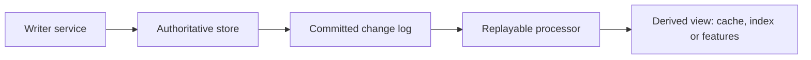
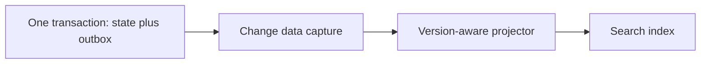

# Data-intensive systems: choose guarantees before topology

Data services fail when their parts disagree about which value is current,
which write succeeded, or which records a computation included. Choose those
guarantees before choosing a database or adding another copy of the data.

For engineers building data and machine learning (ML) platforms and services.
Start with the decision tables. Turn the checks into repository tests and
operational exercises for the selected products and versions. This page
defines design acceptance criteria; it does not supply a universal linter.

Skill: none yet.

## Sources

This is an original decision guide informed by the following public sources.
The recommendations and synthetic examples are this playbook's synthesis;
they are not quotations or claims of production results. Web references were
checked on 2026-11-26. Pin product documentation to the deployed version.
Kafka links below target 4.1 and Avro targets 1.12.0. PostgreSQL `/current/`
links, Flink `stable` links and other rolling guides can change after this
review; select the matching release before applying product-specific advice.

- Martin Kleppmann, [Designing Data-Intensive Applications](https://dataintensive.net/),
  first edition: chapters 2–4 on models, storage and encoding; 5–9 on
  replication, partitioning, transactions and distributed systems; 10–12 on
  batch, streams and derived data. This book supplies the main conceptual
  framework, rather than a product configuration recipe.
- [PostgreSQL Documentation: Transaction Isolation](https://www.postgresql.org/docs/current/transaction-iso.html):
  anomaly definitions and an example of implementation-specific guarantees.
- [PostgreSQL Documentation: Data Consistency Checks at the Application Level](https://www.postgresql.org/docs/current/applevel-consistency.html#NON-SERIALIZABLE-CONSISTENCY):
  explicit locking and snapshot timing for application invariants.
- [Apache Avro Specification: Schema Resolution](https://avro.apache.org/docs/1.12.0/specification/#schema-resolution):
  writer/reader schemas and defaults.
- [Confluent: Schema Evolution and Compatibility](https://docs.confluent.io/platform/current/schema-registry/fundamentals/schema-evolution.html):
  compatibility direction, transitive checks and format-specific rules.
- Giuseppe DeCandia and colleagues,
  [Dynamo: Amazon's Highly Available Key-Value Store](https://www.allthingsdistributed.com/2007/10/amazons_dynamo.html):
  partitioning, replication, version conflicts and repair.
- [Apache Kafka Design: Message Delivery Semantics](https://kafka.apache.org/41/design/design/):
  delivery guarantees and the boundary of transactional processing.
- [Apache Beam: Basics of the Beam Model](https://beam.apache.org/documentation/basics/):
  event time, windows, watermarks and late data.
- [Jepsen: Consistency Models](https://jepsen.io/consistency),
  [Linearizability](https://jepsen.io/consistency/models/linearizable) and
  [Strong Serializability](https://jepsen.io/consistency/models/strict-serializable):
  formal guarantees and the anomalies that distinguish them.
- Diego Ongaro and John Ousterhout,
  [The Raft Consensus Algorithm](https://raft.github.io/):
  majority voting, leader election and replicated logs.
- PostgreSQL Documentation:
  [WAL Reliability](https://www.postgresql.org/docs/current/wal-reliability.html),
  [Continuous Archiving and Point-in-Time Recovery](https://www.postgresql.org/docs/current/continuous-archiving.html),
  [Routine Vacuuming](https://www.postgresql.org/docs/current/routine-vacuuming.html),
  [initdb](https://www.postgresql.org/docs/current/app-initdb.html),
  [CREATE INDEX](https://www.postgresql.org/docs/current/sql-createindex.html) and
  [Client Connection Defaults](https://www.postgresql.org/docs/current/runtime-config-client.html):
  durability, maintenance, checksums and migration controls.
- [Apache Iceberg Table Specification](https://iceberg.apache.org/spec/):
  snapshots, field identity and atomic table metadata commits.
- [Apache Flink: Checkpointing](https://nightlies.apache.org/flink/flink-docs-stable/docs/dev/datastream/fault-tolerance/checkpointing/):
  coordinated state recovery and checkpoint controls.
- Rajesh Nishtala and colleagues,
  [Scaling Memcache at Facebook](https://www.usenix.org/conference/nsdi13/technical-sessions/presentation/nishtala),
  USENIX NSDI 2013: cache leases, stale-set protection and refill load.
- Stripe Engineering,
  [Online Migrations at Scale](https://stripe.com/blog/online-migrations):
  phased migration and comparison before cutover.
- [Debezium: Outbox Event Router](https://debezium.io/documentation/reference/stable/transformations/outbox-event-router.html):
  aggregate-key routing and event/header mapping.

## At a glance

Takeaway: choose one authority for each fact, then make every derived copy
repairable from retained source data.

The writer owns valid state transitions. The store owns committed state.
The log records changes. The processor applies changes to a derived view.
These are responsibilities, not a requirement for five separate services.

| Question | Starting decision | Evidence before release |
| --- | --- | --- |
| Model and engine | Start with the existing transactional store if it meets the workload | Representative query plans and steady-state load results |
| Schema | Version the writer and reader contract | Compatibility matrix including retained records |
| Replication | Prefer one write leader unless another topology solves a stated need | Lag, failover and acknowledged-write recovery tests |
| Partitioning | Delay sharding until a measured limit requires it | Skewed key distribution and rebalance exercise |
| Transactions | Name the invariant before choosing isolation | Concurrent histories that would violate it |
| Delivery | Expect retries and ambiguous outcomes | Crash between effect and acknowledgement |
| Processing | Choose freshness and correction policy explicitly | Late, duplicate, reordered and replayed input tests |
| Derived data | Retain a rebuild path and a freshness budget | Rebuild, reconciliation and deletion propagation tests |

See [API design](api-design.md) for exposed contracts and request idempotency.
The companion [performance and memory](performance-and-memory.md) playbook
covers code, data structures and profiling.
This page covers persisted state and guarantees across components.

## Decision guide

### Data models and storage engines

Write down the owner, keys, queries, update frequency, retention and invariants
for each dataset. Estimate rows, bytes, request skew and peak write rate. Name
the acceptable freshness and data-loss bounds. A technology name is not a
workload description.

| Access pattern | Model to consider | Cost or constraint to test |
| --- | --- | --- |
| Shared entities, joins and multi-record invariants | Relational tables with constraints | Index maintenance, joins and transaction contention |
| An aggregate usually read and replaced together | Document | Document growth, duplicated facts and cross-document changes |
| Lookup by a known key | Key-value | Secondary queries and multi-key invariants need explicit support |
| Traversal across variable relationships | Graph | Traversal depth, fan-out and partition crossings |

Choose physical storage separately from the logical model:

| Storage choice | Fits when | Trade-off to measure |
| --- | --- | --- |
| Row-oriented | Point reads and updates need most fields of a record | Analytical scans may read unused fields |
| Column-oriented | Aggregations scan a few fields across many records | Small updates, ingestion delay and row reconstruction |
| B-tree index | Point lookups, ordered ranges and mixed updates | Page splits, random writes and cache residency |
| Log-structured merge tree (LSM) | Buffered writes and sorted immutable runs suit sustained ingestion | Compaction competes with reads; read, write and space amplification |

Row versus column layout and B-tree versus LSM indexing are different axes.
Products combine them. Do not infer transaction support or durability from
either label. More indexes accelerate selected reads while adding write and
storage work. An LSM engine still needs compaction capacity after ingestion.

Example: keep job status and its transition constraints in a transactional
row store. Export historical runs to columnar files for training analysis
only when scan cost justifies the extra pipeline. Declare the row store the
authority for current status and the export a delayed view.

Checks: benchmark the actual read/write mix with realistic data size and key
skew. Include warm and cold caches, sustained compaction, index growth and
recovery. Set latency, throughput and disk-headroom thresholds before the run;
record the plans and results with the design decision.

#### Crash durability and maintenance

Write-ahead logging (WAL) persists recovery information before changed data
pages. Check the commit acknowledgement policy and whether flush requests
reach nonvolatile storage through operating-system and device caches. A fast
acknowledgement is insufficient evidence of power-loss durability. Keep
PostgreSQL `fsync` and `full_page_writes` enabled unless a reviewed storage
contract justifies an alternative. Full-page images protect against partial
page writes during crashes; checksums detect corruption and do not repair it.
See [WAL Reliability](https://www.postgresql.org/docs/current/wal-reliability.html).

Verify data-page checksum settings during provisioning and restoration.
PostgreSQL WAL records carry their own integrity checks; page checksums are
a separate facility, not a switch that enables WAL checksumming. Temporary
files and unlogged relations do not provide the same crash-recovery contract
as logged durable tables. Verify the deployed version's coverage rather than
promising a checksum over every byte in the system.

Multiversion concurrency control (MVCC) retains older row versions for
concurrent readers. In PostgreSQL, let autovacuum reclaim eligible dead
tuples and freeze transaction identifiers (XIDs) before wraparound threatens
availability. Monitor dead tuples, table/index growth, vacuum progress and
XID age. Bound transaction duration and investigate old snapshots or idle
transactions that hold back cleanup. Vacuum commonly makes space reusable
inside a relation; it does not generally shrink files back to the filesystem.
See [Routine Vacuuming](https://www.postgresql.org/docs/current/routine-vacuuming.html).

Checks: exercise crash recovery on disposable infrastructure and validate
recovered records and checksums. Under sustained updates, verify vacuum keeps
up, snapshots do not retain unbounded history, and alerts fire before disk or
XID exhaustion. These checks complement the storage benchmark above.

### Encoding and schema evolution

An encoding chooses bytes on disk or on the wire. JSON is inspectable but
still needs a schema and semantic rules. Avro and Protocol Buffers provide
typed contracts with different evolution rules. Columnar formats suit scans;
they do not replace the service's event contract.

| Direction | Reader/writer pair that must work | Why it matters |
| --- | --- | --- |
| Backward compatibility | New reader, old writer's data | Replay retained history after a reader upgrade |
| Forward compatibility | Old reader, new writer's data | Rolling deployment or reader rollback |
| Full compatibility | Both pairs | Independently deployed readers and writers |
| Transitive checking | Chosen direction against all relevant prior schemas | History spans more than the immediately previous version |

Use a registry when producers and consumers deploy independently. Commit
schemas, register immutable versions and store the schema identifier with
records. Configure compatibility per subject rather than trusting a global
default. Retain schemas as long as the corresponding data can be replayed.
Registry checks do not verify changes in meaning, units or authorization.

Example: add `source_region` with a reader default of `unknown` when old
records lack it. Test actual bytes from both writers with both readers.
In Avro, a default resolves a missing writer field; it does not make the
writer free to omit any field. A rename, enum addition or integer widening
needs a format-specific check. Never reuse a retired Protocol Buffers field
number. Changing milliseconds to seconds is a semantic break even if both
schemas say integer.

For a database migration, use an expand/migrate/contract sequence only when
real consumers or retained data require overlap. Add the new representation,
deploy compatible readers, backfill with reconciliation, then retire the old
representation after rollback and replay needs expire. Record the owner and
removal condition for any temporary dual path.

For a live store migration, use staged writes, idempotent backfill, shadow
reads and controlled read cutover, following
[Online Migrations at Scale](https://stripe.com/blog/online-migrations).
Keep one authoritative writer and a durable repair path for the second store;
two independent writes still have the partial-failure problem described below.
Compare keyed values and query results over a representative workload and
declare the acceptable mismatch criteria before cutover. Keep the read switch
reversible while the old path remains supported, then remove temporary writes.

Set a bounded PostgreSQL `lock_timeout` for migration statements so a waiting
schema change cannot build an unbounded lock queue. Evaluate
`CREATE INDEX CONCURRENTLY` when writes must continue: it has extra work and
failure modes, can leave an invalid index, and cannot run inside a transaction
block. Test cleanup and retry; “online” does not mean lock-free. Use the cited
CREATE INDEX and Client Connection Defaults guides for exact constraints.

Checks: block incompatible schema changes in continuous integration (CI).
Keep serialized fixtures for supported versions and test mixed deployments,
unknown fields, absent fields and rollback. Link exposed event contracts to
[API design: webhooks and events](api-design.md#webhooks-and-events).

### Replication and consistency

Replication keeps copies on different nodes. It improves some availability
and recovery properties but also creates disagreement during lag and failure.
Replication is not a backup: an accidental deletion can reach every replica.

| Topology | Consider when | Required failure decision |
| --- | --- | --- |
| Single leader | One authority can order writes | Failover fencing and which acknowledged writes survive promotion |
| Multiple leaders | Disconnected or local writes in several regions are necessary | Concurrent update resolution, uniqueness and conflict visibility |
| Leaderless | The application can handle versions and quorum trade-offs | Read/write quorum settings, conflict handling and repair |

Synchronous replication adds acknowledgement latency and may stop writes
when replicas cannot respond. Asynchronous replication permits lag and can
lose acknowledged writes if an incomplete replica becomes leader. State the
actual acknowledgement policy and recovery point objective (maximum accepted
data loss), rather than writing only “replicated.”

For leaderless systems, `R + W > N` creates read/write quorum overlap only
under assumptions about the same replica set and successful operations.
It does not establish linearizability by itself. Concurrent versions, failed
writes, membership changes and sloppy quorums require separate treatment.
Even strict quorum intersection alone does not prevent a read from observing
an in-flight value that a later read misses. Atomic-register protocols need
additional version and propagation rules, such as synchronous read write-back
before returning. Read repair is one part of such a protocol, not by itself
a proof of linearizability. Require the complete algorithm and its failure
assumptions; use the Jepsen consistency definitions when reviewing claims.
Last-write-wins based on wall time can silently discard a valid update.

For automatic leader election, use a maintained implementation of quorum
consensus, such as Raft or Paxos, rather than constructing failover from
heartbeat timeouts. A majority of `2f + 1` voters can progress with `f`
unavailable voters; three and five are common sizes. Odd sizes use voters
efficiently, but even-sized groups are not inherently unsafe. Two voters need
both for a majority, so losing either stops progress. Place voters across
failure domains, use supported membership changes, and fence the old writer
at the storage boundary. A witness counts only under the product's documented
protocol. See [The Raft Consensus Algorithm](https://raft.github.io/).

| Guarantee | What a reader can rely on | Implementation direction to verify |
| --- | --- | --- |
| Eventual convergence | Copies converge if writes cease and repair succeeds | Repair plus explicit conflict resolution; no freshness bound implied |
| Read-after-write | A session sees its own completed write | Route to leader or require a replica to reach the returned log position |
| Monotonic reads | A session does not move backward to an older version | Track version position across requests and replica changes |
| Causal consistency | A dependent change is not visible before its cause | Carry dependencies; test cross-key observations |
| Linearizability | Each operation appears atomic between its call and response | Use the product's documented strong path and test failover |
| Strict serializability | Transactions have a serial order that respects completion before a later invocation | Verify both transaction isolation and real-time order across clients |

Example: after creating a model version, return a commit-position token.
A read carrying that token waits for a sufficiently caught-up replica or
uses the leader. Define the deadline and failure response if neither works.
Do not quietly return a stale “not found.” A fixed sleep cannot prove catch-up.

During a network partition, a system cannot guarantee both linearizable
operations and a successful response to every request. Decide which operations
wait or fail and which tolerate stale results. Scope guarantees per operation;
serializable transactions alone do not promise real-time ordering.
Strict serializability, also called strong serializability or external
consistency, adds that ordering requirement to serializability. A completed
transaction must precede a transaction invoked afterward. Overlapping
transactions still need a valid serial order. Compare product claims against
[Jepsen's model definitions](https://jepsen.io/consistency/models/strict-serializable)
and test transaction histories, not only final values.

Checks: delay a replica, partition the leader, promote a replica and reconnect
the old leader. Verify fencing, session guarantees and acknowledged-write
survival. Alert on lag in time and log distance; test restoring an independent
backup to the declared recovery time objective (maximum accepted downtime).

For recovery points between base backups, retain a complete WAL archive and
test point-in-time recovery (PITR). In PostgreSQL, restore the base backup and
replay archived WAL to a chosen supported target before the bad change.
Measure archive lag against the data-loss objective and rehearse missing WAL,
restore duration and post-restore integrity in an isolated environment. Keep
archive access separate from serving credentials. An archive gap can break
the recovery chain even while replicas are healthy. Recheck backup procedures
after storage-layout changes. See
[Continuous Archiving and PITR](https://www.postgresql.org/docs/current/continuous-archiving.html).

### Partitioning and hot keys

Partitioning assigns different records to different nodes. Replication makes
copies of those partitions. A partition key controls both load distribution
and which operations can stay local.

| Choice | Advantage | Failure mode |
| --- | --- | --- |
| Hash key | Spreads many independent keys | Range queries scatter; one popular key stays hot |
| Range key | Local ordered scans | Increasing timestamps can overload the newest range |
| Tenant key | Locality and an isolation boundary | One large tenant can dominate a partition |
| Salted key | Spreads a hot key across buckets | Reads and aggregates must merge buckets; ordering scope changes |

Measure load per partition and per key, including state bytes, queue age and
tail latency. Average cluster utilization hides hot partitions. More nodes
do not split a single hot key unless the key design or workload changes.

Example: aggregate a popular event type into `(event_type, bucket)` partial
counts, then combine the counts. Use a deterministic bucket derived from
event identity so retries choose the same bucket. This fits mergeable counts;
it does not solve a globally unique reservation or a strictly ordered account.

Keep joins co-partitioned where useful, but calculate skew before broadcasting
a “small” dimension. Define how routing metadata changes during rebalancing,
how stale clients retry and how capacity covers the temporary copies. Apply
per-tenant quotas before one tenant exhausts shared state.

Checks: load the most popular key and a large tenant, not just uniformly
random keys. Exercise a partition move while writing. Assert no missing or
duplicated effects and measure the fan-out and recovery load.

### Transactions and isolation

A transaction groups changes into one commit. Isolation controls how
concurrent transactions can observe and affect each other. The same level
name can have stronger guarantees in one database than another.

| Level or implementation | Anomalies it can allow | Use and verification |
| --- | --- | --- |
| Read uncommitted | Dirty reads of writes that may roll back; also nonrepeatable reads and phantoms | Avoid for correctness-sensitive reads; some engines map it to read committed |
| Read committed | Nonrepeatable reads, changing query result sets (phantoms), read skew and unsafe read-modify-write races | Use atomic updates, constraints or locks for affected invariants |
| SQL repeatable read minimum | Phantoms and serialization anomalies; dirty and nonrepeatable reads are prohibited | Check implementation rather than assuming a stable full snapshot |
| Snapshot isolation | Write skew across different rows; application read-modify-write handling varies | A stable snapshot alone does not protect a cross-row invariant |
| Serializable | No serialization anomalies among participating transactions | Retry serialization failures; keep external effects outside retryable code |

A lost update occurs when two writers read the same value and one overwrites
the other's change. A write skew occurs when writers change different rows
after reading an overlapping condition, jointly breaking an invariant.
PostgreSQL repeatable read supplies snapshot isolation and prevents phantoms,
but permits serialization anomalies; do not generalize its behavior to every
product with the same level name. See the cited Transaction Isolation guide.

Example: two workers each see another worker marked available and mark
themselves unavailable. They update different rows, so snapshot isolation
can leave none available. Use serializable transactions with whole-transaction
retries. Alternatively, in PostgreSQL Read Committed, require every writer of
this invariant to acquire `SELECT ... FOR UPDATE` on the same existing guard
row, then check availability in a separate statement after acquiring the lock.
Hold the guard lock through the worker update and commit. The separate check
gets a fresh snapshot that includes the previous guard holder's commit.
Locking an unchanged guard row alone is insufficient under PostgreSQL
Repeatable Read: a waiting transaction can retain an older snapshot.
The snapshot begins with the first query or data modification, including
`SELECT ... FOR UPDATE`. If the previous holder updates the guard row,
the waiting Repeatable Read transaction instead fails serialization and must
retry the whole transaction. An explicit table lock taken before that first
query is a different protocol: snapshot creation happens after the wait.
Choose its lock mode to exclude the competing writers and budget contention.
`SELECT ... FOR UPDATE` cannot lock a row that does not exist. Use a
pre-existing parent/sentinel row, serializable isolation or an appropriate
unique/exclusion constraint for that invariant.
A row lock on each worker's own row is also insufficient. See the cited
Data Consistency Checks guide.

Prefer a unique constraint for uniqueness and an atomic conditional update
for a single-row state transition. Check affected-row counts. Locks need a
consistent acquisition order and deadlines. Multi-store writes need a named
coordination protocol or compensating workflow; a local transaction cannot
make a database and an external service commit atomically.

Checks: run two real connections with barriers that force the harmful
interleaving. Assert the invariant, including after a retry or deadlock.
For each isolation choice, retain the counterexample it must prevent. Test
against the selected database engine, not an in-memory substitute.

### Partial failure, clocks and retries

A timeout says that a caller did not receive an answer by its deadline.
The server may already have committed. Process pauses and delayed networks
also make a healthy node appear dead. A failure detector supplies suspicion,
not proof.

1. Assign one stable operation identifier before the first attempt. Bind it
   to the tenant, operation type and payload fingerprint.
2. Within one local transaction, claim that identifier under a unique
   constraint, apply the effect and persist the result. A duplicate returns
   the recorded result; a different payload with the same identifier fails.
3. Acknowledge only after commit. After an ambiguous timeout, retry or query
   status using the same identifier.
4. Bound retry attempts by an overall deadline. Use backoff with jitter and
   retry only transient failures. Specify deduplication retention to cover
   the supported replay horizon; reject older attempts or retain durable ids.

If the effect is external, use its idempotency contract or a transactional
outbox and a deduplicating receiver. A crash after an external effect but
before recording success still creates duplicates without such cooperation.
“Exactly once” must name the input, effect, storage boundary and recovery
assumptions. Kafka transactions can atomically commit Kafka outputs and
consumed offsets; they do not automatically include a database or email.

Use a monotonic clock for elapsed deadlines. Wall clocks can jump and disagree
across hosts; an event timestamp cannot prove causal order. Use log positions
or logical versions for ordering where appropriate. A lease can expire while
its holder is paused. Require the protected storage system to reject an older
fencing token, a monotonically increasing ownership generation, before it
accepts writes from a new holder.

Checks: crash before commit, after commit and before acknowledgement; replay
concurrent duplicates and a conflicting payload. Pause a lease holder until
another takes ownership, then resume it and assert its stale writes fail.
Measure retries, unknown outcomes and rejected stale writers without logging
sensitive payloads. See [API idempotency keys](api-design.md#idempotency-keys).

### Batch and stream processing

Batch computes over a bounded input. Streaming updates results as an
unbounded input arrives. Choose from freshness, correction and cost needs;
a recurring batch job is enough when its delay meets the requirement.

| Decision | Meaning and practical rule |
| --- | --- |
| Event time | When the event occurred; use for business-time aggregates |
| Processing time | When a worker handles it; useful for operational latency, but replay changes it |
| Tumbling window | Non-overlapping intervals; name timezone and boundary convention |
| Sliding window | Overlapping intervals; budget multiplied state and output |
| Session window | Activity grouped by inactivity gap; late arrivals can merge sessions |
| Watermark | Estimate of event-time progress, not proof that every earlier event arrived |
| Allowed lateness | How long state remains eligible for correction after the watermark passes |

Define triggers, accumulation or replacement semantics, and what happens
after the lateness limit: reject, retain for correction, or rebuild. Emit a
stable window/result key so corrected results replace earlier versions.

Example: count events in `[12:00, 12:05)` by event time, retain correction
state for a chosen late-arrival budget, and upsert by `(group, window_start)`.
An event arriving after state expiry goes to a correction dataset. The budget
is a product decision measured from arrival delays, not a universal constant.

| Join | State and correctness decision |
| --- | --- |
| Batch join | Snapshot both inputs consistently; handle duplicate keys and skew |
| Stream to table | Decide whether to use the latest dimension or its value at event time |
| Stream to stream | Bound the match interval and retained state; define unmatched and late records |

For ML training, an event-time join must use only features available at the
prediction time. Joining historical labels to today's dimension can leak
future information. Keep feature definitions and source versions aligned
between training and serving, and test point-in-time correctness.

For mutable analytical tables on object storage, consider an open table format
such as [Apache Iceberg](https://iceberg.apache.org/spec/) when atomic
publication and history justify the catalog and maintenance work. Commit
through the catalog's supported atomic metadata protocol; listing a directory
of Parquet files does not establish a table snapshot. Record snapshot IDs,
schema and transformation versions with a training run. Field IDs support
schema evolution, while partition evolution avoids making physical directory
layout the reader contract. Schedule compaction and snapshot expiration.
Retain referenced snapshots and files for the reproducibility period; an ID
alone cannot recover expired data. Coordinate multiple table snapshots when
the dataset needs a common consistency point.

For stateful streams, persist a consistent checkpoint of operator state and
replay positions on durable storage. In
[Flink](https://nightlies.apache.org/flink/flink-docs-stable/docs/dev/datastream/fault-tolerance/checkpointing/),
configure checkpoint interval, timeout, retention and storage explicitly.
Checkpoints support automatic recovery; savepoints support planned upgrades
and moves, subject to compatible operator identities and state serializers.
Monitor completion age, duration, alignment delay, state size and failed
attempts. A completed checkpoint protects processing state, but end-to-end
effects still require replayable sources and cooperating transactional or
idempotent sinks. Rehearse recovery and an upgrade before relying on either.

Reprocessing needs retained input, schema versions, code/configuration versions
and stable identities. Remove dependence on today's clock or an unversioned
lookup. Replay into a separate output generation, compare with expectations,
then switch readers. Prevent replay from repeating external notifications.
Budget state bytes, checkpoint time, spill, backpressure and catch-up capacity;
an unbounded deduplication set or join is a memory leak by design.

Checks: use a small fixed input with duplicates, reordered events, boundary
timestamps, late arrivals and a restart. Assert final records and corrections,
not just event counts. Replay a retained interval and compare keyed results.

### Derived data and synchronization

Caches, search indexes, materialized views and feature tables are derived
data when another system owns their source facts. Declare their freshness
budget, deletion behavior and rebuild owner. A time-to-live limits some stale
values; it does not prove synchronization.

Takeaway: commit the fact and its publication record together, then make
projection retries and rebuilding safe.

Change data capture (CDC) reads committed storage changes. A transactional
outbox writes a publication record alongside business state in one transaction;
CDC or a poller delivers it later. Event sourcing instead makes domain events
the authoritative history from which state is rebuilt. A database row-change
feed is not automatically a domain event history.

| Pattern | Fits when | Cost to accept |
| --- | --- | --- |
| CDC from tables | Existing database is authoritative | Coupling to row schema; reconstructing business intent may be impossible |
| Transactional outbox | State changes must reliably publish semantic events | Delivery lag, duplicate handling and outbox cleanup |
| Event sourcing | Domain history and replay justify an event-first model | Event evolution, projection operations and retention/deletion design |
| Cache-aside | Reads can tolerate a defined stale interval | Invalidation races, stampedes and stale fills after invalidation |

For a hot cache miss, coalesce concurrent fills per key and bound refill
concurrency so expiry or a cold start cannot overwhelm the source database.
Coalescing limits duplicate work; it does not stop a slow fill from installing
an old value after invalidation. Use an invalidation-aware lease token or
source-version check that the cache enforces atomically on fill. Expire or
revoke tokens when the source changes. Limit cold-cache warming separately
from interactive traffic. These controls follow the lease and refill lessons
in [Scaling Memcache at Facebook](https://www.usenix.org/conference/nsdi13/technical-sessions/presentation/nishtala).

For an outbox that needs log-based delivery, evaluate
[Debezium's Outbox Event Router](https://debezium.io/documentation/reference/stable/transformations/outbox-event-router.html).
Map the event ID to deduplication identity, the aggregate ID to the message
key, the aggregate type to routing and the intended domain payload to the
body. Map permitted trace context to headers without publishing internal row
details. Aggregate keys preserve ordering only within the chosen partition.
Test duplicate delivery and snapshot/restart behavior; the transform does not
make every downstream effect transactional. Clean outbox rows only under a
verified connector/snapshot recovery policy. Polling remains an option when
its lag, query cost and operational simplicity meet the requirements.

Avoid independently writing a database and index on the request path. Failure
between writes leaves them inconsistent. A projector should apply a source
version per entity and reject older versions. Preserve deletion tombstones
long enough that an old replay cannot resurrect a deleted record. Partition
ordering does not establish global order across all entities.

For an initial snapshot plus CDC, use a connector-supported consistent
snapshot/log-position protocol. An unrelated table scan followed by “start
from now” can miss changes. Retain the log through the snapshot and catch-up
period. Reconcile counts and keyed values at a defined source position; matching
counts alone can hide substituted or stale records.

Example: build `index_v2` from a consistent snapshot, consume subsequent
changes, compare keyed versions and sample query results, then switch the
read alias. Keep the old generation for a defined rollback period. Track
lag from source commit to searchable visibility, not only broker queue size.

Treat logs, snapshots and projections as separate security surfaces. Minimize
event fields, scope tenant access and encrypt sensitive retained data. Design
retention and deletion propagation across backups, logs and projections;
“immutable history” is not an exemption from a deletion requirement.

Checks: stop the projector, accumulate changes and recover it. Inject a
duplicate, an older update after a deletion, and a schema transition during a
rebuild. Verify convergence, tenant isolation, deletion and freshness budgets.
Exercise full reconstruction before treating the derived store as disposable.

## Checklist

- [ ] Record source ownership, access patterns, invariants, retention and load assumptions.
- [ ] Pin engine versions and document actual consistency, durability and isolation settings.
- [ ] Pass schema, concurrency, retry and stale-writer tests at real component boundaries.
- [ ] Pass skew, lag, late-data and replay tests against predeclared resource and freshness budgets.
- [ ] Restore source data and rebuild derived data within the recovery objectives.
- [ ] Assign alert and repair ownership for lag, conflicts, failed events and reconciliation differences.
- [ ] Verify access control and deletion across every retained copy.
- [ ] Attach measured evidence and remaining limitations to the design decision and release review.

## Rules of thumb

- Keep a fact's write authority explicit. Every additional writable copy needs a conflict policy.
- Measure realistic skew and steady-state maintenance, not only uniform-key peak throughput.
- Name a guarantee's boundary. A broker, transaction or schema label alone cannot prove end-to-end behavior.
- Keep the input and metadata required for repair before making a derived view disposable.
- Prefer the existing store and a bounded batch job until evidence requires more components.

## Claim review

This page synthesizes the named sources in original wording. It contains no
book excerpts, measured production outcomes or universal performance claims.
Examples are synthetic. Recommendations are acceptance criteria to verify
against the deployed product; product guarantees can differ by configuration
and version.

## Privacy review

This page uses public sources and synthetic examples. It contains no private
project, machine, customer or client identifiers, credentials or internal
operational evidence. The repository's private-term scan is the release check.
