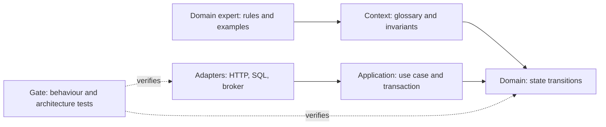

# Domain-driven design: model rules, ownership, and consistency

Use domain-driven design (DDD) where changing business rules and conflicting
meanings make software hard to change safely. Start with language and
ownership. Add aggregates and ports only where they protect a real rule.

**Audience:** engineers and technical leads building data platforms, machine
learning (ML) platforms, and services. The examples are synthetic.

Skill: `apply-playbooks` turns the rules into change acceptance criteria;
`system-design-assessment` reviews boundary and consistency trade-offs.

## Sources

The guidance below is an original synthesis. The decision defaults and
examples are local recommendations, not requirements stated by the books.
Public web references were checked on 2026-11-26.

- Eric Evans, *Domain-Driven Design: Tackling Complexity in the Heart of
  Software*: language, model boundaries, and tactical patterns. See Martin
  Fowler's public [Bounded Context](https://martinfowler.com/bliki/BoundedContext.html)
  explanation for the relationship between language and model boundaries.
- Vaughn Vernon, [*Effective Aggregate Design*](https://www.dddcommunity.org/library/vernon_2011/):
  consistency constraints, aggregate sizing, and relationships by identity.
- Martin Kleppmann, [*Designing Data-Intensive Applications*](https://www.oreilly.com/library/view/designing-data-intensive-applications/9781491903063/):
  transactions, concurrency, distributed state, and event processing.
- Alistair Cockburn, [*Hexagonal Architecture*](https://alistair.cockburn.us/hexagonal-architecture):
  isolate application behaviour from input and output technologies.
- Harry Percival and Bob Gregory, [*Architecture Patterns with Python*](https://www.cosmicpython.com/book/chapter_06_uow):
  repositories, application services, and the unit of work.
- [*ArchUnit User Guide*](https://www.archunit.org/userguide/html/000_Index.html):
  executable checks for dependency direction and cycles.
- [*Architectural Decision Records*](https://adr.github.io/):
  decision logs and links to Michael Nygard's *Documenting Architecture Decisions*.
- Eric Evans, [*Domain-Driven Design Reference*](https://www.domainlanguage.com/ddd/reference/):
  canonical pattern definitions, including context mapping and domain events.
- Martin Fowler, [*Anemic Domain Model*](https://martinfowler.com/bliki/AnemicDomainModel.html)
  and [*CQRS*](https://martinfowler.com/bliki/CQRS.html):
  choosing domain behaviour and read/write separation deliberately.
- DDD Crew, [*Bounded Context Canvas*](https://raw.githubusercontent.com/ddd-crew/bounded-context-canvas/master/README.md)
  and [*DDD Starter Modelling Process*](https://raw.githubusercontent.com/ddd-crew/ddd-starter-modelling-process/master/README.md),
  with Alberto Brandolini's [*EventStorming*](https://www.eventstorming.com/):
  collaborative discovery and explicit boundary assumptions.
- Matthew Skelton and Manuel Pais, *Team Topologies*,
  [*Key Concepts*](https://teamtopologies.com/key-concepts), alongside
  Vlad Khononov's *Learning Domain-Driven Design* and Vaughn Vernon's
  *Implementing Domain-Driven Design*: ownership and strategic modelling.
- Gregor Hohpe and Bobby Woolf, *Enterprise Integration Patterns*,
  [*Process Manager*](https://www.enterpriseintegrationpatterns.com/patterns/messaging/ProcessManager.html):
  stateful workflow coordination.
- [*Import Linter*](https://import-linter.readthedocs.io/en/stable/) and
  [*Spring Modulith Fundamentals*](https://docs.spring.io/spring-modulith/reference/fundamentals.html):
  module contracts and verification. Check rolling documentation against the
  tool version used by the project.

## At a glance



Takeaway: model the business rule first, then use tests to protect its
consistency boundary and dependency direction.

| Question | Default |
| --- | --- |
| Where to invest? | Complex, changing rules in the core business capability |
| Shared vocabulary? | One glossary per bounded context; translate at boundaries |
| Deployment? | Start with modules; a context does not require a microservice |
| Immediate consistency? | The smallest aggregate that protects the invariant |
| Cross-context exchange? | Published API, event, or owned read projection; no access to another context's internal tables |
| External technology? | Adapter behind a port owned by its caller |
| Proof? | Domain tests, real persistence tests, contract tests, and architecture checks |

## Decision guide

### When DDD pays off

| Situation | Choose | Reason or stop condition |
| --- | --- | --- |
| Deployment approvals, dataset access, or retention rules change often | Model the rules with domain experts; use tactical patterns selectively | Invalid transitions have business consequences |
| Teams disagree on what a model, feature, or dataset means | Strategic DDD: glossary, contexts, and context map | A shared schema cannot resolve conflicting meanings |
| Simple create/read/update/delete service with little policy | Direct application code and database constraints | Stop before adding pass-through repositories and empty domain classes |
| Bulk transformation, vector operation, or numerical kernel | Data-oriented processing with explicit input/output contracts | Per-row domain objects can add allocation without protecting a rule |
| Generic identity, payments, or scheduling capability | Evaluate a maintained product or library | Custom modelling must justify its ownership cost |
| No access to domain expertise | Gather worked examples and name unresolved assumptions | Do not treat a guessed model as agreed business policy |

DDD does not require event sourcing, command-query responsibility segregation
(CQRS), microservices, or a class hierarchy. Adopt each separately for an
observed need. A domain can be modelled with functions and immutable data.

Check: before adding a pattern, name the rule it protects, a counterexample
it rejects, and the simplest alternative. Review these with a domain expert.

Classify **subdomains**, the business problem areas, before choosing the code
patterns. A subdomain describes the problem; a bounded context defines the
model boundary used to solve it. They need not map one-to-one.

| Subdomain | Business role | Investment default |
| --- | --- | --- |
| Core | Rules that distinguish the business from alternatives | Work closely with experts; model complex invariants explicitly |
| Supporting | Business-specific work that enables the core | Start with a transaction script or CRUD module when rules are simple |
| Generic | Capabilities whose rules are broadly shared | Evaluate a maintained product or library before custom implementation |

These are investment defaults, not a complexity ranking. A supporting
capability can need a rich model, and identity or billing can be core for a
business that sells those capabilities. Revisit the classification when the
business strategy changes. Evans' *DDD Reference* and DDD Crew's *Bounded
Context Canvas* provide the strategic vocabulary.

### Language and context boundaries

A **ubiquitous language** is the vocabulary that domain experts and engineers
use in conversation, code, tests, and contracts. A **bounded context** is the
boundary within which that vocabulary and model have one consistent meaning.
A **context map** records how these boundaries interact and who controls each
contract. Fowler's *Bounded Context* explains why one global model breaks
down when different groups assign different meanings to the same term.

1. Collect commands, business facts, and rejected transitions from real use
   cases. Ask what must happen when an approval expires during deployment.
2. Define terms per context. Include meaning, an example, and a confusable
   term. Put vocabulary in the glossary and implementation choices in ADRs.
3. Mark authoritative ownership and exposed contracts on the context map.
   Contexts exchange identifiers and contracts, not shared mutable objects.
4. Exercise a boundary with a concrete failure: incompatible version,
   unavailable supplier, or a fact that arrives after its replacement.

Use an [EventStorming workshop](https://www.eventstorming.com/) to discover
the flow with domain experts. Start with a timeline of business events and
mark disputed meanings and handoffs. In a design-focused session, attach the
commands, actors, policies, and read models that explain each transition.
Keep unresolved assumptions visible; a workshop sketch is not an accepted
design. Capture each candidate context's purpose, language, interfaces, and
assumptions in a version-controlled
[Bounded Context Canvas](https://raw.githubusercontent.com/ddd-crew/bounded-context-canvas/master/README.md).

| Context | Term | Meaning | Distinguish from |
| --- | --- | --- | --- |
| Training | Model version | Immutable artifact and training metadata | Serving deployment |
| Serving | Deployment | Assignment of a model version to an environment | Training run |
| Governance | Approval | Permission for a specific artifact digest and policy revision | Successful evaluation |

Different contexts can share an identifier while keeping distinct models.
The serving context need not load a training run to deploy its artifact.

| Relationship | Use when | Record and verify |
| --- | --- | --- |
| Customer-supplier | A downstream team can negotiate requirements with its upstream provider | Named owners, contract acceptance tests, change notice and failure policy |
| Conformist | The downstream team accepts the upstream model and cannot justify translation | Accepted semantic coupling and upstream compatibility assumptions |
| Anti-corruption layer | A vendor or legacy model would distort the local language | Translation adapter, rejected unknown values, mapping and contract tests |
| Partnership | Both teams can coordinate changes and share delivery risk | Joint release and incident responsibilities |
| Separate ways | The capability needs no integration | Keep models independent; avoid a speculative shared library |
| Open Host Service | Many consumers need a stable upstream capability | One supported protocol and compatibility policy; open means available to intended consumers, not unauthenticated |
| Published Language | Contexts need an agreed interchange model | Documented field meanings and schema evolution; an Avro or OpenAPI document can describe the contract |
| Big Ball of Mud | Legacy responsibilities and models cannot yet be separated reliably | Mark the uncertain boundary and contain its semantics behind translation |

Evans' *DDD Reference* names an anti-corruption layer as a context-mapping
pattern. Record organizational dynamics and technical integration choices
separately: customer-supplier can describe the teams while an anti-corruption
layer describes their translation boundary. An Open Host Service and a
Published Language can serve many downstream consumers without bespoke
contracts for each. A shared kernel means jointly owned model code; use it
only when both teams accept coordinated changes and test ownership.

Give every context one accountable owning team. Check that the team can
understand and operate its scope; split responsibilities when cognitive load
prevents safe changes. Shared ownership needs an explicit coordination
agreement. Following [Team Topologies](https://teamtopologies.com/key-concepts),
record how teams interact: temporary collaboration to discover the model,
X-as-a-Service for a self-service contract, or facilitating to transfer a
capability. These interaction modes complement context-map relationships;
they do not mechanically determine a context boundary.

Inside a modular monolith, each context owns its persistence schema. Forbid
direct reads, joins, and writes against another context's internal tables.
Use a published interface or an explicitly owned reporting projection built
from published data contracts. A shared database server does not imply shared
table ownership. Enforce access with database permissions where practical;
review SQL and test data access as well as package imports.

Check: review every boundary crossing against the context map. Fail
architecture checks on cross-context internal imports. Use
[API design](api-design.md) for externally consumed schemas and compatibility.

### Aggregates and invariants

An **invariant** is a rule that must hold after every committed change. An
**aggregate** groups the state that must change atomically to preserve that
rule. Its **root** is the entry point for changes to that state. Vernon's
*Effective Aggregate Design* motivates sizing by consistency needs.

| Rule | Boundary | Verification |
| --- | --- | --- |
| One active deployment per tenant and environment | Deployment slot identified by tenant and environment | Unique database constraint plus two concurrent activation attempts |
| Approval must match the deployed artifact digest | Deployment records the exact approved digest | Reject mismatches and expired approvals at the defined decision point |
| A reporting count eventually reflects deployments | Separate projection | Replay, duplicate delivery, delayed update, and reconciliation tests |

Sizing rules:

- Start with one root and only the state required for immediate invariants.
  Reference other aggregates by identity. Avoid loading an entire tenant,
  every dataset partition, or training history for one command.
- Specify maximum child cardinality and loaded bytes for each write use case.
  If either grows without a business bound, split lifecycle ownership or use
  a bounded query. Do not use a universal object-count threshold.
- Prefer one aggregate write per transaction. If a hard invariant spans two
  roots, revisit the boundary first. A multi-aggregate transaction is a narrow,
  documented exception within one context and one transactional store.
  Record its contention and partitioning costs. Never extend that exception
  across contexts. Do not replace an immediate safety rule with eventual
  consistency; redesign ownership or the workflow if it cannot be enforced.
- Keep locks and transactions short. Use optimistic version checks where
  appropriate; retry by reloading state and re-evaluating the command.
  Database uniqueness and isolation must protect races across processes.
- For a cross-context workflow, define intermediate states, expiry,
  compensation, and repair ownership. A saga coordinates steps; it does not
  make remote writes atomic. Define whether approval must be valid at
  admission or throughout deployment, then design revocation accordingly.

Check: test valid and invalid state transitions without infrastructure. Then
test conflicting writes against the real database and isolation settings.
Measure loaded bytes, query count, and conflict rate under representative
cardinality. See the companion
[Performance and memory](performance-and-memory.md)
for data structures, allocation, and profiling guidance.

For a workflow that spans contexts, choose coordination explicitly:

| Approach | Use when | Required guard |
| --- | --- | --- |
| Event choreography | A small set of independent reactions remains easy to trace | Correlation ids, idempotent handlers, and an owner for stalled flows |
| Process Manager | Branches, deadlines, or compensation need durable progress tracking | Persist state, command outcomes, timeouts, and retry-safe transitions |

A [Process Manager](https://www.enterpriseintegrationpatterns.com/patterns/messaging/ProcessManager.html)
routes work according to the recorded workflow state. It adds a coordinator
that must recover after failure; it does not make participants' commits atomic.
Example: persist approval requested, handle approval granted, issue deployment,
then time out or compensate if deployment fails. Test duplicate replies and
a coordinator crash between recording progress and sending the next command.

### Entities and value objects

| Concept | Choose when | Example | Guard |
| --- | --- | --- | --- |
| Entity | Identity persists while attributes change | Deployment slot with a stable tenant/environment identity | Equality by identity; root operations control state changes |
| Value object | Meaning comes from its attributes | Artifact digest or evaluation threshold | Immutable; equality by value; reject invalid construction |
| Domain service | A business calculation has no natural entity owner | Compare evaluation results with an approval policy | Explicit inputs and result; no hidden network calls |

Prefer operations such as `deployment.activate(approval)` over public setters
for `status` and `approved_digest`. Validate digest shape in a value object;
validate that the approval matches this deployment in the domain operation.
Represent units and time zones explicitly. Avoid a bare float when a value
means a duration, currency, or probability with a defined valid range.

Check: tests cover invalid construction, equality, and attempted invalid
transitions. Reconstruct persisted entities through a path that validates
their invariants; handle corrupt records explicitly. DDD does not replace
tenant authorization or input validation at a trust boundary.

Fowler's [Anemic Domain Model](https://martinfowler.com/bliki/AnemicDomainModel.html)
describes the cost of domain classes that expose data while procedural
services own all their business behaviour. For complex invariants, place the
decision beside the state it protects. For a simple use case, an intentional
**transaction script**, a procedure that validates and commits that use case,
can be sufficient. Pure functions with immutable data can also enforce a
rich domain model; the warning is about scattered policy, not a demand for
object-oriented code.

### Domain events and integration events

A **domain event** records a business fact inside one context. An
**integration event** is a published contract for other contexts. Map between
them explicitly so internal refactoring does not change consumer contracts.

| Question | Domain event | Integration event |
| --- | --- | --- |
| Example | DeploymentActivated | Versioned deployment-activated notification |
| Audience | Handlers in the owning context | Independently changing consumers |
| Data | Facts needed by local business logic | Minimal approved payload with stable identifiers |
| Compatibility | Change with the owning model and handlers | Review consumer compatibility and retention |
| Timing | Can be raised before commit; handlers must respect the transaction boundary | Publish only after committed state is durable |

Choose handler timing explicitly. Synchronous domain handlers inside the
transaction can reject the primary write and can accidentally expand it to
multiple aggregates. Apply the same transaction-boundary rules to those
handlers. Asynchronous post-commit handlers preserve independent writes but
introduce lag and partial failure. Persist their pending work through an
outbox or equivalent durable mechanism; an in-memory callback after commit
can lose work if the process exits.

For reliable publication, write state and an outbox record in the same
transaction, then let a relay publish the record. If the relay crashes after
send but before acknowledgement, delivery can repeat. Give each event a stable
id. Commit consumer deduplication and its local side effect together, or use
an idempotent destination for external side effects.

Define ordering scope, an aggregate sequence when needed, and handling for
stale or missing events. Set retry limits and a repair path. Do not claim
end-to-end exactly-once effects from broker delivery guarantees alone.
Events carry past-tense facts; a command requests an action and can be rejected.
Minimize personal data and secrets in retained messages.

Checks: test rollback produces no published fact; crash and replay tests
produce one business effect; contract tests cover schema evolution. Follow
[API design: webhooks and events](api-design.md#webhooks-and-events) for
AsyncAPI and CloudEvents conventions.

### Repositories and application services

A **repository** retrieves and saves aggregate roots in domain terms. An
**application service** coordinates one use case. A **unit of work** commits
or rolls back the local transaction. *Architecture Patterns with Python*
describes how these responsibilities fit together.

| Component | Owns | Keep elsewhere |
| --- | --- | --- |
| Application service | Authorization orchestration, load, domain call, save, commit | Business state-transition rules belong in the domain |
| Domain model | Invariants and business decisions | SQL, HTTP, broker clients, and transaction control |
| Repository port | Required load/save contract for roots | Generic CRUD for every table |
| Persistence adapter | SQL mapping, version checks, constraint error translation | Business approval policy |
| Read query | Bounded projection for a screen or report | Reconstructing a large aggregate just to display fields |

Example use case: authorize access to the tenant and deployment, begin the
unit of work, load the slot with its version, call `activate(approval)`, save
with the expected version, add the outbox record, and commit. A domain
rejection or write conflict rolls back. Never send a remote request while
holding that database transaction open without an explicit failure design.

Check: unit tests prove the application service commits only on success.
Persistence contract tests prove rollback, version conflicts, and constraint
translation against the real database. Share those contracts with test doubles
so an in-memory repository cannot silently accept impossible writes.

For reads, start with dedicated read-only query handlers against the owning
context's existing store. A list view can select only required columns without
hydrating aggregates. This does not grant access to other contexts' internal
tables. Introduce separate read and write models where they simplify a real
use case; [Fowler's CQRS discussion](https://martinfowler.com/bliki/CQRS.html)
warns about the added complexity. A separate asynchronously updated read store
needs a measured reason, such as different scaling or data shapes, plus a
budget for projection lag, replay, and rebuild. Document what a caller sees
immediately after a successful write.

### Ports, adapters, and architecture tests

In hexagonal architecture, a **port** names an interaction the application
supports or needs. An **adapter** implements the interaction for a technology.
Cockburn's *Hexagonal Architecture* keeps application behaviour testable
without its production database or user interface. Dependency direction is
separate from runtime call direction.

| Module | May import | Must not import |
| --- | --- | --- |
| domain | Standard library and explicitly approved pure value libraries | application, adapters, web frameworks, database or broker SDKs |
| application, including port interfaces | domain and application interfaces | Concrete adapters or framework types |
| adapters | application ports and domain types | Another context's internal modules |
| bootstrap | All components needed for wiring | Business decisions embedded in wiring |

The runtime starts in an HTTP or message adapter, invokes the application
service, and reaches persistence through a port. The persistence adapter
implements that port; the domain never imports the adapter. Keep shared port
types inward so annotations cannot reverse the dependency.

Use Import Linter for Python, ArchUnit for Java, or Konsist for Kotlin to
enforce these rules in the same gate as the behavioural tests. For example,
an ArchUnit rule for a Java service can forbid outward dependencies:

```java
noClasses().that().resideInAPackage("..domain..")
    .should().dependOnClassesThat()
    .resideInAnyPackage("..application..", "..adapters..")
    .check(importedProductionClasses);
```

This rule covers the internal direction only. Add framework bans, allowed
external dependencies, context isolation, and cycle checks. Scan every
production module; fail on an empty selection so a package rename cannot
silently disable the check. Prove the rule detects a deliberate forbidden
dependency, then remove that dependency before committing. Static import
checks cannot detect all reflection or dynamic imports; integration tests
must also exercise the real composition root.

[Import Linter](https://import-linter.readthedocs.io/en/stable/) provides
independence, layers, and acyclic-siblings contracts for these module rules.
For Spring applications,
[Spring Modulith](https://docs.spring.io/spring-modulith/reference/fundamentals.html)
models provided interfaces, internal implementation, and required interfaces.
Use its module verification alongside the invariant and persistence tests;
code dependency checks alone cannot detect SQL joins across owned schemas.

Check: CI fails on a domain-to-adapter import, an application-to-adapter
import, a cross-context internal import, or a dependency cycle. Pure domain
tests run without a database, network, or framework startup.

### Record decisions as ADRs

An **Architecture Decision Record (ADR)** explains one significant choice and
its consequences. Use the repository's existing format and decision owner.
Record a decision when reversal is costly, the reason will otherwise be
surprising, and real alternatives existed.

| Record | Include | Example |
| --- | --- | --- |
| Glossary | Context-specific terms, definitions, examples | Approval means permission for one artifact digest |
| Context map | Ownership, upstream/downstream relationships, contracts | Governance supplies approval facts to serving |
| ADR | Status, context, alternatives, decision, consequences, evidence, revisit trigger | Choose an outbox over direct broker publication to close the commit/send gap |

Keep a new ADR proposed until its accountable owner accepts it. Link its
enforcing tests and the affected context map. If the decision changes, add
a superseding ADR and preserve the accepted record. An ADR is not a substitute
for the schema, constraint, or executable architecture rule.

Check: review boundary and consistency changes with their ADR and test
evidence in the same pull request. Example revisit trigger: measured write
conflicts exceed the service's agreed budget at expected tenant concurrency.

## Checklist

- [ ] Identify the business rule and explain why DDD earns its cost here.
- [ ] Classify the subdomain and select modelling depth for its actual rules.
- [ ] Discover disputed terms and handoffs with domain experts; record assumptions.
- [ ] Agree on context-specific terms with a domain expert.
- [ ] Map owners, integration contracts, and relationship types.
- [ ] Assign team accountability and prevent access to other contexts' internal tables.
- [ ] State immediate invariants and allowed temporary inconsistencies.
- [ ] Bound aggregate size and test races against real persistence.
- [ ] Separate immutable values, entity identity, and state transitions.
- [ ] Separate domain events from versioned integration contracts.
- [ ] Prove rollback, duplicate handling, and publication recovery.
- [ ] Choose workflow coordination and read-model consistency explicitly.
- [ ] Keep use-case orchestration outside business policy.
- [ ] Run architecture checks for forbidden dependencies and cycles.
- [ ] Record significant trade-offs and their enforcing checks in ADRs.

## Rules of thumb

- A bounded context can be one module in one deployable application.
- Model the write invariant separately from the reporting query.
- A large object graph is a reason to check the consistency boundary.
- Translate foreign terminology once at the boundary, then use local terms.
- Keep domain tests fast by keeping infrastructure outside the domain.
- Review model usefulness with people; verify code boundaries with tools.

## Claim review

- This page provides decision guidance, not measured performance claims.
- The deployment examples and decision defaults are synthetic recommendations.
- DDD, hexagonal architecture, and ADRs are complementary practices; none
  implies a particular deployment topology or event storage design.
- Architecture tests check declared dependencies. They do not prove that the
  model reflects the business or that distributed effects are atomic.

## Privacy review

- All examples use generic data and ML platform concepts.
- No private project, machine, employer, client, or operational record appears.
- The text summarizes public ideas in original wording and quotes no book text.
