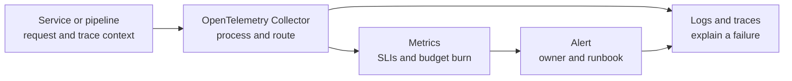

# Observability: measure user outcomes, then explain failures

Start with the question an operator must answer: are users getting the result
they need, within the promised time? Collect enough evidence to explain a bad
result and choose a safe response.

For service owners, platform engineers, and data engineers. This page covers
ordinary services and data platforms. For agent workloads, also use
[agent observability](../agentic-sre/observability.md) and
[agent SLOs and error budgets](../agentic-sre/slos-and-error-budgets.md).

**Keep the telemetry contract and alert rules in the service repository.**
Test propagation, redaction, alert firing, and recovery in its gate. This page
is a decision guide; it does not install instrumentation or publish alerts.

Skill: none in the public skill catalog.

## Sources

Public sources checked on 2026-11-26. The procedures and example choices below
are recommendations for adopting these ideas, not claims about a deployment.

- Google, *Site Reliability Engineering*:
  [Monitoring Distributed Systems](https://sre.google/sre-book/monitoring-distributed-systems/)
  [Being On-Call](https://sre.google/sre-book/being-on-call/),
  [Service Level Objectives](https://sre.google/sre-book/service-level-objectives/),
  and [Eliminating Toil](https://sre.google/sre-book/eliminating-toil/).
- Google, *The Site Reliability Workbook*:
  [Implementing SLOs](https://sre.google/workbook/implementing-slos/),
  [Alerting on SLOs](https://sre.google/workbook/alerting-on-slos/),
  [Example Error Budget Policy](https://sre.google/workbook/error-budget-policy/),
  [Data Processing Pipelines](https://sre.google/workbook/data-processing/),
  and [Monitoring](https://sre.google/workbook/monitoring/).
- Tom Wilkie's [RED method, presented by Grafana Labs](https://grafana.com/blog/the-red-method-how-to-instrument-your-services/)
  and Brendan Gregg's [USE method](https://www.brendangregg.com/usemethod.html).
- OpenTelemetry: [logs](https://opentelemetry.io/docs/concepts/signals/logs/),
  [context propagation](https://opentelemetry.io/docs/concepts/context-propagation/),
  [messaging spans](https://opentelemetry.io/docs/specs/semconv/messaging/messaging-spans/),
  [Collector architecture](https://opentelemetry.io/docs/collector/architecture/),
  [sampling](https://opentelemetry.io/docs/concepts/sampling/),
  [Collector resiliency](https://opentelemetry.io/docs/collector/resiliency/), and
  [scaling the Collector](https://opentelemetry.io/docs/collector/scaling/).
- OpenTelemetry specifications:
  [Metrics SDK](https://opentelemetry.io/docs/specs/otel/metrics/sdk/),
  [Metrics Data Model](https://opentelemetry.io/docs/specs/otel/metrics/data-model/),
  [Tracing SDK](https://opentelemetry.io/docs/specs/otel/trace/sdk/),
  [recording errors](https://opentelemetry.io/docs/specs/semconv/general/recording-errors/),
  [service resources](https://opentelemetry.io/docs/specs/semconv/resource/service/),
  [deployment environment](https://opentelemetry.io/docs/specs/semconv/resource/deployment-environment/),
  and [HTTP convention migration](https://opentelemetry.io/docs/specs/semconv/non-normative/http-migration/).
- Prometheus: [metric and label naming](https://prometheus.io/docs/practices/naming/),
  [instrumentation](https://prometheus.io/docs/practices/instrumentation/),
  [histograms and summaries](https://prometheus.io/docs/practices/histograms/),
  [recording rules](https://prometheus.io/docs/practices/rules/),
  and [alerting](https://prometheus.io/docs/practices/alerting/).
- W3C: [Trace Context](https://www.w3.org/TR/trace-context/).
- Stripe Engineering:
  [Fast and flexible observability with canonical log lines](https://stripe.com/blog/canonical-log-lines).

## At a glance

Takeaway: metrics detect impact; correlated logs and traces help the operator
find the failing stage.

| Component | Responsibility |
| --- | --- |
| Instrumented service or worker | Records outcomes, durations, and diagnostic context |
| Collector | Receives telemetry, applies processing, and exports to selected backends |
| Metric backend | Evaluates indicators and alert rules |
| Log and trace backends | Retain searchable events and request paths |
| On-call owner | Uses the runbook to restore the user outcome |

Start here: choose one important user journey, define its indicator, and test
one failure from request entry through notification. Expand after that works.

## Decision guide

### Choose signals by the question

Google's four golden signals describe service health:

| Signal | Question | Useful measurement |
| --- | --- | --- |
| Latency | How long does the user wait? | Duration distribution, with successful and failed requests distinguishable |
| Traffic | How much work arrives? | Requests or records per second |
| Errors | How often does the expected result fail? | Bad outcomes over valid attempts, including incorrect successful responses |
| Saturation | How close is a resource to its limit? | Queue wait, pool wait, memory pressure, or another measure of constrained capacity |

Use RED (rate, errors, duration) for request-driven services. Keep the same
dashboard layout across services so responders can inspect unfamiliar ones.
For workers, adapt it to operations and add queue depth, age, and saturation;
count arrivals and completions separately when backlog can grow. For batch
and streaming outcomes, use the pipeline indicators below.
[RED method](https://grafana.com/blog/the-red-method-how-to-instrument-your-services/)

Use USE (utilisation, saturation, errors) to inspect each constrained resource:
CPU, disk, network, memory, and connection pools. Time-based utilisation is
the fraction of an interval spent busy; capacity-based utilisation is the
fraction of a finite resource consumed. Saturation measures excess work or
waiting. High average utilisation does not prove impact, and a low average
can hide short saturating bursts. Measure containers against their configured
quotas and limits, not only host totals. Inspect cache hit rates separately.
[USE method](https://www.brendangregg.com/usemethod.html)

Lead with user symptoms on the service dashboard. Use resource signals to
explain them. Measure tail latency with histograms; averages hide slow users.
Choose their resolution and buckets using
[the histogram guidance below](#cardinality-sampling-and-cost).

Pair black-box monitoring (externally observed behaviour) with white-box
monitoring (internal state). External probes can detect DNS, TLS, proxy, and
process failures that service instrumentation misses. Measure latency and
errors at both caller and server boundaries to distinguish network delay
from application work.
[Monitoring Distributed Systems](https://sre.google/sre-book/monitoring-distributed-systems/)

Check: exercise a slow dependency and verify both the latency distribution
and its waiting-resource signal change.

### SLIs, SLOs, and error budgets

A service level indicator (SLI) measures an outcome. A service level objective
(SLO) sets its target over a named window. Define the indicator as good events
divided by valid events. State the measurement boundary, source, exclusions,
and latency threshold before setting a target. A server's accepted request is
not necessarily the user's completed operation.
[Implementing SLOs](https://sre.google/workbook/implementing-slos/)

For example, a local illustrative objective is 99.9% of valid reads returning
the correct result within 300 ms over a rolling 28 days, or four weeks. Whole
weeks keep the weekday/weekend mix constant. Its allowed bad-event
fraction is `1 - 0.999 = 0.001`. With one million valid reads, that permits
1,000 bad reads. An event-based budget is not a fixed allowance of downtime.

Record no traffic as undefined, not perfect reliability. Distinguish missing
telemetry from zero traffic. Use independent probes for sparse critical
journeys and to detect monitoring failure. Give synthetic probes their own
indicator or alert; passing probes must not dilute the real-user SLO
denominator. Do not derive that denominator from selectively sampled traces.

A service level agreement (SLA) adds contractual commitments and consequences.
Where an SLA exists, agree an internal SLO with enough margin to respond
before breaching it. Align dependency targets with the consumer's needs;
an unnecessarily strict dependency target creates avoidable work.
[Service Level Objectives](https://sre.google/sre-book/service-level-objectives/)

The service owner approves the target and error-budget policy. Write down
the owner, actions when budget runs low or is exhausted, reliability work,
permitted emergency changes, exception approver, and recovery condition.
Review the policy with release decisions.
Set a postmortem trigger for large individual budget losses. Google's example
policy uses more than 20% of the budget consumed by one incident; adopt or
adjust that trigger explicitly with the owner.
[Example Error Budget Policy](https://sre.google/workbook/error-budget-policy/)

Check: replay known good, bad, excluded, and absent events through the actual
indicator query. Verify the numerator and denominator independently.

### Alerts that protect the budget

Burn rate is `observed bad-event fraction / allowed bad-event fraction`.
For a 99.9% SLO, 1% bad events means 10 times the sustainable rate. Use multiple
pairs of windows. Require the long **and** short window in a pair to exceed
its threshold. Combine pairs of the **same severity** with **or**. The short
window confirms the failure is continuing. Keep page and ticket rules
separate, and inhibit the matching ticket while a page fires.

The Workbook's 30-day example provides these starting points:

| Action | Long window | Short window | Burn threshold | Approximate budget consumed over long window |
| --- | --- | --- | --- | --- |
| Page | 1 hour | 5 minutes | 14.4 | 2% |
| Page | 6 hours | 30 minutes | 6 | 5% |
| Ticket | 3 days | 6 hours | 1 | 10% |

The approximation is `burn rate × long-window duration / SLO-window duration`;
it assumes representative traffic. The table uses **30 days**, unlike the
28-day example above: spending 2% over one hour gives `0.02 × 28 × 24 = 13.44`
times burn for 28 days. Recalculate every row for the selected window.
Review low-traffic behaviour and the time needed to respond.

Prefer confirmation windows to a long `for:` timer that delays a page and
resets on brief dips. Test extreme targets: at 90% over 30 days, a 14.4 times
threshold would require 144% bad events and can never fire. At 99.999%, a
time-based 30-day budget is only about 26 seconds of full outage. Metric
alerting alone cannot protect that objective; use limited rollouts and rapid
rollback to constrain how many users a failure can affect.
[Alerting on SLOs](https://sre.google/workbook/alerting-on-slos/)

Page for symptoms that require immediate action: failed user operations,
excessive end-to-end latency, or data missing its consumption deadline.
Keep diagnostic causes such as CPU spikes on dashboards or tickets unless
they predict imminent impact with enough time for a defined intervention.
Group related notifications to avoid paging once per instance.

Precompute expensive SLI queries with recording rules. Aggregate bad and
valid event rates separately, then divide; averaging instance error ratios
gives low-traffic instances too much weight. Use consistent rule names such
as Prometheus's `level:metric:operations` convention.
[Recording rules](https://prometheus.io/docs/practices/rules/)

Send an always-firing watchdog through the collection, evaluation, and
notification path to an independent receiver. Alert if it stops arriving.
This checks the alerting system itself, including failures its own internal
metrics cannot report.
[Prometheus alerting](https://prometheus.io/docs/practices/alerting/)

Check: test sustained burn, a brief spike, recovery, zero traffic, and missing
series in the alert engine. For Prometheus, use `promtool test rules` with
fixture series. Verify the notification route as well as the expression.

### Logs, metrics, and traces

Metrics aggregate outcomes over time. Logs record events. A trace joins spans,
where each span describes one operation. Structured logs carry the active
`trace_id` and `span_id`, so an operator can move from a slow trace to its
events. Use metric exemplars to link a histogram observation to a trace when
the backend supports them.
[OpenTelemetry logs](https://opentelemetry.io/docs/concepts/signals/logs/)

The OTel SDK's recommended default `TraceBased` exemplar filter requires a
sampled span, so head sampling reduces trace-link coverage. A metric View
that excludes an attribute can still export it as an exemplar's filtered
attribute. Remove sensitive values before recording the measurement; a View
is not a privacy filter. If needed, disable or explicitly filter exemplars.
[Metrics SDK](https://opentelemetry.io/docs/specs/otel/metrics/sdk/)

Define a log schema: UTC timestamp, severity, stable event name, service name,
version, environment, outcome, duration with unit, and active context. Emit
JSON through the production logger. Include a bounded, validated `request_id`
for support correlation; generate it when absent or invalid. A request ID is
distinct from a trace ID. Preserve the mapping when a workflow starts a new
trace. Keep identifiers out of metric labels.

Emit one structured completion event per request or job in each service.
Accumulate the bounded route and domain attributes, dependency timings,
retry count, and outcome on that event. A middleware completion hook can
emit it even when handling raises an exception; a process crash can still
prevent emission. Keep debug events separate and control their volume.
Use a bounded logging path whose errors do not fail the user's operation.
[Stripe's canonical log lines](https://stripe.com/blog/canonical-log-lines)

Allowlist fields and redact before export, including exception messages.
Exclude credentials, request bodies, query strings, and personal data by
default. Restrict backend access and retention. Context identifiers correlate
events; they never establish caller identity or authorisation.

Check: send concurrent requests through the real logger and span exporter.
Assert matching context, no context leakage between requests, and redaction
of seeded sensitive values. Keep fixtures synthetic.

### Instrumentation and propagation

1. Instrument server entry, outbound HTTP, database calls, and queue clients
   with maintained OpenTelemetry libraries. Avoid recording the same operation
   twice. Add manual spans for meaningful domain stages.
2. Set `service.name`, `service.version`, and `deployment.environment.name`
   resource attributes. The last replaces legacy `deployment.environment`.
   Use `service.namespace` where names overlap and a `service.instance.id`
   unique within the service identity for each running instance.
   [Service resources](https://opentelemetry.io/docs/specs/semconv/resource/service/),
   [deployment environment](https://opentelemetry.io/docs/specs/semconv/resource/deployment-environment/)
3. Extract W3C `traceparent` and `tracestate` with the SDK propagator. Invalid
   context starts a new trace. Inject context on outgoing HTTP within the
   approved trust boundary. At public ingress, bound and validate headers and
   set a local sampling policy: an untrusted `sampled` flag must not force
   unlimited collection. Restart traces at a secure boundary when needed.
   Before calls to untrusted systems, strip internal state and baggage and
   decide explicitly whether to propagate trace identity. Keep secrets and
   personal data out of context. Test browser cross-origin header allowlists.
   [W3C Trace Context](https://www.w3.org/TR/trace-context/),
   [Context propagation](https://opentelemetry.io/docs/concepts/context-propagation/)
4. Inject context into message metadata. Extract it in consumers and restore
   worker-local context after processing. Record delivery attempts separately.
   Messaging conventions use links to message creation contexts by default,
   including single-message cases. Parent-child correlation is an option for
   a single message; preserve any ambient processing context as the selected
   convention requires. Batch and fan-in need links to express several
   producers. Avoid forcing long workflows into one unbounded trace.
   [Messaging spans](https://opentelemetry.io/docs/specs/semconv/messaging/messaging-spans/)
5. Export through the OpenTelemetry Collector using OTLP (OpenTelemetry
   Protocol). Keep backend endpoints and credentials in configuration.
   Receivers accept signals, processors transform or filter them, and exporters
   route them. Configure authentication, encryption, and redaction for each
   export destination.
   [Collector architecture](https://opentelemetry.io/docs/collector/architecture/)

The collector is a routing role, not a requirement for one shared instance.
Choose agents or gateways to match failure boundaries and volume.

Pin SDK and convention versions. HTTP conventions are stable; messaging
conventions are still in development. Inventory the actual dashboard and
alert consumers before changing emitted names. Where the instrumentation
supports it and existing consumers need a transition, use
`OTEL_SEMCONV_STABILITY_OPT_IN` migration modes such as `http/dup` or
`messaging/dup` temporarily, budget their duplicate telemetry, and set a
removal condition. These modes are not universal SDK switches.
[HTTP migration](https://opentelemetry.io/docs/specs/semconv/non-normative/http-migration/),
[messaging conventions](https://opentelemetry.io/docs/specs/semconv/messaging/messaging-spans/)

Record a failed operation consistently on its span and metric with a bounded
`error.type`; omit that attribute and leave span status unset on success.
A recovered retry does not make the overall successful operation an error.
Failed attempt spans can still describe their own failures. Follow the
operation's convention for status classification.
[Recording errors](https://opentelemetry.io/docs/specs/semconv/general/recording-errors/)

Initialise known bounded counter series to zero. For periodic work, export
the Unix timestamp of the last success and compute its age in the query;
an application-updated age gauge can freeze when its updater stalls. Expose
bounded build, configuration-version, and rollout markers so operators can
correlate failures with changes beyond deployments. Avoid arbitrary flag
combinations or unbounded configuration values as metric labels.
[Prometheus instrumentation](https://prometheus.io/docs/practices/instrumentation/)

Use the same change markers in incident views and rollout reviews.
[Workbook: Monitoring](https://sre.google/workbook/monitoring/)

Check: an integration fixture crosses HTTP, enqueue, dequeue, and an outbound
call. Assert the expected parents or links, including retries and malformed
context. Test scheduled work with no incoming context.

### Cardinality, sampling, and cost

Every distinct metric label combination creates a time series. Bound route,
status, operation, and error-class values. Use route templates rather than raw
URLs; never use user, request, trace, or message IDs as labels. Estimate the
product of label counts before adding a dimension, including histogram buckets
and instance count. Set an active-series budget and monitor it.
[Prometheus instrumentation](https://prometheus.io/docs/practices/instrumentation/),
[metric naming](https://prometheus.io/docs/practices/naming/)

Choose latency storage deliberately:

| Type | Use and limit |
| --- | --- |
| Client-side summary quantiles | Cannot combine precomputed percentiles across replicas; unsuitable for a fleet-wide latency SLI |
| Classic histogram | Aggregates compatible buckets; each bucket adds a series. Put explicit boundaries at latency SLO thresholds |
| Native or exponential histogram | Prefer when the full export and query path supports it. Prometheus native histograms use one composite series per label set; bucket storage still costs memory |

Histogram queries can change thresholds within the retained distribution's
resolution; they cannot recover detail that was never stored. Verify the
accuracy around an SLO boundary before relying on an interpolated fraction.
[Histograms and summaries](https://prometheus.io/docs/practices/histograms/)

Configure the SDK's per-stream cardinality limit where supported, and monitor
overflow. The Metrics SDK specification recommends 2,000 when no explicit
limit applies; excess combinations aggregate under `otel.metric.overflow=true`.
Check the deployed SDK's implementation rather than assuming that limit
protects every instrumentation path.
[Metrics SDK](https://opentelemetry.io/docs/specs/otel/metrics/sdk/)

| Sampling choice | Benefit | Limit to account for |
| --- | --- | --- |
| Head: decide at trace start | Reduces collection and transport early | Cannot know whether a later operation will fail |
| Tail: decide after observing spans | Can retain selected errors and slow traces | Buffers spans and requires trace-affine routing and a decision deadline |

Use parent-based decisions consistently across services. Tail sampling cannot
recover spans already dropped by head sampling. State error-retention goals
as a policy, not a guarantee: late spans and overload can lose evidence.
Keep an unbiased baseline sample for exploration. Compute SLO metrics before
selective trace sampling, or from independent counters.
[OpenTelemetry sampling](https://opentelemetry.io/docs/concepts/sampling/)

Within a trusted trace, use `ParentBased` and make ratio decisions at the
root. Legacy `TraceIdRatioBased` decisions on child spans can disagree across
SDKs. The specification deprecates that sampler in favour of probability
sampling; evaluate consistent probability sampling as the chosen SDKs support
it, rather than requiring an immediate fleet migration.
[Tracing SDK](https://opentelemetry.io/docs/specs/otel/trace/sdk/)

Budget bytes per second, retention, query cost, SDK queues, and collector
memory. Bound export queues, retries, batch sizes, and tail-sampling state.
Monitor queue occupancy, refused or dropped telemetry, export failures, and
collector resource pressure. Use an independent missing-data check so a broken
collector does not hide its own failure. Document the loss or backpressure
policy; telemetry failure must not create unbounded application memory growth.
[Scaling the Collector](https://opentelemetry.io/docs/collector/scaling/)

Put memory limiting before memory-intensive processing and batching, and
leave headroom for the process. For remote exporters, configure
`sending_queue` and `retry_on_failure`. Add persistent `file_storage` on
critical hops if restart loss is unacceptable; it still has disk-capacity
and retry-expiry limits. A durable broker is an option when that extra
operational cost is justified. Bounded SDK batch-span queues also drop data
when full, so monitor application-side loss as well as collector loss.
[Collector resiliency](https://opentelemetry.io/docs/collector/resiliency/),
[Tracing SDK](https://opentelemetry.io/docs/specs/otel/trace/sdk/)

Route spans by trace ID before tail sampling, for example with a front
collector tier and a load-balancing exporter. Stateful metric aggregation
needs routing by its aggregation keys; trace affinity alone is insufficient.
The Collector guidance suggests considering scale-up around 60–70% exporter
queue occupancy. First determine whether ingestion, processing, or a slow
destination is the bottleneck; replicas cannot fix a saturated destination.
[Scaling the Collector](https://opentelemetry.io/docs/collector/scaling/),
[Metrics Data Model](https://opentelemetry.io/docs/specs/otel/metrics/data-model/)

For profiling and application resource budgets, use the companion
[performance and memory playbook](performance-and-memory.md).

Check: load-test representative telemetry with the backend unavailable. Verify
bounded memory, visible loss, and recovery. Compare telemetry volume and cost
before and after each new dimension or sampling rule.

### Data-pipeline indicators

Measure at the consumer's usable output, including publication delay. A green
scheduler or completed worker does not prove usable data arrived. The table
adapts the Workbook's freshness, correctness, and coverage concepts into four
operational indicators. Completeness maps to coverage; lateness makes
deadline adherence explicit. Agree their definitions with the data owner.
[Implementing SLOs](https://sre.google/workbook/implementing-slos/),
[Data Processing Pipelines](https://sre.google/workbook/data-processing/)

| Indicator | Example good / valid events | Required definition |
| --- | --- | --- |
| Freshness | Consumption checks with data age below a threshold / scheduled checks | Which source timestamp defines age, check schedule, expected quiet periods |
| Completeness | Distinct expected records delivered / expected records | Independent source manifest or reconciliation denominator, window closure |
| Correctness | Outputs passing declared reconciliation and domain rules / outputs checked | Rules, reference truth, and coverage limits if checks sample data |
| Lateness | Eligible events published within their deadline / eligible events | Event time, deadline, clock assumptions, late-arrival allowance |

Freshness describes how current available data is; lateness describes whether
individual expected deliveries met deadlines. Track watermark lag and oldest
unprocessed event age to diagnose delay. Report unknown completeness when the
expected denominator is unavailable. Observed arrivals alone cannot reveal
missing records.

Define how duplicates, retries, quarantined records, and backfills affect each
denominator. Keep backfill and live-delivery indicators distinguishable.
Passing declared correctness checks is evidence of those checks, not proof of
all possible data properties.

Page on end-to-end consumer outcomes. Use stage-level throughput, lag, and
resource metrics to diagnose failures; paging on every retrying stage can
produce noise while missing losses between stages. Inject deterministic
golden records or heartbeat items and verify their expected arrival through
the real pipeline. Isolate synthetic output from customer results and the
real-data indicator denominator.

For scheduled jobs, set missing-success alerts from the job interval and
consumer deadline. Prometheus suggests allowing at least two full runs to
avoid transient noise; use an earlier alert when the business deadline
cannot tolerate that delay.
[Prometheus instrumentation](https://prometheus.io/docs/practices/instrumentation/),
[alerting](https://prometheus.io/docs/practices/alerting/)

Check: replay fixtures with a missing partition, duplicate event, late event,
corrupt output, and quiet source. Verify the indicator changes and the correct
consumer-deadline alert fires.

### Dashboards, runbooks, and toil

Build dashboards around questions: are users affected, which journey changed,
when did it start, and which dependency or resource explains it? Show SLO
compliance and burn first, then RED and USE views. Link to logs and traces
with the same service, time range, and context. Annotate deployments.
[Monitoring Distributed Systems](https://sre.google/sre-book/monitoring-distributed-systems/)

Every paging alert names an owner and links to a runbook containing the symptom,
impact check, diagnostic queries, safe mitigation, recovery check, and
escalation path. Review stale links during incident exercises. Test that an
operator can reach the evidence from the notification.

Toil is manual, repetitive, automatable, interrupt-driven operational work
that leaves little lasting improvement and grows with the service. Ordinary
administrative overhead is a separate cost. Google's SRE model reserves at
least half of engineering time for engineering work; agree and measure a
local operational-work budget. Review noisy notifications, repeated manual
queries, and repeated mitigations. Remove unactionable alerts; automate a
proven mitigation with bounded authority and a recovery path. Track pages per
shift and time spent on recurring work to see whether the change helped.
[Eliminating Toil](https://sre.google/sre-book/eliminating-toil/)

Set response expectations from the SLO and budget burn, then staff a rotation
that can meet them. Google's on-call guidance uses an upper bound of two
incidents per 12-hour shift and aims for one alert per incident; treat those
as planning references, not a universal staffing formula. Repeated excess
load needs corrective work. Quiet rotations need scheduled incident drills
so diagnosis and mitigation skills stay current.
[Being On-Call](https://sre.google/sre-book/being-on-call/)

Check: exercise one failure from notification to verified recovery. Record
missing evidence and manual steps as owned follow-up work.

## Checklist

- [ ] One user journey has explicit good and valid events, owner, target, and window.
- [ ] The error-budget policy defines exhaustion, exceptions, and recovery.
- [ ] Golden signals, RED, and USE answer service and resource questions.
- [ ] Burn alerts require both windows and group pairs by severity; fixtures prove firing and recovery.
- [ ] Structured logs and spans share context across HTTP and queues.
- [ ] Sensitive data is redacted before export; access and retention are bounded.
- [ ] Metric exemplars and context headers cannot bypass redaction or sampling limits.
- [ ] Metric dimensions, buffers, sampling state, and telemetry spend have budgets.
- [ ] Missing telemetry and exporter failure are visible and tested.
- [ ] An independent watchdog verifies collection through notification.
- [ ] Data indicators handle missing, late, duplicate, and incorrect output.
- [ ] Pages link to an owned runbook tested through recovery.
- [ ] Response times, alert load, engineering time, and incident drills have an owner.

## Rules of thumb

- Start with the user outcome and one working failure drill.
- A trace explains an example; an SLI measures the eligible population.
- Keep diagnostic identifiers in logs and traces, outside metric labels.
- Review the monitoring pipeline as a production dependency with failure limits.
- Delete a panel or alert when nobody can name the question or action it serves.

## Claim review

- [x] Every figure traces to a cited source or is labelled as illustrative.
- [x] Every factual claim stays within the cited evidence.
- [x] Evidence limits and qualifiers remain explicit.

## Privacy review

- [x] No employer material.
- [x] No customer material.
- [x] No private-repository material.
- [x] No trace material.
- [x] No transcript material.
