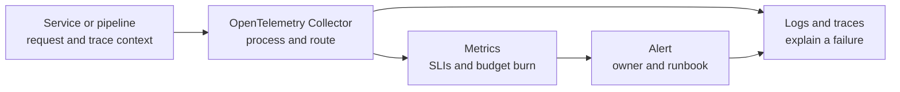

# Observability: measure user outcomes, then explain failures

Start with the question an operator must answer: are users getting the result
they need, within the promised time? Collect enough evidence to explain a bad
result and choose a safe response.

For service owners, platform engineers, and data engineers. This page covers
ordinary services and data platforms. For agent workloads, also use
[agent observability](../agentic-sre/observability.md) and
[agent SLOs and error budgets](../agentic-sre/slos-and-error-budgets.md).

**Keep the telemetry contract and alert rules in the service repository.**
Test propagation, redaction, alert firing, and recovery in its gate. This page
is a decision guide; it does not install instrumentation or publish alerts.

Skill: none in the public skill catalog.

## Sources

Public sources checked on 2026-11-26. The procedures and example choices below
are recommendations for adopting these ideas, not claims about a deployment.

- Google, *Site Reliability Engineering*:
  [Monitoring Distributed Systems](https://sre.google/sre-book/monitoring-distributed-systems/)
  and [Eliminating Toil](https://sre.google/sre-book/eliminating-toil/).
- Google, *The Site Reliability Workbook*:
  [Implementing SLOs](https://sre.google/workbook/implementing-slos/),
  [Alerting on SLOs](https://sre.google/workbook/alerting-on-slos/),
  [Example Error Budget Policy](https://sre.google/workbook/error-budget-policy/),
  and [Data Processing Pipelines](https://sre.google/workbook/data-processing/).
- Tom Wilkie's [RED method, presented by Grafana Labs](https://grafana.com/blog/the-red-method-how-to-instrument-your-services/)
  and Brendan Gregg's [USE method](https://www.brendangregg.com/usemethod.html).
- OpenTelemetry: [logs](https://opentelemetry.io/docs/concepts/signals/logs/),
  [context propagation](https://opentelemetry.io/docs/concepts/context-propagation/),
  [messaging spans](https://opentelemetry.io/docs/specs/semconv/messaging/messaging-spans/),
  [Collector architecture](https://opentelemetry.io/docs/collector/architecture/),
  [sampling](https://opentelemetry.io/docs/concepts/sampling/), and
  [scaling the Collector](https://opentelemetry.io/docs/collector/scaling/).
- Prometheus: [metric and label naming](https://prometheus.io/docs/practices/naming/).

## At a glance

Takeaway: metrics detect impact; correlated logs and traces help the operator
find the failing stage.

| Component | Responsibility |
| --- | --- |
| Instrumented service or worker | Records outcomes, durations, and diagnostic context |
| Collector | Receives telemetry, applies processing, and exports to selected backends |
| Metric backend | Evaluates indicators and alert rules |
| Log and trace backends | Retain searchable events and request paths |
| On-call owner | Uses the runbook to restore the user outcome |

Start here: choose one important user journey, define its indicator, and test
one failure from request entry through notification. Expand after that works.

## Decision guide

### Choose signals by the question

Google's four golden signals describe service health:

| Signal | Question | Useful measurement |
| --- | --- | --- |
| Latency | How long does the user wait? | Duration distribution, with successful and failed requests distinguishable |
| Traffic | How much work arrives? | Requests or records per second |
| Errors | How often does the expected result fail? | Bad outcomes over valid attempts, including incorrect successful responses |
| Saturation | How close is a resource to its limit? | Queue wait, pool wait, memory pressure, or another measure of constrained capacity |

Use RED (rate, errors, duration) for request-driven services and worker
operations. It covers traffic, errors, and latency. Count arrivals and
completions separately when backlog can grow. Add saturation explicitly.
[RED method](https://grafana.com/blog/the-red-method-how-to-instrument-your-services/)

Use USE (utilisation, saturation, errors) to inspect each constrained resource:
CPU, disk, network, memory, and connection pools. Utilisation measures busy
capacity; saturation measures work waiting beyond available capacity. A high
average utilisation alone does not prove user impact.
[USE method](https://www.brendangregg.com/usemethod.html)

Lead with user symptoms on the service dashboard. Use resource signals to
explain them. Measure tail latency with histograms; averages hide slow users.

Check: exercise a slow dependency and verify both the latency distribution
and its waiting-resource signal change.

### SLIs, SLOs, and error budgets

A service level indicator (SLI) measures an outcome. A service level objective
(SLO) sets its target over a named window. Define the indicator as good events
divided by valid events. State the measurement boundary, source, exclusions,
and latency threshold before setting a target. A server's accepted request is
not necessarily the user's completed operation.
[Implementing SLOs](https://sre.google/workbook/implementing-slos/)

For example, a local illustrative objective is 99.9% of valid reads returning
the correct result within 300 ms over a rolling 30 days. Its allowed bad-event
fraction is `1 - 0.999 = 0.001`. With one million valid reads, that permits
1,000 bad reads. An event-based budget is not a fixed allowance of downtime.

Record no traffic as undefined, not perfect reliability. Distinguish missing
telemetry from zero traffic. Use independent probes for sparse critical
journeys and to detect monitoring failure; keep synthetic and real traffic
identifiable. Do not derive the SLO denominator from selectively sampled
error traces.

The service owner approves the target and error-budget policy. Write down
the owner, actions when budget runs low or is exhausted, reliability work,
permitted emergency changes, exception approver, and recovery condition.
Review the policy with release decisions.
[Example Error Budget Policy](https://sre.google/workbook/error-budget-policy/)

Check: replay known good, bad, excluded, and absent events through the actual
indicator query. Verify the numerator and denominator independently.

### Alerts that protect the budget

Burn rate is `observed bad-event fraction / allowed bad-event fraction`.
For a 99.9% SLO, 1% bad events means 10 times the sustainable rate. Use multiple
pairs of windows. Require the long **and** short window in a pair to exceed
its threshold; combine the pairs with **or**. The short window confirms the
failure is continuing.

The Workbook's 30-day example provides these starting points:

| Action | Long window | Short window | Burn threshold | Approximate budget consumed over long window |
| --- | --- | --- | --- | --- |
| Page | 1 hour | 5 minutes | 14.4 | 2% |
| Page | 6 hours | 30 minutes | 6 | 5% |
| Ticket | 3 days | 6 hours | 1 | 10% |

The approximation is `burn rate × long-window duration / SLO-window duration`;
it assumes representative traffic. Recalculate for another SLO window and
review low-traffic behaviour. Choose thresholds with the response time in mind.
[Alerting on SLOs](https://sre.google/workbook/alerting-on-slos/)

Page for symptoms that require immediate action: failed user operations,
excessive end-to-end latency, or data missing its consumption deadline.
Keep diagnostic causes such as CPU spikes on dashboards or tickets unless
they predict imminent impact with enough time for a defined intervention.
Group related notifications to avoid paging once per instance.

Check: test sustained burn, a brief spike, recovery, zero traffic, and missing
series in the alert engine. For Prometheus, use `promtool test rules` with
fixture series. Verify the notification route as well as the expression.

### Logs, metrics, and traces

Metrics aggregate outcomes over time. Logs record events. A trace joins spans,
where each span describes one operation. Structured logs carry the active
`trace_id` and `span_id`, so an operator can move from a slow trace to its
events. Use metric exemplars to link a histogram observation to a trace when
the backend supports them.
[OpenTelemetry logs](https://opentelemetry.io/docs/concepts/signals/logs/)

Define a log schema: UTC timestamp, severity, stable event name, service name,
version, environment, outcome, duration with unit, and active context. Emit
JSON through the production logger. Include a bounded, validated `request_id`
for support correlation; generate it when absent or invalid. A request ID is
distinct from a trace ID. Preserve the mapping when a workflow starts a new
trace. Keep identifiers out of metric labels.

Allowlist fields and redact before export, including exception messages.
Exclude credentials, request bodies, query strings, and personal data by
default. Restrict backend access and retention. Context identifiers correlate
events; they never establish caller identity or authorisation.

Check: send concurrent requests through the real logger and span exporter.
Assert matching context, no context leakage between requests, and redaction
of seeded sensitive values. Keep fixtures synthetic.

### Instrumentation and propagation

1. Instrument server entry, outbound HTTP, database calls, and queue clients
   with maintained OpenTelemetry libraries. Avoid recording the same operation
   twice. Add manual spans for meaningful domain stages.
2. Set service name, version, and environment as resource attributes. Pin SDK
   and semantic-convention versions; review changes before upgrades.
3. Extract W3C `traceparent` and `tracestate` with the SDK propagator. Invalid
   context starts a new trace. Inject context on outgoing HTTP. Define which
   trust boundaries may continue incoming context and allowlist baggage.
   [Context propagation](https://opentelemetry.io/docs/concepts/context-propagation/)
4. Inject context into message metadata. Extract it in consumers and restore
   worker-local context after processing. Record delivery attempts separately.
   Use span links for batch or fan-in relationships; one parent cannot express
   several producers. Follow the selected messaging conventions rather than
   forcing every job into one unbounded trace.
   [Messaging spans](https://opentelemetry.io/docs/specs/semconv/messaging/messaging-spans/)
5. Export through the OpenTelemetry Collector using OTLP (OpenTelemetry
   Protocol). Keep backend endpoints and credentials in configuration.
   Receivers accept signals, processors transform or filter them, and exporters
   route them. Configure authentication, encryption, and redaction for each
   export destination.
   [Collector architecture](https://opentelemetry.io/docs/collector/architecture/)

The collector is a routing role, not a requirement for one shared instance.
Choose agents or gateways to match failure boundaries and volume.

Check: an integration fixture crosses HTTP, enqueue, dequeue, and an outbound
call. Assert the expected parents or links, including retries and malformed
context. Test scheduled work with no incoming context.

### Cardinality, sampling, and cost

Every distinct metric label combination creates a time series. Bound route,
status, operation, and error-class values. Use route templates rather than raw
URLs; never use user, request, trace, or message IDs as labels. Estimate the
product of label counts before adding a dimension, including histogram buckets
and instance count. Set an active-series budget and monitor it.
[Prometheus naming guidance](https://prometheus.io/docs/practices/naming/)

| Sampling choice | Benefit | Limit to account for |
| --- | --- | --- |
| Head: decide at trace start | Reduces collection and transport early | Cannot know whether a later operation will fail |
| Tail: decide after observing spans | Can retain selected errors and slow traces | Buffers spans and requires trace-affine routing and a decision deadline |

Use parent-based decisions consistently across services. Tail sampling cannot
recover spans already dropped by head sampling. State error-retention goals
as a policy, not a guarantee: late spans and overload can lose evidence.
Keep an unbiased baseline sample for exploration. Compute SLO metrics before
selective trace sampling, or from independent counters.
[OpenTelemetry sampling](https://opentelemetry.io/docs/concepts/sampling/)

Budget bytes per second, retention, query cost, SDK queues, and collector
memory. Bound export queues, retries, batch sizes, and tail-sampling state.
Monitor queue occupancy, refused or dropped telemetry, export failures, and
collector resource pressure. Use an independent missing-data check so a broken
collector does not hide its own failure. Document the loss or backpressure
policy; telemetry failure must not create unbounded application memory growth.
[Scaling the Collector](https://opentelemetry.io/docs/collector/scaling/)

For profiling and application resource budgets, use the companion
[performance and memory playbook](https://github.com/davidtandoh/playbooks/blob/fm/pb-performance-memory/practices/engineering-standards/performance-and-memory.md)
(under review separately when this page was authored).

Check: load-test representative telemetry with the backend unavailable. Verify
bounded memory, visible loss, and recovery. Compare telemetry volume and cost
before and after each new dimension or sampling rule.

### Data-pipeline indicators

Measure at the consumer's usable output, including publication delay. A green
scheduler or completed worker does not prove usable data arrived. The table is
a starting contract to adapt with the data owner, following the Workbook's
[Data Processing Pipelines](https://sre.google/workbook/data-processing/).

| Indicator | Example good / valid events | Required definition |
| --- | --- | --- |
| Freshness | Consumption checks with data age below a threshold / scheduled checks | Which source timestamp defines age, check schedule, expected quiet periods |
| Completeness | Distinct expected records delivered / expected records | Independent source manifest or reconciliation denominator, window closure |
| Correctness | Outputs passing declared reconciliation and domain rules / outputs checked | Rules, reference truth, and coverage limits if checks sample data |
| Lateness | Eligible events published within their deadline / eligible events | Event time, deadline, clock assumptions, late-arrival allowance |

Freshness describes how current available data is; lateness describes whether
individual expected deliveries met deadlines. Track watermark lag and oldest
unprocessed event age to diagnose delay. Report unknown completeness when the
expected denominator is unavailable. Observed arrivals alone cannot reveal
missing records.

Define how duplicates, retries, quarantined records, and backfills affect each
denominator. Keep backfill and live-delivery indicators distinguishable.
Passing declared correctness checks is evidence of those checks, not proof of
all possible data properties.

Check: replay fixtures with a missing partition, duplicate event, late event,
corrupt output, and quiet source. Verify the indicator changes and the correct
consumer-deadline alert fires.

### Dashboards, runbooks, and toil

Build dashboards around questions: are users affected, which journey changed,
when did it start, and which dependency or resource explains it? Show SLO
compliance and burn first, then RED and USE views. Link to logs and traces
with the same service, time range, and context. Annotate deployments.
[Monitoring Distributed Systems](https://sre.google/sre-book/monitoring-distributed-systems/)

Every paging alert names an owner and links to a runbook containing the symptom,
impact check, diagnostic queries, safe mitigation, recovery check, and
escalation path. Review stale links during incident exercises. Test that an
operator can reach the evidence from the notification.

Toil is recurring operational work that scales with service growth and leaves
little lasting improvement. Review noisy notifications, repeated manual
queries, and repeated mitigations. Remove unactionable alerts; automate a
proven mitigation with bounded authority and a recovery path. Track pages per
shift and time spent on recurring work to see whether the change helped.
[Eliminating Toil](https://sre.google/sre-book/eliminating-toil/)

Check: exercise one failure from notification to verified recovery. Record
missing evidence and manual steps as owned follow-up work.

## Checklist

- [ ] One user journey has explicit good and valid events, owner, target, and window.
- [ ] The error-budget policy defines exhaustion, exceptions, and recovery.
- [ ] Golden signals, RED, and USE answer service and resource questions.
- [ ] Burn alerts require both windows; fixtures prove firing and recovery.
- [ ] Structured logs and spans share context across HTTP and queues.
- [ ] Sensitive data is redacted before export; access and retention are bounded.
- [ ] Metric dimensions, buffers, sampling state, and telemetry spend have budgets.
- [ ] Missing telemetry and exporter failure are visible and tested.
- [ ] Data indicators handle missing, late, duplicate, and incorrect output.
- [ ] Pages link to an owned runbook tested through recovery.

## Rules of thumb

- Start with the user outcome and one working failure drill.
- A trace explains an example; an SLI measures the eligible population.
- Keep diagnostic identifiers in logs and traces, outside metric labels.
- Review the monitoring pipeline as a production dependency with failure limits.
- Delete a panel or alert when nobody can name the question or action it serves.

## Claim review

- [x] Every figure traces to a cited source or is labelled as illustrative.
- [x] Every factual claim stays within the cited evidence.
- [x] Evidence limits and qualifiers remain explicit.

## Privacy review

- [x] No employer material.
- [x] No customer material.
- [x] No private-repository material.
- [x] No trace material.
- [x] No transcript material.
