# Performance and memory: budgets before building

Write the resource budget before the implementation. Measure the hot path,
choose data structures for the access pattern, keep memory bounded, and make the repository's gate reject regressions.

**The spec and benchmark check are the source of truth.** This page defines
what each project must record and enforce. It supplies no universal latency,
throughput, or memory target. Project owners choose those values from the
workload and deployment constraints.

Audience: engineers and technical leads building services, jobs, and data
pipelines.

Skill: none yet.

## Sources

Primary sources checked on 2026-11-26:

Investigation and benchmark design:

- Brendan Gregg, *Systems Performance: Enterprise and the Cloud*, second
  edition; the author's primary web guides cover the
  [USE Method](https://www.brendangregg.com/usemethod.html) and
  [flame graphs](https://www.brendangregg.com/flamegraphs.html).
- [HdrHistogram corrected and raw recording](https://raw.githubusercontent.com/HdrHistogram/HdrHistogram/master/README.md):
  coordinated omission and expected-interval correction.
- OpenJDK [Java Microbenchmark Harness (JMH)](https://openjdk.org/projects/code-tools/jmh/),
  its [project guide](https://raw.githubusercontent.com/openjdk/jmh/master/README.md),
  and [dead-code sample](https://raw.githubusercontent.com/openjdk/jmh/master/jmh-samples/src/main/java/org/openjdk/jmh/samples/JMHSample_08_DeadCode.java).
- [async-profiler](https://raw.githubusercontent.com/async-profiler/async-profiler/master/README.md):
  JVM sampling without safepoint bias, allocation, and contended-lock profiling.

Code and runtime:

- Java collection contracts for [ArrayList](https://docs.oracle.com/en/java/javase/25/docs/api/java.base/java/util/ArrayList.html),
  [HashMap](https://docs.oracle.com/en/java/javase/25/docs/api/java.base/java/util/HashMap.html),
  [TreeMap](https://docs.oracle.com/en/java/javase/25/docs/api/java.base/java/util/TreeMap.html),
  [ArrayDeque](https://docs.oracle.com/en/java/javase/25/docs/api/java.base/java/util/ArrayDeque.html),
  and [PriorityQueue](https://docs.oracle.com/en/java/javase/25/docs/api/java.base/java/util/PriorityQueue.html).
- [Kotlin sequences](https://kotlinlang.org/docs/sequences.html),
  [primitive arrays](https://kotlinlang.org/docs/arrays.html), and
  [coroutine channels](https://kotlinlang.org/docs/channels.html), and
  [inline value classes](https://kotlinlang.org/docs/inline-classes.html).
- JVM [garbage collection tuning](https://docs.oracle.com/en/java/javase/25/gctuning/introduction-garbage-collection-tuning.html),
  [heap sizing](https://docs.oracle.com/en/java/javase/25/gctuning/factors-affecting-garbage-collection-performance.html),
  and [thread pool queues](https://docs.oracle.com/en/java/javase/25/docs/api/java.base/java/util/concurrent/ThreadPoolExecutor.html).
- Oracle JDK 25 [GC ergonomics](https://docs.oracle.com/en/java/javase/25/gctuning/ergonomics.html),
  [G1 tuning](https://docs.oracle.com/en/java/javase/25/gctuning/garbage-first-garbage-collector-tuning.html),
  [ZGC](https://docs.oracle.com/en/java/javase/25/gctuning/z-garbage-collector1.html),
  and [Metaspace and compact headers](https://docs.oracle.com/en/java/javase/25/gctuning/other-considerations.html).
- [Scala collection performance](https://docs.scala-lang.org/overviews/collections-2.13/performance-characteristics.html),
  [Spark SQL performance tuning](https://spark.apache.org/docs/latest/sql-performance-tuning.html),
  and [Spark memory and serialization tuning](https://spark.apache.org/docs/latest/tuning.html).
- Python [generators](https://docs.python.org/3/howto/functional.html#generators),
  [slots](https://docs.python.org/3/reference/datamodel.html#slots),
  [string construction](https://docs.python.org/3/library/stdtypes.html#text-sequence-type-str),
  and [cache behaviour](https://docs.python.org/3/library/functools.html#functools.lru_cache).
- Python [profiling](https://docs.python.org/3/library/profiling.html),
  [sampling](https://docs.python.org/3/library/profiling.sampling.html),
  [tracemalloc](https://docs.python.org/3/library/tracemalloc.html), and
  [execution monitoring](https://docs.python.org/3/library/sys.monitoring.html).
- NumPy [broadcasting](https://numpy.org/doc/stable/user/basics.broadcasting.html)
  and [copies and views](https://numpy.org/doc/stable/user/basics.copies.html).
- Node.js [event loop guidance](https://nodejs.org/en/learn/asynchronous-work/dont-block-the-event-loop)
  and [streams](https://nodejs.org/api/stream.html),
  [event-loop measurements](https://nodejs.org/api/perf_hooks.html),
  [heap flags](https://nodejs.org/api/cli.html), and
  [AbortController](https://nodejs.org/api/globals.html#class-abortcontroller).
- V8 engineering: [fast properties](https://v8.dev/blog/fast-properties) and
  [elements kinds](https://v8.dev/blog/elements-kinds).
- ECMAScript [Promise.all semantics](https://tc39.es/ecma262/multipage/control-abstraction-objects.html#sec-promise.all).

Budgets and execution limits:

- [pyperf benchmark guidance](https://pyperf.readthedocs.io/en/latest/run_benchmark.html):
  repeated measurements, warmups, and unstable results.
- [Kubernetes resource management](https://kubernetes.io/docs/concepts/configuration/manage-resources-containers/):
  memory requests, limits, and out-of-memory termination; also
  [Pod quality of service](https://kubernetes.io/docs/concepts/workloads/pods/pod-qos/)
  and the detailed [node-pressure eviction order](https://kubernetes.io/docs/concepts/scheduling-eviction/node-pressure-eviction/).
- [Apache Spark configuration](https://spark.apache.org/docs/latest/configuration.html):
  executor heap, memory overhead, off-heap memory, and PySpark memory.
- [Airflow Celery provider configuration](https://airflow.apache.org/docs/apache-airflow-providers-celery/stable/configurations-ref.html):
  worker concurrency and prefetch settings.

Budgets, bounded collections, evidence requirements, and regression gates on
this page are engineering policy. The sources explain runtime controls and
measurement mechanics; they do not prescribe project budgets. Check the
configuration reference for the version deployed before choosing settings.

## At a glance

```mermaid
flowchart TB
    SPEC["Spec: workload and resource budgets"] --> BUILD["Build the simplest bounded implementation"]
    BUILD --> MEASURE["Benchmark and profile the hot path"]
    MEASURE --> CHECK["Gate: budgets and regression margin"]
    CHECK -->|Pass| REVIEW["Pull request with evidence"]
    CHECK -->|Fail| FIX["Optimise the measured bottleneck"]
    FIX --> MEASURE
```



Takeaway: budgets define success, measurements identify misses, and the gate
keeps the accepted result from regressing.

| Decision | Default |
| --- | --- |
| Latency | Specify the operation, percentile, maximum duration, and offered load |
| Throughput | Specify minimum completed work per unit of time at that load |
| Peak memory | Specify the measurement scope, maximum bytes, and workload size |
| Data handling | Stream or paginate; bound all retained data and concurrent work |
| Implementation | Choose by access pattern, complexity, and retained bytes; measure the result |
| Delivery | Attach evidence and run a hot-path regression benchmark in the gate |

## Decision guide

### Set budgets before building

Record these fields in the spec and review them before implementation:

| Field | Required detail |
| --- | --- |
| Workload | Operation or job, input size and distribution, largest supported item, concurrency, and duration |
| Latency budget | Percentile and maximum duration; include queue time where callers experience it |
| Throughput budget | Minimum successful completions per unit of time; count errors and timeouts separately |
| Peak-memory budget | Maximum bytes; name process, container, executor, or whole-job scope and include child processes where relevant |
| Environment | Hardware class, runtime and dependency versions, resource limits, and cold or warm state |
| Gate policy | Benchmark command, baseline commit, regression margin per metric, repetitions, and noise-handling rule |
| Owner | Who approves a budget or baseline change and the reason for that change |

Keep the memory budget below the enforced limit with explicit headroom.
Account for runtime overhead and maximum concurrent work. A latency result
without an input size and load is insufficient evidence. If a metric does
not apply, record why and name the completion measure that replaces it.

### Measure before optimising

1. Identify the hot path: the operation expected to dominate execution time
   or resource use. Confirm it with a representative benchmark or profile.
2. Measure the base commit and candidate under the same workload and
   environment. Repeat runs, declare warmup, and report variation. Measure
   cold starts separately when startup affects the budget.
3. Record latency, successful throughput, and peak memory against their
   budgets. Name the memory instrument and its scope. A language allocation
   profile alone cannot establish whole-container peak memory.
4. Attach commands, commit identifiers, workload definition, environment,
   and before/after results to the pull request. Use synthetic or approved
   public inputs. Keep profiles free of private payloads and identifiers.
5. If a budget is missed, profile CPU time, allocations, retained memory,
   or input/output waits as relevant. Change the measured bottleneck and
   rerun the same benchmark. A profile identifies causes; timed and memory
   measurements establish whether the budget passes.

For a new path with no baseline, compare the first measured implementation
with the absolute budgets. Keep that reviewed result as the initial baseline.

#### Make tail-latency evidence representative

For independent arriving requests, use an open-loop load generator: schedule
arrivals without waiting for earlier responses. A closed-loop generator waits
for responses before sending more work. During a stall it can stop generating
the requests that would have queued, understating tail latency. This is
coordinated omission. Model the actual caller behaviour; a closed-loop test
is useful for a fixed client population but answers a different question.

Measure from scheduled arrival where appropriate, and report offered load,
completed work, timeouts, and dropped or delayed generator arrivals. Ensure
the generator itself has enough capacity. For an interval-based recorder,
HdrHistogram's `recordValueWithExpectedInterval` can estimate omitted samples
from a declared expected interval. Preserve raw and corrected results; do not
apply correction again to latency that already includes scheduling delay.
Correction is an assumption-based estimate, not a replacement for a suitable
arrival model or evidence of real requests.

#### Investigate resources before individual functions

Use Brendan Gregg's Utilization, Saturation, and Errors (USE) method to triage
CPU, memory, storage, and network. Utilization measures resource use;
saturation measures queued work; errors identify failed resource operations.
Record unavailable measurements rather than assuming they are zero.

A CPU profile shows executing stacks. Pair it with off-CPU analysis for
blocked input/output or locks and scheduler-delay evidence for runnable work
waiting for CPU. Use allocation or retained-memory profiles for memory misses.
A flame graph groups stacks by measured weight; width is not elapsed order.
Compare base and candidate with the same sampling mode and workload, using a
differential flame graph to locate changed stack weights. Inspect counts and
units before interpreting a wider stack as a regression.

### Bound memory by default

- Stream or paginate datasets. Do not load a complete input merely to iterate
  over it. Ensure downstream operations also stream; collecting the output
  recreates the same memory problem.
- Bound every queue, cache, batch, and in-memory collection. Define maximum
  entries and bytes where item size varies. Bound item size at ingress.
- Define what happens at each bound: apply backpressure, reject work, evict
  cache entries, flush a batch, or spill to bounded storage. Test that
  behaviour. Cache expiry alone does not bound a burst of new entries.
- Bound concurrency and outstanding requests. Include retry buffers,
  prefetch, serialization copies, and per-worker state in the memory budget.
- Test maximum supported input, skewed partitions, and a slow consumer.
  Include a sustained run when retained memory could grow with time.
  An empty queue after a short run does not prove bounded retention.

### Set service and job limits

Every service and job must have an explicit enforced memory limit in its
deployment or execution configuration. Inspect the effective configuration,
not only the checked-in template.

| Runtime | What to configure and verify |
| --- | --- |
| Container service or job | Set a memory limit and an appropriate scheduling request. Include sidecars in the overall deployment budget. Kubernetes memory limits can lead to out-of-memory termination; test failure and recovery below production load. |
| Spark job | Set executor memory and overhead explicitly. Account for off-heap and Python memory where used, bound executor count and task concurrency, and give the driver its own limit. A heap setting alone is not a whole-executor bound. |
| Airflow worker | Enforce a limit on the worker container or process group. Set executor-specific concurrency and prefetch from per-task memory measurements. Pools and concurrency controls limit work counts; they do not cap bytes. Give separately launched task containers their own limits. |
| Other service or batch process | Use the execution platform's enforced process or job memory limit. Include children and document how exceeding the limit fails and recovers. |

For Spark on YARN or Kubernetes, executor container sizing includes executor
memory, overhead, configured off-heap memory, and configured PySpark memory.
Use the deployed Spark version's rules. For Airflow, choose controls for the
actual executor; Celery settings do not apply to every executor.

#### Account for Kubernetes eviction as well as container limits

Choose resource requests from observed demand and the scheduling policy.
Requests affect placement and eviction risk; limits contain resource use.
Under node pressure, a Pod can be evicted before reaching its container limit.
`BestEffort`, `Burstable`, and `Guaranteed` quality of service (QoS) classes
summarise configuration, but are not an unconditional eviction order.
Kubelet ranks memory-pressure candidates by usage above requests, Pod
Priority, and usage relative to requests. Even a Pod below requests can be
evicted when other reclamation cannot restore capacity.

For the conventional per-container configuration, `Guaranteed` requires
positive, equal CPU requests and limits and positive, equal memory requests
and limits for every container. Memory equality alone is insufficient.
Consider it for latency-critical workloads when the reserved capacity and
CPU throttling tradeoff fit the budget. It lowers eviction risk; it does not
guarantee immunity. Verify the deployed version's rules and test recovery.

### Choose the simplest structure

Use existing structures and libraries when they meet the budget. Consider
algorithmic complexity and retained data before adding caches, concurrency,
or a second execution path. Every optimisation must preserve correctness
and the declared resource bounds.

If measurements pass, stop optimising. If they fail, change one measured
bottleneck at a time and keep the evidence. A larger cache or more workers
requires a new memory calculation and another load test.

### Write efficient code

Start with the operation the code repeats most. State the input bound and
which operations must be cheap. A type name such as `List` does not establish
its complexity; inspect the concrete implementation and runtime version.
Use the table to select candidates, then benchmark the real workload.

#### Choose data structures by access pattern

`n` is the number of stored elements. `O(1)` means constant work, `O(n)`
means work grows linearly, and `O(log n)` means logarithmic growth.
Amortized cost averages expensive resize operations across many operations.
Hash-table costs below assume well-distributed hashes and bounded key costs;
include hashing and equality costs for long strings or composite keys.

| Access pattern | Candidate | Time cost | Memory and correctness tradeoff |
| --- | --- | --- | --- |
| Scan or access by position; append at the end | Array or array-backed list | Index `O(1)`; dynamic append amortized `O(1)`; middle insert/delete `O(n)` | Compact reference storage; growth can temporarily retain old and new buffers. Reserve only a validated capacity. |
| Repeated membership or lookup by key | Hash set or hash map | Expected `O(1)` lookup/update; inspect collision behaviour | Extra buckets and entries spend memory to avoid repeated scans. Define duplicate-key handling and key equality. |
| Keep keys ordered; find ranges | Balanced search tree such as Java TreeMap | Lookup/update `O(log n)`; range traversal adds the returned items | Node overhead and pointer traversal; ordering must match the intended key semantics. |
| First-in, first-out queue or stack | Array deque or bounded ring buffer | End operations amortized `O(1)` for ArrayDeque | Avoid shifting a list on every removal from its front. ArrayDeque itself is unbounded; enforce admission capacity. |
| Repeatedly get the next smallest item | Heap-backed priority queue | Insert/remove-min `O(log n)`; peek `O(1)` | No sorted iteration guarantee; Java PriorityQueue capacity is not a maximum. Bound entries and define tie order if required. |
| Dense numeric scans | Primitive or typed array | Index `O(1)`; full scan `O(n)` | Avoid one boxed object per value. Choose width and overflow behaviour; a reference array does not pack the referenced objects. |

These operation costs are illustrated by the Java collection contracts in
Sources. Other implementations can differ. For a small collection scanned
once, a plain list may use less memory and finish sooner than constructing
a hash index. Do not add an index without counting its build cost and lifetime.

For Java HashMap, iteration costs capacity plus size. Over-reserving buckets
therefore affects both bytes and scan time. With the default load factor of
0.75, growth occurs after the size exceeds capacity times load factor.
On JDK 19+, `HashMap.newHashMap(expectedMappings)` accepts the expected mapping
count; `new HashMap(int)` instead accepts initial capacity. Comparable keys
can help break collision ties; this does not establish a universal worst-case
constant-time guarantee. Check collision-heavy inputs and validate capacity
before allocating.

#### Avoid accidental quadratic work

Look inside loops for list membership, repeated search, sorting, concatenation,
and copies of an accumulated result. Scanning `m` allowed keys for each of
`n` rows costs `O(n * m)` comparisons; when both grow together, that is
quadratic. Build a reusable bounded index when repeated lookup justifies it.

Python example: `rows` is a streaming iterator and `allowed_ids` has already
passed an entry and key-size limit. The total is computed without retaining
matching rows:

```python
def selected_total(rows, allowed_ids):
    allowed = set(allowed_ids)
    return sum(row["amount"] for row in rows if row["id"] in allowed)
```

With suitable hashes, index construction and lookup take expected `O(m + n)`
work and `O(m)` extra index space. Include string hashing costs where relevant.
The set changes duplicate handling only for membership; row order and repeated
rows are still consumed as supplied. Measure the memory tradeoff.

For repeated immutable-list append, copying the growing prefix can accumulate
quadratic work. Use the runtime's builder or an append-efficient structure.
Use a minimum operation when only the minimum is needed; do not sort the
whole collection. When testing scale, increase both relevant dimensions and
include duplicate and skewed keys. Constant factors still matter within bounds.

#### Control allocation and copying

- Fuse simple filter/map/reduce passes when intermediate results have no
  consumer. Iterators, sequences, and generators can avoid intermediate
  collections. Lazy execution has overhead; measure it for short inputs.
- Find hidden copies: slices, concatenation, conversions between collection
  types, defensive copies, and serialization buffers. Count peak overlap of
  input, transformed output, and encoded bytes, not only the final object.
- Reuse a buffer within one clear owner when a profile shows allocation cost.
  Do not share mutable scratch space across requests. Avoid a custom object
  pool unless its retention and synchronization costs beat ordinary allocation.
- Pre-size from a validated bound when useful. Never reserve directly from
  an unchecked input length. Release large temporary state after use; a small
  view or closure can retain a much larger backing object.
- Boxing wraps a primitive value in an object. Prefer primitive storage in
  measured numeric hot paths; conversions to generic collections can bring
  boxing back. Preserve null handling, precision, and overflow semantics.

#### Consider layout and locality

Locality means accessing data near data already in the processor's cache.
Sequential packed numeric storage avoids the pointer traversal of a graph of
small objects. An array of object references packs references, not object
fields. Compare bytes per record and scan time before changing representation.

For column-wise numeric work, consider arrays per field or existing columnar
formats. For work that consumes whole records, measure the record layout too.
NumPy views share underlying data; a view may keep the full parent alive.
A copy can reduce long-term retention even when it increases immediate work.
Do not invent a binary layout or sacrifice maintainability without a measured
budget miss.

#### Count string and serialization costs

Repeated immutable-string concatenation can copy growing prefixes. Use a
builder, `join`, or incremental output as appropriate. A final joined string
still occupies memory; stream large output instead of building one value.
Check whether formatting is repeated inside a loop or before disabled logging.

Parse once at the boundary and carry typed values through the hot path. Avoid
object-to-JSON-to-object round trips. Select only needed fields before encoding.
Measure encoding, decoding, compression, and temporary buffers with realistic
payload sizes. Bound decoded size as well as wire size; compressed input can
expand. Use incremental parsers for large documents when the format permits it.

#### Batch input and output with backpressure

An N+1 query pattern issues one query to list records and another per record.
Count queries and bytes per operation, not just function time. Replace repeated
round trips with a join or a bounded bulk fetch when semantics permit it.
Chunk bulk keys to stay within parameter and response-size limits.

Buffer small writes and batch remote calls up to explicit byte, item, and
wait-time bounds. Measure throughput and tail latency together: waiting to
fill a batch can miss a latency budget. Flush the partial final batch and
close buffers on failure. Backpressure means a slow consumer stops or slows
the producer before retained work exceeds its bound. Apply it through every
stage; one unbounded handoff defeats the stream.

#### Budget concurrency and contention

Threads, suspended coroutines, promises, queued tasks, and captured request
state all consume resources. Bound both active workers and waiting work.
A fixed thread count does not bound an executor's queue. A semaphore acquired
inside a task does not bound tasks already created and waiting for it.
Acquire admission capacity before creating retained work or use a bounded
producer/worker channel.

Size pools against measured CPU work, input/output wait, downstream connection
limits, and per-task memory. Watch lock wait time and shared mutable counters.
Keep blocking input/output out of CPU dispatchers and event loops. More
workers can increase contention and allocation without raising throughput.
On cancellation or timeout, stop producers and release resources; abandoned
work still counts against the budget.

#### Cache only measured repeated work

Use a cache when measured reuse saves more work than lookup, allocation, and
eviction cost. Define key correctness, invalidation, maximum entries or
weighted bytes, maximum value size, and eviction behaviour. Time-to-live alone
does not bound occupancy. Bound concurrent fills and waiting callers so a
burst of misses cannot allocate unlimited work. Include keys, metadata, and
in-flight results in memory measurements. Test cold, warm, and low-hit cases.

#### Kotlin and JVM

- Use `IntArray`, `LongArray`, or other primitive arrays for measured dense
  numeric work. `Array<Int>` and generic numeric collections involve boxing.
  Keep ordinary collections when their convenience meets the budget.
- Use a sequence for a lazy chain when it avoids materialization or permits
  early termination. `sorted`, `groupBy`, and a final `toList` still retain
  data. A sequence over an existing list does not release that input list.
- A direct loop can avoid intermediate collections and preserve primitive
  storage. This example sums positive integers into a wider accumulator:

```kotlin
fun positiveTotal(values: IntArray): Long {
    var total = 0L
    for (value in values) if (value > 0) total += value.toLong()
    return total
}
```

Measure allocation rate, retained heap, and garbage collection (GC) pauses
under load. GC reclaims unreachable heap objects; it cannot reclaim reachable
cache entries. Set maximum heap (`-Xmx` or the platform equivalent) with space
outside it for stacks, direct buffers, metadata, and native allocations.
Heap size is not the process memory limit. Choose collector settings from the
deployed JVM's guidance and a measured pause/throughput problem, rather than
copying flags. Bound coroutine channels and concurrent launches; suspension
frees a thread to do other work but retains coroutine state.

For JVM microbenchmarks, use JMH with explicit forks, warmup, and measured
iterations. Return the computed result or consume it with a JMH `Blackhole`.
Use varying inputs and inspect the generated benchmark: just-in-time (JIT)
compilation can remove unused work, fold constants, or move invariant work
out of a loop. A manually timed loop is insufficient hot-path evidence.
Keep end-to-end load tests as separate evidence.

Use JDK Flight Recorder for runtime events and, where supported, async-profiler
for CPU, allocation, native, or contended-lock stacks. Its sampling avoids
safepoint bias: collecting stacks only at certain JVM stopping points can
misrepresent where time is spent. Verify profiling modes, permissions, and
overhead on the deployed runtime before collecting production evidence.

| JVM concern | Measured choice |
| --- | --- |
| Collector goals | Start with the deployed default. On JDK 25 server-class machines this is generally G1; adjust its `-XX:MaxGCPauseMillis` goal only with pause and throughput evidence. A goal is not a hard bound. |
| Lower pauses | Evaluate generational ZGC with `-XX:+UseZGC` when the workload needs it. Include concurrent CPU work and heap headroom; compare end-to-end latency and peak memory. |
| Collector-specific flags | Check the chosen collector's documentation. Do not assume `-XX:GCTimeRatio` controls every collector or copy fixed young-generation sizes into G1. |
| Native class metadata | Metaspace has no default upper cap. Set `-XX:MaxMetaspaceSize` from measured class-loading demand and monitor usage; an undersized cap can cause failures. Include it outside the Java heap budget. |
| Object footprint | On supported JDK 25 configurations, benchmark `-XX:+UseCompactObjectHeaders`. Check compatibility and class-count restrictions; measure live bytes and throughput rather than assuming a fixed saving per object. |

Release files, sockets, and other native resources explicitly, for example
with `use` or try-with-resources. Finalization is deprecated for removal;
finalizers and `Cleaner` do not provide timely release for a bounded-resource
budget.

Kotlin `@JvmInline value class` can preserve a distinct type without a wrapper
allocation at suitable direct call sites. It is not universally allocation
free: generic, interface, and some nullable uses require boxing. Audit actual
call sites and measure before replacing an existing wrapper or collection.

#### Scala and Spark

- Match Scala collections to the operation: `List` prepends cheaply but
  indexing and append are linear. Use a suitable builder for repeated append,
  an array for numeric scans, and consult the version's collection cost table.
- In Spark, filter and project early where semantics allow. Prefer built-in
  expressions to row-wise user-defined functions so the query engine can
  optimise the execution plan. Inspect `explain` and stage metrics. With
  Adaptive Query Execution (AQE), a pre-execution plan is provisional; inspect
  the executed plan and metrics in the Spark UI after the action.

```scala
import org.apache.spark.sql.functions.{col, sum}

val totals = events
  .filter(col("active"))
  .select(col("region"), col("amount"))
  .groupBy("region")
  .agg(sum("amount").as("total"))
```

`events` is an existing DataFrame. This aggregation can shuffle data between
executors; the short code does not imply low cost. Check shuffled bytes,
spill, task skew, and peak executor memory. Size partitions for per-task data
and concurrent tasks; more partitions also add scheduling overhead.
Repartition only for a measured distribution need. Broadcast a join's small
side only after checking its materialized size against each executor's memory
headroom. Cache reused data only when recomputation costs justify retention;
choose a storage level, include it in the memory budget, and `unpersist` when
finished. Avoid `collect` or `toPandas` for inputs that do not fit the driver's
budget. Test skewed keys, not only evenly distributed examples.

Keep `spark.sql.adaptive.enabled` enabled unless evidence justifies a change.
AQE can coalesce post-shuffle partitions, change join strategy, and split skewed
join partitions from runtime statistics. Verify which changes actually occur;
it does not remove every shuffle or skew problem.

For JVM RDD paths using Java serialization, compare Kryo via
`spark.serializer=org.apache.spark.serializer.KryoSerializer` and register
frequent custom classes where appropriate. Benchmark serialization time and
bytes. This setting is not a replacement for Spark SQL's internal row format
and does not make Python object serialization use Kryo.

#### Python

Generators yield values on demand; they do not make the upstream reader or
downstream materialization streaming. `list`, `sorted`, or an aggregation
that retains every group can still consume the full input.
Check the complete path. For numeric data, use established vectorised NumPy,
DataFrame, or query-engine operations instead of per-row Python callbacks.
Vectorisation can allocate large intermediate arrays; process bounded chunks
and inspect broadcasting shapes before creating an expanded result.

For many fixed-shape objects, consider `__slots__` to avoid a per-instance
attribute dictionary. Check inheritance, dynamic attributes, and serialization
requirements before changing an existing class. Measure total retained memory,
not just the shallow object size. A cache decorator still needs a limit:
`functools.cache` and `lru_cache(maxsize=None)` are unbounded, while a finite
`lru_cache` entry count does not bound arbitrary value sizes.

Choose a profiler supported by the deployed Python version. Deterministic
tracing records calls and can distort frequently called short functions;
statistical sampling estimates time from stack samples. Python 3.15's
`profiling` package provides `profiling.tracing` and `profiling.sampling`.
Earlier versions need their own supported tools, such as `cProfile` or a
compatible sampler. Do not prescribe newer module names on older runtimes.
`sys.monitoring` (3.12+) supplies execution-event hooks for tools; it is not
itself a statistical profiler. Measure unprofiled runs for budget acceptance.

Use `tracemalloc` snapshot differences to locate growth in traced Python
allocations. Pair them with process resident set size (RSS) and container
memory measurements. Native extensions can allocate outside traced pools;
an empty Python allocation diff cannot establish whole-process stability.

#### TypeScript and Node.js

TypeScript types do not change JavaScript execution costs. Keep CPU-heavy
loops, synchronous input/output, and large `JSON.parse`/`JSON.stringify` work
from blocking the event loop that serves other requests. Use a bounded worker
pool for measured CPU work; include message copies and queue retention in
its budget. Eagerly mapping an entire input to asynchronous operations before
`Promise.all` can launch and retain all that work; admit it through a bounded
worker stage instead. `Promise.all` aggregates promises; it does not schedule
a worker pool or cancel siblings when one rejects. Pass an `AbortSignal` to
operations that support cancellation, stop admission on failure, and await
cleanup before releasing sockets, buffers, or capacity.

Use Node streams for large byte flows. This TypeScript-compatible example
compresses a file without reading it into one application buffer:

```typescript
import { createReadStream, createWriteStream } from "node:fs";
import { pipeline } from "node:stream/promises";
import { createGzip } from "node:zlib";

await pipeline(
  createReadStream("input.jsonl"),
  createGzip(),
  createWriteStream("output.jsonl.gz"),
);
```

`pipeline` propagates backpressure and errors through these stages. Stream
buffer thresholds (`highWaterMark`) are not hard memory limits. Bound chunk
or record size, configure each stage for the budget, and measure the whole
pipeline. For a manual writable loop, stop when `write` returns false and
wait for `drain` before continuing. Do not add an unbounded promise queue
inside a transform.

In measured V8 property-access hot paths, create objects with consistent
property order and avoid repeated shape changes or deletion. Hidden classes
are V8's internal records of object shape. For numeric arrays, avoid accidental
holes or mixed element types when dense numeric storage is intended.
These are engine-specific choices, not JavaScript guarantees. V8 can change
representations, and some operations can specialise arrays again; do not
claim that every transition is irreversible.

Measure `performance.eventLoopUtilization()` deltas and
`monitorEventLoopDelay()` from `node:perf_hooks` alongside throughput and tail
latency. High event-loop utilization is distinct from process CPU percentage;
label delay units when exporting results. Set V8 `--max-old-space-size` below
the process/container memory budget, leaving room for young-generation memory,
native buffers, and worker state. Tune `--max-semi-space-size` only with GC
and memory measurements; neither flag caps total process memory.

### Gate performance regressions

Add a representative hot-path benchmark to the same gate used locally and
in continuous integration (CI). The project implements the benchmark and
comparison check; this playbook does not supply a universal runner.

The check must exit nonzero when:

- latency or peak memory exceeds its absolute budget;
- successful throughput falls below its absolute budget;
- latency or peak memory rises above `baseline * (1 + margin)`;
- throughput falls below `baseline * (1 - margin)`; or
- a required measurement or comparable baseline is missing or invalid.

Use a separate agreed fractional margin per metric. Define the statistic
being compared and choose margins from observed measurement variation.
Do not silently pass an unstable run. Use a bounded rerun policy; if the
result remains inconclusive, block acceptance until comparable evidence is
available. Run the required comparison on a controlled runner when shared
CI noise prevents a reliable result.

Store benchmark definitions and budget policy in version control. Preserve
results as gate artifacts. Change a budget or baseline only through review
with an explanation; never regenerate the baseline merely to turn a failure
green. For gate structure and flake governance, follow
[CI for agentic engineering](../../ci-for-agentic-engineering.md).

## Checklist

- [ ] The spec states workload, latency, throughput, and peak-memory budgets.
- [ ] The spec names the environment, owner, and regression margins.
- [ ] Hot-path changes include reproducible before/after evidence against budgets.
- [ ] Data streams end to end; retained data and concurrency have explicit bounds.
- [ ] Every bound has defined and tested behaviour when reached.
- [ ] Every service and job has an enforced memory limit with headroom.
- [ ] Peak-memory measurements cover the declared process or job scope.
- [ ] Maximum-size input and sustained-load cases pass where relevant.
- [ ] Arrival modelling and tail-latency recording account for coordinated omission.
- [ ] Profiler scope and runtime-version support are recorded with the results.
- [ ] The gate rejects budget misses, regressions, and invalid evidence.
- [ ] Data structures match lookup, ordering, append, and scan requirements.
- [ ] Loop complexity includes nested searches, copies, and query counts.
- [ ] Allocation, boxing, layout, string, and serialization costs are measured where hot.
- [ ] Batches, cache fills, worker admission, and downstream buffers are bounded.
- [ ] Language-specific runtime costs are included in the benchmark and profile.
- [ ] The implementation meets the budget with the simplest suitable structure.

## Rules of thumb

- Optimise the measured bottleneck. Keep a passing simple implementation.
- A bounded batch inside an unbounded queue still permits unbounded memory.
- A cache needs a capacity bound as well as an expiry policy.
- More concurrency spends memory; measure the tradeoff before increasing it.
- Compare successful work at the required load. Fast failures do not satisfy
  a throughput or latency budget.
- A memory limit contains a failure; bounded application behaviour prevents it.

## Claim review

- [x] No project performance results or universal budgets are claimed.
- [x] Runtime facts trace to primary documentation; policy is labelled as policy.
- [x] Measurement scope, environment, and evidence limits remain explicit.

## Privacy review

- [x] No employer material.
- [x] No customer material.
- [x] No private-repository material.
- [x] No trace material.
- [x] No transcript material.
