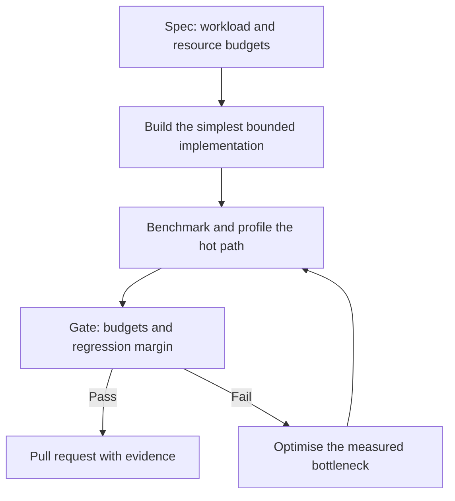

# Performance and memory: budgets before building

Write the resource budget before the implementation. Measure the hot path,
keep memory bounded, and make the repository's gate reject regressions.

**The spec and benchmark check are the source of truth.** This page defines
what each project must record and enforce. It supplies no universal latency,
throughput, or memory target. Project owners choose those values from the
workload and deployment constraints.

Audience: engineers and technical leads building services, jobs, and data
pipelines.

Skill: none yet.

## Sources

Primary sources checked on 2026-11-26:

- [pyperf benchmark guidance](https://pyperf.readthedocs.io/en/latest/run_benchmark.html):
  repeated measurements, warmups, and unstable results.
- [Kubernetes resource management](https://kubernetes.io/docs/concepts/configuration/manage-resources-containers/):
  memory requests, limits, and out-of-memory termination.
- [Apache Spark configuration](https://spark.apache.org/docs/latest/configuration.html):
  executor heap, memory overhead, off-heap memory, and PySpark memory.
- [Airflow Celery provider configuration](https://airflow.apache.org/docs/apache-airflow-providers-celery/stable/configurations-ref.html):
  worker concurrency and prefetch settings.

Budgets, bounded collections, evidence requirements, and regression gates on
this page are engineering policy. The sources explain runtime controls and
measurement mechanics; they do not prescribe project budgets. Check the
configuration reference for the version deployed before choosing settings.

## At a glance

Takeaway: budgets define success, measurements identify misses, and the gate
keeps the accepted result from regressing.

| Decision | Default |
| --- | --- |
| Latency | Specify the operation, percentile, maximum duration, and offered load |
| Throughput | Specify minimum completed work per unit of time at that load |
| Peak memory | Specify the measurement scope, maximum bytes, and workload size |
| Data handling | Stream or paginate; bound all retained data and concurrent work |
| Implementation | Use the simplest structure that passes the budgets |
| Delivery | Attach evidence and run a hot-path regression benchmark in the gate |

## Decision guide

### Set budgets before building

Record these fields in the spec and review them before implementation:

| Field | Required detail |
| --- | --- |
| Workload | Operation or job, input size and distribution, largest supported item, concurrency, and duration |
| Latency budget | Percentile and maximum duration; include queue time where callers experience it |
| Throughput budget | Minimum successful completions per unit of time; count errors and timeouts separately |
| Peak-memory budget | Maximum bytes; name process, container, executor, or whole-job scope and include child processes where relevant |
| Environment | Hardware class, runtime and dependency versions, resource limits, and cold or warm state |
| Gate policy | Benchmark command, baseline commit, regression margin per metric, repetitions, and noise-handling rule |
| Owner | Who approves a budget or baseline change and the reason for that change |

Keep the memory budget below the enforced limit with explicit headroom.
Account for runtime overhead and maximum concurrent work. A latency result
without an input size and load is insufficient evidence. If a metric does
not apply, record why and name the completion measure that replaces it.

### Measure before optimising

1. Identify the hot path: the operation expected to dominate execution time
   or resource use. Confirm it with a representative benchmark or profile.
2. Measure the base commit and candidate under the same workload and
   environment. Repeat runs, declare warmup, and report variation. Measure
   cold starts separately when startup affects the budget.
3. Record latency, successful throughput, and peak memory against their
   budgets. Name the memory instrument and its scope. A language allocation
   profile alone cannot establish whole-container peak memory.
4. Attach commands, commit identifiers, workload definition, environment,
   and before/after results to the pull request. Use synthetic or approved
   public inputs. Keep profiles free of private payloads and identifiers.
5. If a budget is missed, profile CPU time, allocations, retained memory,
   or input/output waits as relevant. Change the measured bottleneck and
   rerun the same benchmark. A profile identifies causes; timed and memory
   measurements establish whether the budget passes.

For a new path with no baseline, compare the first measured implementation
with the absolute budgets. Keep that reviewed result as the initial baseline.

### Bound memory by default

- Stream or paginate datasets. Do not load a complete input merely to iterate
  over it. Ensure downstream operations also stream; collecting the output
  recreates the same memory problem.
- Bound every queue, cache, batch, and in-memory collection. Define maximum
  entries and bytes where item size varies. Bound item size at ingress.
- Define what happens at each bound: apply backpressure, reject work, evict
  cache entries, flush a batch, or spill to bounded storage. Test that
  behaviour. Cache expiry alone does not bound a burst of new entries.
- Bound concurrency and outstanding requests. Include retry buffers,
  prefetch, serialization copies, and per-worker state in the memory budget.
- Test maximum supported input, skewed partitions, and a slow consumer.
  Include a sustained run when retained memory could grow with time.
  An empty queue after a short run does not prove bounded retention.

### Set service and job limits

Every service and job must have an explicit enforced memory limit in its
deployment or execution configuration. Inspect the effective configuration,
not only the checked-in template.

| Runtime | What to configure and verify |
| --- | --- |
| Container service or job | Set a memory limit and an appropriate scheduling request. Include sidecars in the overall deployment budget. Kubernetes memory limits can lead to out-of-memory termination; test failure and recovery below production load. |
| Spark job | Set executor memory and overhead explicitly. Account for off-heap and Python memory where used, bound executor count and task concurrency, and give the driver its own limit. A heap setting alone is not a whole-executor bound. |
| Airflow worker | Enforce a limit on the worker container or process group. Set executor-specific concurrency and prefetch from per-task memory measurements. Pools and concurrency controls limit work counts; they do not cap bytes. Give separately launched task containers their own limits. |
| Other service or batch process | Use the execution platform's enforced process or job memory limit. Include children and document how exceeding the limit fails and recovers. |

For Spark on YARN or Kubernetes, executor container sizing includes executor
memory, overhead, configured off-heap memory, and configured PySpark memory.
Use the deployed Spark version's rules. For Airflow, choose controls for the
actual executor; Celery settings do not apply to every executor.

### Choose the simplest structure

Use existing structures and libraries when they meet the budget. Consider
algorithmic complexity and retained data before adding caches, concurrency,
or a second execution path. Every optimisation must preserve correctness
and the declared resource bounds.

If measurements pass, stop optimising. If they fail, change one measured
bottleneck at a time and keep the evidence. A larger cache or more workers
requires a new memory calculation and another load test.

### Gate performance regressions

Add a representative hot-path benchmark to the same gate used locally and
in continuous integration (CI). The project implements the benchmark and
comparison check; this playbook does not supply a universal runner.

The check must exit nonzero when:

- latency or peak memory exceeds its absolute budget;
- successful throughput falls below its absolute budget;
- latency or peak memory rises above `baseline * (1 + margin)`;
- throughput falls below `baseline * (1 - margin)`; or
- a required measurement or comparable baseline is missing or invalid.

Use a separate agreed fractional margin per metric. Define the statistic
being compared and choose margins from observed measurement variation.
Do not silently pass an unstable run. Use a bounded rerun policy; if the
result remains inconclusive, block acceptance until comparable evidence is
available. Run the required comparison on a controlled runner when shared
CI noise prevents a reliable result.

Store benchmark definitions and budget policy in version control. Preserve
results as gate artifacts. Change a budget or baseline only through review
with an explanation; never regenerate the baseline merely to turn a failure
green. For gate structure and flake governance, follow
[CI for agentic engineering](../../ci-for-agentic-engineering.md).

## Checklist

- [ ] The spec states workload, latency, throughput, and peak-memory budgets.
- [ ] The spec names the environment, owner, and regression margins.
- [ ] Hot-path changes include reproducible before/after evidence against budgets.
- [ ] Data streams end to end; retained data and concurrency have explicit bounds.
- [ ] Every bound has defined and tested behaviour when reached.
- [ ] Every service and job has an enforced memory limit with headroom.
- [ ] Peak-memory measurements cover the declared process or job scope.
- [ ] Maximum-size input and sustained-load cases pass where relevant.
- [ ] The gate rejects budget misses, regressions, and invalid evidence.
- [ ] The implementation meets the budget with the simplest suitable structure.

## Rules of thumb

- Optimise the measured bottleneck. Keep a passing simple implementation.
- A bounded batch inside an unbounded queue still permits unbounded memory.
- A cache needs a capacity bound as well as an expiry policy.
- More concurrency spends memory; measure the tradeoff before increasing it.
- Compare successful work at the required load. Fast failures do not satisfy
  a throughput or latency budget.
- A memory limit contains a failure; bounded application behaviour prevents it.

## Claim review

- [x] No project performance results or universal budgets are claimed.
- [x] Runtime facts trace to primary documentation; policy is labelled as policy.
- [x] Measurement scope, environment, and evidence limits remain explicit.

## Privacy review

- [x] No employer material.
- [x] No customer material.
- [x] No private-repository material.
- [x] No trace material.
- [x] No transcript material.
