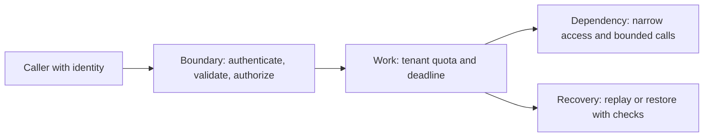

# Secure and reliable systems: make the safe path the default

A failed dependency and a compromised dependency can expose the same weak
boundary. Design the service so either event has limited consequences and a
recovery path that operators can use under pressure.

**Audience:** engineers and technical leads building data platforms, machine
learning (ML) platforms, and services. Use this page during design review and
before changes to access, dependencies, deployment, or recovery. The decision
tables and examples are local recommendations, not claims of certification or
production results.

Skill: none yet.

## Sources

Primary sources consulted on 2026-11-26. All guidance is written in original
words; the examples are synthetic.

- [Building Secure and Reliable Systems](https://google.github.io/building-secure-and-reliable-systems/raw/toc.html),
  edited by Heather Adkins, Betsy Beyer, Paul Blankinship, Piotr Lewandowski,
  Ana Oprea, and Adam Stubblefield. Chapters 5–9 connect least privilege,
  understandability, resilience, and recovery; chapters 12–17 cover code,
  testing, deployment, investigation, and response. This page turns those
  design themes into review questions and checks.
- [NIST SP 800-207: Zero Trust Architecture](https://csrc.nist.gov/pubs/sp/800/207/final):
  network location alone does not establish trust. Access decisions concern
  identities and resources.
- [OWASP Input Validation Cheat Sheet](https://cheatsheetseries.owasp.org/cheatsheets/Input_Validation_Cheat_Sheet.html):
  validate syntax and meaning at input boundaries; validation does not replace
  parameterized queries or context-specific output encoding.
- [OWASP Secrets Management Cheat Sheet](https://cheatsheetseries.owasp.org/cheatsheets/Secrets_Management_Cheat_Sheet.html):
  control the credential lifecycle, including storage, access, rotation,
  revocation, and audit.
- [SLSA specification v1.2](https://slsa.dev/spec/v1.2/): Supply-chain Levels
  for Software Artifacts (SLSA) describes supply-chain guarantees and build
  provenance. Verification must connect the artifact to an expected producer
  and build process.
- [Timeouts, retries, and backoff with jitter](https://aws.amazon.com/builders-library/timeouts-retries-and-backoff-with-jitter/),
  Amazon Builders' Library: deadlines and bounded retries limit amplification;
  randomized delay spreads retry traffic.
- [The Site Reliability Workbook: Canarying Releases](https://sre.google/workbook/canarying-releases/):
  evaluate a limited rollout against a control before increasing exposure.

## At a glance



Takeaway: every transition needs an explicit permission, resource limit, and
failure outcome.

| Question | Default | Evidence before release |
| --- | --- | --- |
| Who may do what? | Resource-scoped authorization; separate runtime and deployment roles | Wrong-tenant and revoked-identity requests fail |
| What does missing configuration mean? | Startup fails or the operation is denied | Omitted security settings cannot enable access |
| What can one failure affect? | Tenant quotas and separate pools for critical work | Saturating batch work leaves serving capacity |
| What if completion is unknown? | Reconcile by operation identity before replay | Crash-after-commit test creates one result |
| What if a release is wrong? | Small canary, explicit stop signals, tested recovery | Abort and recovery rehearsal |

Start with a one-page boundary record: assets and sensitivity, callers,
operations, data owners, dependencies, failure domains, and recovery owner.
Name the confidentiality, integrity, and availability requirements separately.
Record the acceptable outage and data-loss windows; do not invent universal
numbers for all services.

## Decision guide

### Least privilege and zero trust

- Authenticate service-to-service calls as well as user calls. Validate the
  expected issuer, audience, expiry, and credential status using a maintained
  identity library. Encryption protects transport; it does not authorize an
  operation.
- Authorize the actor, action, tenant, and resource at the service boundary.
  Derive tenant scope from verified identity and policy. A request's tenant id
  is a requested target, not proof of membership.
- Give ingestion workers write access only to their assigned landing area.
  Give feature readers read access only to approved datasets. Separate model
  publication, model serving, and training permissions.
- Separate human administration, build, deployment, and runtime identities.
  Avoid wildcard permissions. Review unused grants and recheck authorization
  when long-running jobs cross a new privilege boundary.
- If the authorization service is unavailable, deny protected work. Any cached
  policy needs an explicit freshness bound and revocation design. Keep public
  health reporting independent of protected data access.

| Situation | Choose | Avoid |
| --- | --- | --- |
| Workload needs storage access | Short-lived workload identity scoped to a dataset | One shared account with all buckets |
| Operator needs emergency access | Time-limited break-glass role with alert and later review | Permanent administrator credentials in a runbook |
| Worker calls another service | Authenticate the worker and constrain delegated user scope | Trusting a request because it came from a private subnet |

Checks: exercise the real authorization boundary with a wrong tenant, expired
identity, absent grant, and policy outage. Review effective permissions, not
only the role's name.

### Understandability and safe defaults

Use one owned enforcement path for authentication, authorization, deadlines,
and audit events. Document which component owns each decision. Keep security
configuration small enough that a reviewer can determine the effective policy.

For a dataset export, write invariants such as: only an authorized tenant can
start an export; exports cannot escape that tenant's destination; retries
cannot publish a second export. Map each invariant to an enforcing component
and an executable check.

- Make anonymous access an explicit route declaration. A missing policy denies
  access. Reject unknown security settings and invalid combinations at startup.
- Prefer narrow commands such as `publish_validated_model` to a general
  `execute_command` interface. Keep privileged operations out of generic
  metadata updates.
- Reject unnecessary runtime switches that create untested policy combinations.
  Give temporary exceptions an owner, expiry, and removal check.

Checks: configuration tests cover omission and invalid combinations. Architecture
checks prevent routes from bypassing the shared boundary. Reviewers still
inspect whether the boundary applies the correct resource policy.

### Safe construction and untrusted input

Parse at the boundary; pass validated values into domain code. A static type
annotation or a cast does not validate bytes received over a network.

Conceptual interface, not executable library code:

```pseudocode
parse_export_request(raw_bytes, size_limit) -> Result<ExportRequest, InputError>
authorize_export(identity, request.dataset) -> Result<ExportGrant, AccessError>
start_export(request, grant) -> OperationId
```

`ExportRequest` has a bounded row limit, a parsed dataset identifier, and an
allowed output format. Its constructor enforces those properties. An
`ExportGrant` is created only by the authorization component and binds the
actor, dataset, and operation. The service checks expiry and current policy
when using the grant; possessing an old value cannot bypass revocation.

- Bound bytes before parsing, then bound nesting, collection length, numeric
  ranges, decompressed size, and processing time. Include event payloads,
  uploaded datasets, model metadata, and configuration in the input inventory.
- Separate syntax checks from business rules. A well-formed dataset id can
  still name another tenant's data.
- Use parameterized queries, safe subprocess argument APIs, and appropriate
  output encoding. Validation alone cannot prevent injection.
- Treat user-supplied URLs and file paths as capabilities. Restrict destinations
  and egress; check redirects and resolved addresses. Use established safe file
  access primitives rather than trusting string-prefix checks.
- Load untrusted model artifacts only through reviewed formats and constrained
  loaders. Formats that execute code require isolation and explicit approval.

Checks: fuzz boundary parsers; test oversized, malformed, and wrong-tenant
inputs. Confirm invalid requests cause no writes and errors reveal no secrets.
See [API design](api-design.md) for HTTP contracts, errors, and idempotency.

### Defence in depth and blast radius

Pick controls with different failure modes. A gateway and service sharing the
same incorrect authorization rule do not provide independent protection.

| Failure | Independent limits | Verification |
| --- | --- | --- |
| Compromised ingestion worker | Scoped storage role, restricted egress, tenant write limits | Worker cannot read serving secrets or write another tenant's prefix |
| Expensive query or training job | Admission quota, execution budget, cancellation, separate serving pool | Serving latency stays within its objective under batch saturation |
| Faulty deployment | Canary scope, deployment role limits, halt control outside the new release | Operator can stop expansion when the new service is unhealthy |
| Corrupted or deleted dataset | Versioned recovery copy with separate deletion authority | Restore produces the expected data and access policy |

Partition by tenant or cell when isolation requirements justify the operating
cost. Two replicas with the same identity, release, and storage dependency
share those failure modes. Record the dependencies a recovery path still needs.

Checks: policy tests prove forbidden cross-boundary access. Load tests measure
queue age, memory, and critical-path latency during saturation. For data
structure and allocation choices, use the companion performance-and-memory
playbook once available at `performance-and-memory.md`; this page owns the
resource limits and failure outcomes.

### Secrets and rotation

Prefer short-lived identity over stored secrets. When a secret is necessary,
retrieve it through an access-controlled secret manager. Keep it out of source,
images, command arguments, telemetry, datasets, and model artifacts. Redact at
the producer; do not rely only on a downstream log filter.

1. Record the secret's owner, consumers, scope, expiry, and revocation method.
2. Issue a replacement with the same narrow permissions. If the protocol allows
   overlap, accept both versions for a bounded transition.
3. Switch consumers and verify successful use of the replacement.
4. Revoke the old credential and prove it fails. Remove stale copies.

If compromise is suspected, prioritize revocation and containment even when
normal overlap would reduce disruption. Test reload behaviour and secret-manager
outages. Cached credentials need an expiry and a defined failure outcome.
Encryption-key rotation also needs a plan for reading retained encrypted data;
revoking a service token is a different operation.

Checks: secret scanning in commit and build gates, a rotation rehearsal without
logging values, and an audit event for issuance, access, and revocation.

### Supply-chain security

- Review why a dependency is needed, its maintenance, license, transitive
  dependencies, execution hooks, and access during build. A familiar package
  name is not evidence that a particular artifact is safe.
- Commit lockfiles; pin container images by digest and automation actions by
  immutable revision. Verify downloaded artifact digests against a trusted
  source. Schedule reviewed updates so pinning does not freeze vulnerabilities.
- Build in an isolated environment with narrow credentials. Untrusted pull
  requests must not receive production or publishing secrets.
- Produce a software bill of materials and build provenance. Before deployment,
  verify the digest and the expected source, builder, and build policy. A valid
  signature from an unexpected identity is insufficient.
- Scan for vulnerabilities and define a remediation owner and deadline based
  on exposure. Exceptions need an expiry and compensating controls. Provenance
  establishes origin; it does not prove the code is free of vulnerabilities.

Checks: a clean build consumes the lockfile; policy rejects an unexpected
artifact producer or altered digest. Review dependency changes alongside code.

### Recovery and overload

| Condition | Response | Guard |
| --- | --- | --- |
| Optional ranking dependency fails | Serve an approved simpler ranking | Preserve authorization and label changed behaviour where relevant |
| Feature data is stale | Use bounded-staleness data only when the product contract permits | Include age/version; fail when the freshness bound is exceeded |
| Admission capacity is exhausted | Shed low-priority work before enqueueing | Bounded queue, tenant fairness, explicit rejection |
| Transient dependency failure | Retry only replay-safe operations within budget | Deadline, attempt cap, backoff with jitter |
| Authorization or integrity check fails | Reject the operation | Never disable the check to improve availability |

Propagate a request deadline and cancellation to downstream work. Bound queue
length, connections, concurrency, payload size, and per-tenant work. Measure
queue age as well as depth. A circuit breaker can stop repeated calls to a
failing dependency; give it bounded probes and test recovery to avoid leaving
it stuck open.

Choose one retry owner in a call chain. Retry only classified transient failures,
and honor server retry guidance when it fits the remaining deadline. Use a
capped exponential delay with random jitter, a finite attempt count, and a
shared retry budget. Stop when cancellation, deadline, or budget wins. Three
layers making three attempts each can cause 27 calls to the final dependency.

A timeout means the caller lacks an answer; the write may have committed.
Scope an idempotency key by tenant and operation, bind it to a request
fingerprint, and commit the deduplication record with the side effect when
possible. Reject key reuse with different input. If a remote side effect cannot
share the transaction, use an outbox and receiver deduplication or reconcile
operation state before replay. Document retention and behaviour after expiry.
Do not claim exactly-once effects from a queue's delivery guarantee alone.

Checks: cancel in-flight work, saturate admission, and crash after commit before
response. Assert bounded resource use, one committed effect, and eventual
recovery. Use [API design's idempotency contract](api-design.md#idempotency-keys)
for HTTP details.

### Safe rollout and rollback

Release immutable artifacts and versioned configuration through the same review
path. Record the previous artifact, configuration, schema, and model/data
versions needed for recovery.

1. Rehearse recovery in an isolated environment with representative data.
2. Canary a limited tenant or traffic cohort. Compare errors, latency,
   saturation, and relevant data or model quality against a control.
3. Expand only after a defined observation window and sufficient representative
   traffic. Stop on recorded thresholds; aggregate success can hide one tenant's
   failures.
4. Abort expansion on a breach and execute the tested recovery path. Verify
   restored behaviour and data integrity before resuming.

Code rollback cannot undo a destructive migration, emitted events, or an
external write. Use staged schema changes with a documented compatibility
window when real consumers require it. Otherwise plan a restore, compensating
operation, or forward repair before release. Keep the halt and recovery controls
usable when the primary control plane is unavailable.

Checks: deployment rehearsal proves the abort signal stops expansion and the
previous version can read current data. A backup job succeeding is insufficient;
measure restore time and verify the recovered data against the agreed data-loss
window.

### Verification and incident readiness

Turn the decision record into release evidence. Checks below are requirements
to implement in the service repository; this document does not install them.

| Exercise | Observable pass condition |
| --- | --- |
| Wrong-tenant access and policy outage | Protected reads and writes denied; no data disclosed |
| Credential rotation and revocation | Replacement works; revoked credential fails; no secret in logs |
| Dependency timeout and retry storm | Attempts and total work remain bounded; critical work survives |
| Duplicate delivery and crash after commit | One durable effect; consistent replay response |
| Corrupt input and parser fuzzing | Bounded time/memory; no unauthorized side effect |
| Lost dependency or failed canary | Degradation stays within contract; expansion stops |
| Restore from a separate recovery copy | Data and permissions verified within recovery objectives |

Run small, deterministic fault tests in continuous integration (CI). Rehearse
multi-component failures in an isolated environment. A production resilience
experiment needs an owner, explicit scope, abort signals, and a tested cleanup
path; start with the smallest affected cohort.

Before launch, assign an on-call owner and incident roles. Provide symptom-based
runbooks for overload, credential compromise, bad rollout, and data corruption.
Include first containment action, escalation route, recovery steps, validation,
and stop conditions. Rehearse emergency access and communications without
relying solely on the failing service.

Record request/operation ids, artifact and policy versions, authorization
outcomes, and recovery actions. Protect audit integrity and retention; restrict
access. Exclude credentials and sensitive payloads. Alert on user-visible
failures and credible security signals. After an incident, assign corrective
actions to owners and verify the resulting control or regression test.

For agents, use the [agentic SRE practice](../agentic-sre/README.md), especially
[blast radius](../agentic-sre/blast-radius.md),
[releases](../agentic-sre/releases.md), and
[incidents](../agentic-sre/incidents.md). Those pages own autonomy limits,
agent evaluation gates, and agent-specific incident response.

## Checklist

- [ ] Each trust boundary names the identity, resource, policy owner, and denial path.
- [ ] Unsafe inputs and configuration cannot bypass the shared safe API.
- [ ] Tenant resource limits and failure domains have executable checks.
- [ ] Credentials can rotate and revoke; artifacts have verified origin and update owners.
- [ ] Deadlines, retry budgets, deduplication, and degradation outcomes are explicit.
- [ ] Canary abort, rollback or forward repair, and data restore have been rehearsed.
- [ ] Responders have alerts, protected evidence, working access, and runbooks.

## Rules of thumb

- If an operation cannot be replayed safely, reconcile before retrying it.
- If two safeguards depend on the same failing component, test that shared failure.
- If recovery requires the broken service to be healthy, design another access path.
- If a check can enforce a recurring invariant, put that check in the service gate.

## Claim review

- [x] Sources support the design principles; decision tables are local recommendations.
- [x] The export example is synthetic and makes no production performance claim.
- [x] Service checks are required follow-up, not tools installed by this page.

## Privacy review

- [x] No employer, customer, or private-repository material.
- [x] No private project, machine, or client names.
- [x] No traces, transcripts, secrets, or sensitive payloads.
