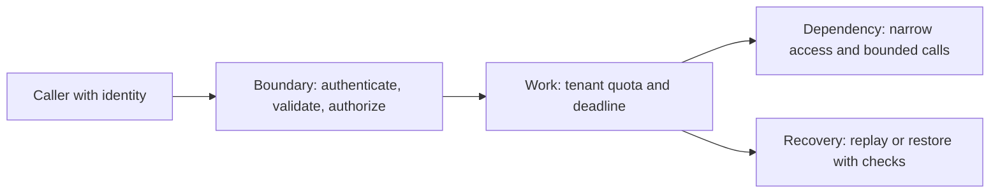

# Secure and reliable systems: make the safe path the default

A failed dependency and a compromised dependency can expose the same weak
boundary. Design the service so either event has limited consequences and a
recovery path that operators can use under pressure.

**Audience:** engineers and technical leads building data platforms, machine
learning (ML) platforms, and services. Use this page during design review and
before changes to access, dependencies, deployment, or recovery. The decision
tables and examples are local recommendations, not claims of certification or
production results.

Skill: none yet.

## Sources

Primary sources consulted on 2026-11-26. All guidance is written in original
words; the examples are synthetic.

- [Building Secure and Reliable Systems](https://google.github.io/building-secure-and-reliable-systems/raw/toc.html),
  edited by Heather Adkins, Betsy Beyer, Paul Blankinship, Piotr Lewandowski,
  Ana Oprea, and Adam Stubblefield. Chapters 5–9 connect least privilege,
  understandability, resilience, and recovery; chapters 12–17 cover code,
  testing, deployment, investigation, and response. This page turns those
  design themes into review questions and checks.
- [NIST SP 800-207: Zero Trust Architecture](https://csrc.nist.gov/pubs/sp/800/207/final):
  network location alone does not establish trust. Access decisions concern
  identities and resources.
- [OWASP Input Validation Cheat Sheet](https://cheatsheetseries.owasp.org/cheatsheets/Input_Validation_Cheat_Sheet.html):
  validate syntax and meaning at input boundaries; validation does not replace
  parameterized queries or context-specific output encoding.
- [OWASP Secrets Management Cheat Sheet](https://cheatsheetseries.owasp.org/cheatsheets/Secrets_Management_Cheat_Sheet.html):
  control the credential lifecycle, including storage, access, rotation,
  revocation, and audit.
- [SLSA specification v1.2](https://slsa.dev/spec/v1.2/): Supply-chain Levels
  for Software Artifacts (SLSA) covers both Build and Source Tracks. The
  [v1.2 changes](https://slsa.dev/spec/v1.2/whats-new) add source provenance,
  history, and continuous enforcement of source controls alongside build
  provenance. Verify the required track and level rather than assuming one
  attestation covers both.
- [Timeouts, retries, and backoff with jitter](https://aws.amazon.com/builders-library/timeouts-retries-and-backoff-with-jitter/),
  Amazon Builders' Library: deadlines and bounded retries limit amplification;
  randomized delay spreads retry traffic.
- [The Site Reliability Workbook: Canarying Releases](https://sre.google/workbook/canarying-releases/):
  evaluate a limited rollout against a control before increasing exposure.

- [NIST SP 800-218: Secure Software Development Framework (SSDF) v1.1](https://csrc.nist.gov/pubs/sp/800/218/final)
  and [OWASP Application Security Verification Standard (ASVS) v5.0.0](https://asvs.owasp.org/):
  secure development practices and versioned verification requirements.
  OWASP's [Threat Modeling](https://cheatsheetseries.owasp.org/cheatsheets/Threat_Modeling_Cheat_Sheet.html),
  [Cryptographic Storage](https://cheatsheetseries.owasp.org/cheatsheets/Cryptographic_Storage_Cheat_Sheet.html),
  and [Logging](https://cheatsheetseries.owasp.org/cheatsheets/Logging_Cheat_Sheet.html)
  cheat sheets and [API Security Top 10](https://owasp.org/API-Security/) inform
  the boundary, encryption, and audit checks below.
- *Site Reliability Engineering*: [Handling Overload](https://sre.google/sre-book/handling-overload/),
  [Addressing Cascading Failures](https://sre.google/sre-book/addressing-cascading-failures/),
  and [Service Level Objectives](https://sre.google/sre-book/service-level-objectives/):
  capacity, request criticality, retry budgets, and reliability targets.
- [Workload isolation using shuffle-sharding](https://aws.amazon.com/builders-library/workload-isolation-using-shuffle-sharding/),
  Amazon Builders' Library: limiting correlated tenant impact through subsets
  of a shared worker pool.
- [CNCF Cloud Native Security Whitepaper](https://www.cncf.io/reports/cloud-native-security-whitepaper/),
  [SPIFFE Overview](https://spiffe.io/docs/latest/spiffe-about/overview/), and
  [Sigstore Overview](https://docs.sigstore.dev/about/overview/): lifecycle
  controls, workload identity, and artifact signing with transparency evidence.
- [Principles of Chaos Engineering](https://principlesofchaos.org/): test a
  measurable steady-state hypothesis under controlled failure injection.

## At a glance



Takeaway: every transition needs an explicit permission, resource limit, and
failure outcome.

| Question | Default | Evidence before release |
| --- | --- | --- |
| Who may do what? | Resource-scoped authorization; separate runtime and deployment roles | Wrong-tenant and revoked-identity requests fail |
| What does missing configuration mean? | Startup fails or the operation is denied | Omitted security settings cannot enable access |
| What can one failure affect? | Tenant quotas and separate pools for critical work | Saturating batch work leaves serving capacity |
| What if completion is unknown? | Reconcile by operation identity before replay | Crash-after-commit test creates one result |
| What if a release is wrong? | Small canary, explicit stop signals, tested recovery | Abort and recovery rehearsal |

Start with a one-page boundary record: assets and sensitivity, callers,
operations, data owners, dependencies, failure domains, and recovery owner.
Name the confidentiality, integrity, and availability requirements separately.
Record the acceptable outage and data-loss windows; do not invent universal
numbers for all services.

## Decision guide

### Threat model and verification baseline

Before adding a trust boundary, ask what the service does, how it could fail or
be attacked, which controls address those cases, and how to verify the controls.
Walk the data-flow diagram through spoofing, tampering, repudiation, information
disclosure, denial of service, and elevation of privilege (STRIDE). Record the
asset, attacker capability, mitigation owner, residual risk, and test for each
material threat. Repeat when identities, data flows, or external dependencies
change. See the [OWASP threat-modeling workflow](https://cheatsheetseries.owasp.org/cheatsheets/Threat_Modeling_Cheat_Sheet.html).

Use SSDF to organize preparation, software protection, secure production, and
vulnerability response. Select ASVS requirements for the service's risk and
record their pinned identifiers as `v5.0.0-<chapter>.<section>.<requirement>` next
to tests or review evidence. Record justified exclusions. This mapping supports
review; it does not establish certification. Include wrong-object and
wrong-function authorization tests: permission to read one dataset does not
permit another dataset or an administrator-only action.

### Least privilege and zero trust

- Authenticate service-to-service calls as well as user calls. Validate the
  expected issuer, audience, expiry, and credential status using a maintained
  identity library. Encryption protects transport; it does not authorize an
  operation.
- Authorize the actor, action, tenant, and resource at the service boundary.
  Derive tenant scope from verified identity and policy. A request's tenant id
  is a requested target, not proof of membership.
- Give ingestion workers write access only to their assigned landing area.
  Give feature readers read access only to approved datasets. Separate model
  publication, model serving, and training permissions.
- Separate human administration, build, deployment, and runtime identities.
  Avoid wildcard permissions. Review unused grants and recheck authorization
  when long-running jobs cross a new privilege boundary.
- Deny protected work when the service cannot establish authorization. Avoid
  making every check depend on a central policy decision service: use verified
  local policy bundles or short-lived signed capabilities when the revocation
  requirement permits bounded staleness. Record maximum policy age, expiry,
  revocation delivery, and the outcome when those bounds are exceeded. Immediate
  revocation through a synchronous policy call adds availability and latency
  coupling. Document the break-glass path and its limits. Keep public health
  reporting independent of protected data access.
- For identity across clusters, evaluate SPIFFE identities and its Workload API
  instead of distributing static service keys. X.509 or JWT SPIFFE Verifiable
  Identity Documents (SVIDs) identify an attested workload; authorization still
  decides what that workload may do. Test identity rotation and issuer outages.

| Situation | Choose | Avoid |
| --- | --- | --- |
| Workload needs storage access | Short-lived workload identity scoped to a dataset | One shared account with all buckets |
| Operator needs emergency access | Time-limited break-glass role with alert and later review | Permanent administrator credentials in a runbook |
| Worker calls another service | Authenticate the worker and constrain delegated user scope | Trusting a request because it came from a private subnet |

Checks: exercise the real authorization boundary with a wrong tenant, expired
identity, absent grant, and policy outage. Review effective permissions, not
only the role's name.

### Understandability and safe defaults

Use one owned enforcement path for authentication, authorization, deadlines,
and audit events. Document which component owns each decision. Keep security
configuration small enough that a reviewer can determine the effective policy.

For a dataset export, write invariants such as: only an authorized tenant can
start an export; exports cannot escape that tenant's destination; retries
cannot publish a second export. Map each invariant to an enforcing component
and an executable check.

- Make anonymous access an explicit route declaration. A missing policy denies
  access. Reject unknown security settings and invalid combinations at startup.
- Prefer narrow commands such as `publish_validated_model` to a general
  `execute_command` interface. Keep privileged operations out of generic
  metadata updates.
- Reject unnecessary runtime switches that create untested policy combinations.
  Give temporary exceptions an owner, expiry, and removal check.

Checks: configuration tests cover omission and invalid combinations. Architecture
checks prevent routes from bypassing the shared boundary. Reviewers still
inspect whether the boundary applies the correct resource policy.

### Safe construction and untrusted input

Parse at the boundary; pass validated values into domain code. A static type
annotation or a cast does not validate bytes received over a network.

Conceptual interface, not executable library code:

```pseudocode
parse_export_request(raw_bytes, size_limit) -> Result<ExportRequest, InputError>
authorize_export(identity, request.dataset) -> Result<ExportGrant, AccessError>
start_export(request, grant) -> OperationId
```

`ExportRequest` has a bounded row limit, a parsed dataset identifier, and an
allowed output format. Its constructor enforces those properties. An
`ExportGrant` is created only by the authorization component and binds the
actor, dataset, and operation. At use, validate expiry and the selected policy
freshness or revocation mechanism. Choose synchronous policy checks when the
required revocation latency demands them; otherwise use bounded local policy
and revocation updates. Test and document the maximum time a revoked grant can
remain usable. A type alone cannot make a distributed revocation instantaneous.

- Bound bytes before parsing, then bound nesting, collection length, numeric
  ranges, decompressed size, and processing time. Include event payloads,
  uploaded datasets, model metadata, and configuration in the input inventory.
- Separate syntax checks from business rules. A well-formed dataset id can
  still name another tenant's data.
- Use parameterized queries, safe subprocess argument APIs, and appropriate
  output encoding. Validation alone cannot prevent injection.
- Treat user-supplied URLs and file paths as capabilities. Restrict destinations
  and egress; check redirects and resolved addresses. Use established safe file
  access primitives rather than trusting string-prefix checks.
- Load untrusted model artifacts only through reviewed formats and constrained
  loaders. Formats that execute code require isolation and explicit approval.

Enforce the safe API with static rules that reject unsafe query construction,
shell interpolation, or unsafe deserialization outside a reviewed boundary
module. Restrict exceptions by path and owner; test the rule against a known
unsafe call. Safe framework types reduce vulnerability classes, but casts and
uncontrolled constructors can defeat them. Use the framework and static checks
together, following *Building Secure and Reliable Systems*, chapter 12.

Checks: fuzz boundary parsers; test oversized, malformed, and wrong-tenant
inputs. Confirm invalid requests cause no writes and errors reveal no secrets.
See [API design](api-design.md) for HTTP contracts, errors, and idempotency.

### Defence in depth and blast radius

Pick controls with different failure modes. A gateway and service sharing the
same incorrect authorization rule do not provide independent protection.

| Failure | Independent limits | Verification |
| --- | --- | --- |
| Compromised ingestion worker | Scoped storage role, restricted egress, tenant write limits | Worker cannot read serving secrets or write another tenant's prefix |
| Expensive query or training job | Admission quota, execution budget, cancellation, separate serving pool | Serving latency stays within its objective under batch saturation |
| Faulty deployment | Canary scope, deployment role limits, halt control outside the new release | Operator can stop expansion when the new service is unhealthy |
| Corrupted or deleted dataset | Versioned recovery copy with separate deletion authority | Restore produces the expected data and access policy |

Partition by tenant or cell when isolation requirements justify the operating
cost. Two replicas with the same identity, release, and storage dependency
share those failure modes. Record the dependencies a recovery path still needs.

When dedicated tenant pools cost too much, evaluate shuffle sharding: assign
each tenant a stable subset of workers and retain routing and quotas during
failure. Subsets can overlap. More combinations do not directly imply a smaller
outage fraction: impact depends on overlap, spare capacity, and whether each
request needs one healthy worker or every assigned worker. Test partial and
complete shard failures and prevent failover from spilling into the whole pool.
See [Workload isolation using shuffle-sharding](https://aws.amazon.com/builders-library/workload-isolation-using-shuffle-sharding/).

Checks: policy tests prove forbidden cross-boundary access. Load tests measure
queue age, memory, and critical-path latency during saturation. For data
structure and allocation choices, use [Performance and memory](performance-and-memory.md);
this page owns the resource limits and failure outcomes.

### Secrets and rotation

Prefer short-lived identity over stored secrets. When a secret is necessary,
retrieve it through an access-controlled secret manager. Keep it out of source,
images, command arguments, telemetry, datasets, and model artifacts. Redact at
the producer; do not rely only on a downstream log filter.

1. Record the secret's owner, consumers, scope, expiry, and revocation method.
2. Issue a replacement with the same narrow permissions. If the protocol allows
   overlap, accept both versions for a bounded transition.
3. Switch consumers and verify successful use of the replacement.
4. Revoke the old credential and prove it fails. Remove stale copies.

If compromise is suspected, prioritize revocation and containment even when
normal overlap would reduce disruption. Test reload behaviour and secret-manager
outages. Cached credentials need an expiry and a defined failure outcome.
Encryption-key rotation also needs a plan for reading retained encrypted data;
revoking a service token is a different operation.

Checks: secret scanning in commit and build gates, a rotation rehearsal without
logging values, and an audit event for issuance, access, and revocation.

### Cryptographic storage

Use maintained cryptographic libraries and authenticated encryption, such as an
approved AES-GCM implementation. Enforce nonce uniqueness for each key through
the library or storage service; do not invent algorithms or manage nonces with
unchecked application counters. Minimize retained sensitive data first.

For envelope encryption, a data encryption key (DEK) encrypts the dataset; a key
encryption key (KEK) in a separate key-management boundary wraps the DEK. Wrapped
DEKs may accompany ciphertext; protect plaintext DEKs and keep the KEK outside
the data store. Separate decrypt permission from storage read access. Rotating
a KEK can rewrap DEKs without rewriting all data. A compromised DEK needs a
data re-encryption and exposure-response plan. Test restore and key availability
for retained backups. See [OWASP Cryptographic Storage](https://cheatsheetseries.owasp.org/cheatsheets/Cryptographic_Storage_Cheat_Sheet.html).

### Supply-chain security

- Review why a dependency is needed, its maintenance, license, transitive
  dependencies, execution hooks, and access during build. A familiar package
  name is not evidence that a particular artifact is safe.
- Commit lockfiles; pin container images by digest and automation actions by
  immutable revision. Verify downloaded artifact digests against a trusted
  source. Schedule reviewed updates so pinning does not freeze vulnerabilities.
- Build in an isolated environment with narrow credentials. Untrusted pull
  requests must not receive production or publishing secrets.
- Produce a software bill of materials and build provenance. Before deployment,
  verify the digest and the expected source, builder, and build policy. A valid
  signature from an unexpected identity is insufficient.
- Scan for vulnerabilities and define a remediation owner and deadline based
  on exposure. Exceptions need an expiry and compensating controls. Provenance
  establishes origin; it does not prove the code is free of vulnerabilities.

Apply SLSA's Source Track controls before building: protect source history,
enforce required review, and verify source provenance and Source Verification
Summary Attestations (VSAs) against the selected policy. Keep this distinct from
Build Track evidence. For artifact signing, evaluate Sigstore's short-lived
identity certificates and transparency log. Verify the expected identity,
issuer, trust root, artifact digest, and log evidence. Choose public or private
transparency infrastructure with an explicit metadata-disclosure policy.

Use CNCF's develop, distribute, deploy, and runtime lifecycle to find gaps:
reviewed source and hardened builds, verified distribution, admission checks,
and constrained runtime permissions and egress need separate controls.

Checks: a clean build consumes the lockfile; policy rejects an unexpected
artifact producer or altered digest. Review dependency changes alongside code.

### Recovery and overload

| Condition | Response | Guard |
| --- | --- | --- |
| Optional ranking dependency fails | Serve an approved simpler ranking | Preserve authorization and label changed behaviour where relevant |
| Feature data is stale | Use bounded-staleness data only when the product contract permits | Include age/version; fail when the freshness bound is exceeded |
| Admission capacity is exhausted | Shed low-priority work before enqueueing | Bounded queue, tenant fairness, explicit rejection |
| Transient dependency failure | Retry only replay-safe operations within budget | Deadline, attempt cap, backoff with jitter |
| Authorization or integrity check fails | Reject the operation | Never disable the check to improve availability |

Propagate a request deadline and cancellation to downstream work. Bound queue
length, connections, concurrency, payload size, and per-tenant work. Measure
queue age as well as depth. Estimate capacity using CPU, memory, or another
limiting resource; equal request rates can have very different costs. Assign
criticality at a trusted ingress and propagate it downstream. For example,
separate serving requests from deferrable feature backfills and shed the latter
first; do not let an untrusted caller promote its own priority.

For sustained overload, prefer gradual client-side adaptive throttling with
continuous probes over a binary circuit breaker that blocks all traffic.
Track recent attempted and accepted requests; Google SRE describes increasing
local rejection as attempts exceed a tunable multiple of accepts. Select that
multiple and sampling window through load tests, and protect recovery probes
from synchronized bursts. A circuit breaker can still suit a hard dependency
failure; give it bounded probes and test recovery. See
[Handling Overload](https://sre.google/sre-book/handling-overload/).

Choose one retry owner in a call chain. Retry only classified transient failures,
and honor server retry guidance when it fits the remaining deadline. Use a
capped exponential delay with random jitter, a finite attempt count, and a
shared retry budget. As an initial experiment, cap retries at 10% of original
requests per client and allow at most three attempts per request; these are
starting settings to validate, not universal safety limits. Prefer retries at
the layer directly above the rejecting dependency and propagate a non-retryable
overload outcome upward so other layers cannot multiply the work. Stop when
cancellation, deadline, or budget wins. Three
layers making three attempts each can cause 27 calls to the final dependency.

A timeout means the caller lacks an answer; the write may have committed.
Scope an idempotency key by tenant and operation, bind it to a request
fingerprint, and commit the deduplication record with the side effect when
possible. Reject key reuse with different input. If a remote side effect cannot
share the transaction, use an outbox and receiver deduplication or reconcile
operation state before replay. Document retention and behaviour after expiry.
Do not claim exactly-once effects from a queue's delivery guarantee alone.

Checks: cancel in-flight work, saturate admission, and crash after commit before
response. Assert bounded resource use, one committed effect, and eventual
recovery. Use [API design's idempotency contract](api-design.md#idempotency-keys)
for HTTP details.

### Safe rollout and rollback

Release immutable artifacts and versioned configuration through the same review
path. Record the previous artifact, configuration, schema, and model/data
versions needed for recovery.

1. Rehearse recovery in an isolated environment with representative data.
2. Canary a limited tenant or traffic cohort. Compare errors, latency,
   saturation, and relevant data or model quality against a control.
3. Expand only after a defined observation window and sufficient representative
   traffic. Stop on recorded thresholds; aggregate success can hide one tenant's
   failures.
4. Abort expansion on a breach and execute the tested recovery path. Verify
   restored behaviour and data integrity before resuming.

Code rollback cannot undo a destructive migration, emitted events, or an
external write. Use staged schema changes with a documented compatibility
window when real consumers require it. Otherwise plan a restore, compensating
operation, or forward repair before release. Keep the halt and recovery controls
usable when the primary control plane is unavailable.

Checks: deployment rehearsal proves the abort signal stops expansion and the
chosen recovery path restores service with consistent data. If recovery uses
code rollback, prove the previous version can read current data.
A backup job succeeding is insufficient;
measure restore time and verify the recovered data against the agreed data-loss
window.

### Verification and incident readiness

Turn the decision record into release evidence. Checks below are requirements
to implement in the service repository; this document does not install them.

| Exercise | Observable pass condition |
| --- | --- |
| Wrong-tenant access | Protected reads and writes denied; no data disclosed |
| Policy outage | Access requires valid local policy or capabilities within recorded freshness and revocation bounds; otherwise deny protected work |
| Credential rotation and revocation | Replacement works; revoked credential fails; no secret in logs |
| Dependency timeout and retry storm | Attempts and total work remain bounded; critical work survives |
| Duplicate delivery and crash after commit | One durable effect; consistent replay response |
| Corrupt input and parser fuzzing | Bounded time/memory; no unauthorized side effect |
| Lost dependency or failed canary | Degradation stays within contract; expansion stops |
| Restore from a separate recovery copy | Data and permissions verified within recovery objectives |

Define service level indicators (SLIs) for user outcomes, such as successful
serving latency or feature freshness, and service level objectives (SLOs) with
a measurement window. An error budget is the allowed failure fraction over
that window. Agree before launch which burn rate or exhausted budget pauses
risky releases. These govern ongoing service quality; recovery time and
data-loss objectives govern recovery after disruption.

Run small, deterministic fault tests in continuous integration (CI). Rehearse
multi-component failures in an isolated environment. A production resilience
experiment needs an owner, explicit scope, abort signals, and a tested cleanup
path; start with the smallest affected cohort. State a steady-state hypothesis
and its metric before injecting a fault. Compare the experimental cohort with
a control and stop when the bound is breached. Automate only experiments whose
scope and recovery have already been verified. See
[Principles of Chaos Engineering](https://principlesofchaos.org/).

Before launch, assign an on-call owner and incident roles. Provide symptom-based
runbooks for overload, credential compromise, bad rollout, and data corruption.
Include first containment action, escalation route, recovery steps, validation,
and stop conditions. Rehearse emergency access and communications without
relying solely on the failing service.

Record request/operation ids, artifact and policy versions, authorization
outcomes, and recovery actions. Protect audit integrity and retention; restrict
access. Bound field lengths and use structured encoding that escapes control
characters to prevent log injection. Apply storage quotas and bounded buffering
so log floods cannot fill the application's disk or exhaust memory. Separate
audit writers from readers and deletion administrators; test disk exhaustion
and record dropped-event counts. Exclude credentials and sensitive payloads.
See [OWASP Logging](https://cheatsheetseries.owasp.org/cheatsheets/Logging_Cheat_Sheet.html).
Alert on user-visible
failures and credible security signals. After an incident, assign corrective
actions to owners and verify the resulting control or regression test.

For agents, use the [agentic SRE practice](../agentic-sre/README.md), especially
[blast radius](../agentic-sre/blast-radius.md),
[releases](../agentic-sre/releases.md), and
[incidents](../agentic-sre/incidents.md). Those pages own autonomy limits,
agent evaluation gates, and agent-specific incident response.

## Checklist

- [ ] Each trust boundary names the identity, resource, policy owner, and denial path.
- [ ] Unsafe inputs and configuration cannot bypass the shared safe API.
- [ ] Tenant resource limits and failure domains have executable checks.
- [ ] Credentials can rotate and revoke; artifacts have verified origin and update owners.
- [ ] Deadlines, retry budgets, deduplication, and degradation outcomes are explicit.
- [ ] Canary abort, rollback or forward repair, and data restore have been rehearsed.
- [ ] Responders have alerts, protected evidence, working access, and runbooks.

## Rules of thumb

- If an operation cannot be replayed safely, reconcile before retrying it.
- If two safeguards depend on the same failing component, test that shared failure.
- If recovery requires the broken service to be healthy, design another access path.
- If a check can enforce a recurring invariant, put that check in the service gate.

## Claim review

- [x] Sources support the design principles; decision tables are local recommendations.
- [x] The export example is synthetic and makes no production performance claim.
- [x] Service checks are required follow-up, not tools installed by this page.

## Privacy review

- [x] No employer, customer, or private-repository material.
- [x] No private project, machine, or client names.
- [x] No traces, transcripts, secrets, or sensitive payloads.
