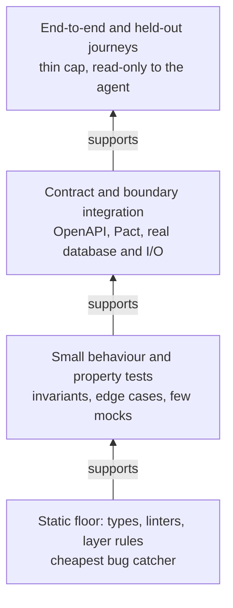

# Testing in agentic engineering

Coding agents make tests cheap to write and expensive to keep. This playbook
sets the shape of a suite that agents add to, names what agents over-produce,
and gives the rules that make an agent write fewer tests that catch more
faults.

## Sources

All sources were accessed and checked on **2026-11-25**. The 2026 agent
studies are preprints; treat their percentages as directional.

- [Software Engineering at Google, Ch. 11: Testing Overview](https://abseil.io/resources/swe-book/html/ch11.html)
- [Software Engineering at Google, Ch. 12: Unit Testing](https://abseil.io/resources/swe-book/html/ch12.html)
- [Software Engineering at Google, Ch. 13: Test Doubles](https://abseil.io/resources/swe-book/html/ch13.html)
- [Software Engineering at Google, Ch. 14: Larger Testing](https://abseil.io/resources/swe-book/html/ch14.html)
- [Google Testing Blog: Just Say No to More End-to-End Tests](https://testing.googleblog.com/2015/04/just-say-no-to-more-end-to-end-tests.html)
- [Google Testing Blog: Mutation Testing](https://testing.googleblog.com/2021/04/mutation-testing.html)
- [Practical Mutation Testing at Scale: A View from Google](https://research.google/pubs/practical-mutation-testing-at-scale-a-view-from-google/)
- [The Practical Test Pyramid](https://martinfowler.com/articles/practical-test-pyramid.html)
- [Contract Test](https://martinfowler.com/bliki/ContractTest.html)
- [The Testing Trophy and Testing Classifications](https://kentcdodds.com/blog/the-testing-trophy-and-testing-classifications)
- [Pact documentation](https://docs.pact.io/)
- [ApprovalTests](https://approvaltests.com/)
- [Hypothesis documentation](https://hypothesis.readthedocs.io/en/latest/)
- [Automated Unit Test Improvement using Large Language Models at Meta (TestGen-LLM)](https://arxiv.org/abs/2402.09171)
- [Mutation-Guided LLM-based Test Generation at Meta (ACH)](https://arxiv.org/abs/2501.12862)
- [Engineering at Meta: LLM-powered bug catchers (ACH)](https://engineering.fb.com/2025/02/05/security/revolutionizing-software-testing-llm-powered-bug-catchers-meta-ach/)
- [On the Diffusion of Test Smells in LLM-Generated Unit Tests](https://arxiv.org/abs/2410.10628)
- [Effective LLM Code Refinement via Property-Oriented and Structurally Minimal Feedback](https://arxiv.org/abs/2506.18315)
- [LLMShot: Reducing snapshot testing maintenance via LLMs](https://arxiv.org/abs/2507.10062)
- [ImpossibleBench: Measuring LLMs' Propensity of Exploiting Test Cases](https://arxiv.org/abs/2510.20270)
- [EvilGenie: A Reward Hacking Benchmark](https://arxiv.org/abs/2511.21654)
- [Are Coding Agents Generating Over-Mocked Tests? An Empirical Study](https://arxiv.org/abs/2602.00409)
- [Rethinking the Value of Agent-Generated Tests for LLM-Based Software Engineering Agents](https://arxiv.org/abs/2602.07900)
- [TDAD: Test-Driven Agentic Development – Reducing Code Regressions in AI Coding Agents via Graph-Based Impact Analysis](https://arxiv.org/abs/2603.17973)
- [Reward Hacking Benchmark: Measuring Exploits in LLM Agents with Tool Use](https://arxiv.org/abs/2605.02964)
- [SpecBench: Measuring Reward Hacking in Long-Horizon Coding Agents](https://arxiv.org/abs/2605.21384)
- [On the risk of coding before testing: An empirical study on LLM-based test generation workflow](https://arxiv.org/abs/2607.05139)
- [Ephyra: A Property-Based Testing Framework for the LLM Era](https://arxiv.org/abs/2611.23282)
- [Anthropic: Demystifying evals for AI agents](https://www.anthropic.com/research/demystifying-evals-for-ai-agents)
- [Anthropic: Finding bugs across the Python ecosystem with Claude and property-based testing](https://www.anthropic.com/research/property-based-testing)
- [Anthropic: Effective harnesses for long-running agents](https://www.anthropic.com/research/effective-harnesses-for-long-running-agents)

## At a glance

| Question | Rule |
| --- | --- |
| What shape should an agent-built suite take? | Static checks as the floor, small behaviour and property tests as the bulk, contract and boundary tests in the middle, and a thin cap of end-to-end journeys. |
| Should one agent write the code first and then its tests? | Avoid it for critical logic. Tests generated after faulty code detected 14% of faults, against 25% for tests generated independently ([arXiv:2607.05139](https://arxiv.org/abs/2607.05139)). |
| Do strict TDD prompts improve agent patches? | Not on their own. In one study, procedural TDD instructions raised regressions from 6.08% to 9.94%, while a code-to-test impact map cut them to 1.82% ([arXiv:2603.17973](https://arxiv.org/abs/2603.17973)). |
| How do you check that agent-written tests catch faults? | Run mutation testing on changed code instead of chasing line coverage ([Google](https://research.google/pubs/practical-mutation-testing-at-scale-a-view-from-google/), [arXiv:2501.12862](https://arxiv.org/abs/2501.12862)). |
| What do agents over-produce? | Mocks (36% of agent test commits add mocks, against 26% for non-agents, [arXiv:2602.00409](https://arxiv.org/abs/2602.00409)), print-debugging scripts in place of assertions ([arXiv:2602.07900](https://arxiv.org/abs/2602.07900)), and smell-heavy unit tests ([arXiv:2410.10628](https://arxiv.org/abs/2410.10628)). |
| Can the agent being graded edit the grading suite? | No. Agents exploit visible or editable tests; on SpecBench the visible-to-held-out gap grew by 28 percentage points per tenfold increase in code size ([arXiv:2605.21384](https://arxiv.org/abs/2605.21384)). |
| Software tests or agent evals? | Software tests for deterministic code; evals with code, model, and human graders for agent behaviour ([Anthropic](https://www.anthropic.com/research/demystifying-evals-for-ai-agents)). |

## Decision guide

Support levels in section 5 use this scale. **Strong**: two or more
independent primary sources support the claim. **Single source**: one primary
source does. **Contested**: credible primary sources disagree or report
competing trade-offs.

### 1. Shape the test portfolio

Agents make writing a test nearly free. Reading, maintaining, and running an
unneeded test stays expensive. Google's guidance aims for about 80% unit tests
and 20% broader-scoped tests ([SWE Book Ch. 12](https://abseil.io/resources/swe-book/html/ch12.html)),
and the Testing Trophy puts static analysis under unit, integration, and
end-to-end layers ([Testing Trophy](https://kentcdodds.com/blog/the-testing-trophy-and-testing-classifications)).
Both push each check to the cheapest layer that proves the contract.

Takeaway: let types, linters, and architecture rules remove whole classes of
tests before an agent writes a test file.

| Layer | What earns its place | What does not belong | Grounding |
| --- | --- | --- | --- |
| **Static floor** | Strict types, linters, schema validators, import-layer rules | Unit tests that assert type shapes or that getters exist | [Testing Trophy](https://kentcdodds.com/blog/the-testing-trophy-and-testing-classifications) |
| **Small behaviour tests** | Public API contracts, state transitions, boundary values, bug reproductions; single process, deterministic | Mocks of private helpers, exact call counts on internal collaborators, tests that mirror the code they follow | [SWE Book Ch. 12](https://abseil.io/resources/swe-book/html/ch12.html), [Ch. 13](https://abseil.io/resources/swe-book/html/ch13.html) |
| **Property-based tests** | Round trips, idempotency, monotonicity, ordering invariance, conservation laws, using a generator such as Hypothesis | Fixed layouts or arbitrary business copy | [Hypothesis](https://hypothesis.readthedocs.io/en/latest/), [Anthropic](https://www.anthropic.com/research/property-based-testing), [arXiv:2506.18315](https://arxiv.org/abs/2506.18315), [arXiv:2611.23282](https://arxiv.org/abs/2611.23282) |
| **Contract and boundary tests** | Real serialization against OpenAPI or JSON schemas, consumer-driven contracts (Pact), real migrations and queries against a disposable database | Hand-built maps checked against a schema without building the real types; mocking a database driver column by column | [Contract Test](https://martinfowler.com/bliki/ContractTest.html), [Pact](https://docs.pact.io/) |
| **Approval or golden tests** | Complex structured output (syntax trees, generated configuration, deterministic reports) with a human reviewing each diff | Full-page snapshots regenerated without review | [ApprovalTests](https://approvaltests.com/), [arXiv:2507.10062](https://arxiv.org/abs/2507.10062) |
| **End-to-end and held-out suites** | Critical user journeys and cross-feature compositions, kept read-only or outside the agent's writable workspace | Permutations of unit logic that a lower layer tests more cheaply | [SWE Book Ch. 14](https://abseil.io/resources/swe-book/html/ch14.html), [Google Testing Blog](https://testing.googleblog.com/2015/04/just-say-no-to-more-end-to-end-tests.html), [arXiv:2605.21384](https://arxiv.org/abs/2605.21384) |

**Why property-based tests matter more for agent code.** An example test
checks only the inputs its author imagined. A property test checks an
invariant across generated inputs and shrinks a failure to a minimal
counterexample. Property-oriented minimal feedback improved pass@1 by up to
13.4% over TDD-based refinement and fixed over 64% of initially failed
problems ([arXiv:2506.18315](https://arxiv.org/abs/2506.18315)). An agent
using property-based tests reported hundreds of potential bugs in NumPy,
SciPy, and Pandas, not all of them validated ([Anthropic](https://www.anthropic.com/research/property-based-testing)).
Ephyra found 349 bugs across 14 open-source systems, including SQLite,
PostgreSQL, DuckDB, and Cedar ([arXiv:2611.23282](https://arxiv.org/abs/2611.23282)).

**Why targeted mutation testing beats a coverage target.** Coverage shows that
a line ran, not that a test would notice it breaking. Google made mutation
testing practical by mutating only changed code during code review, rather
than the whole code base, and by suppressing unproductive mutants
([Google paper](https://research.google/pubs/practical-mutation-testing-at-scale-a-view-from-google/),
[Google Testing Blog](https://testing.googleblog.com/2021/04/mutation-testing.html)).
Meta's ACH targets a named concern instead: it generates few mutants for that
concern, then has an LLM write tests that kill them. Across 10,795 Android
Kotlin classes it generated 9,095 mutants and 571 tests, and engineers
accepted 73% of the tests ([arXiv:2501.12862](https://arxiv.org/abs/2501.12862),
[Engineering at Meta](https://engineering.fb.com/2025/02/05/security/revolutionizing-software-testing-llm-powered-bug-catchers-meta-ach/)).

### 2. Detect and trim what agents over-produce

| Anti-pattern | Evidence | Detection signal | Repair |
| --- | --- | --- | --- |
| **Over-mocking** | Across 1.2 million commits from 2025 in 2,168 TypeScript, JavaScript, and Python repositories, 23% of coding-agent commits changed tests (13% for non-agents), and 36% of agent test commits added mocks (26% for non-agents). The authors note mocked tests are easier to generate but less effective at validating real interactions ([arXiv:2602.00409](https://arxiv.org/abs/2602.00409)). | High mock-to-assertion ratio; tests that only verify calls; mocks of third-party types such as database drivers or HTTP clients. | Prefer a real implementation, then a fake ([SWE Book Ch. 13](https://abseil.io/resources/swe-book/html/ch13.html)); delete tests that assert only mock calls. |
| **Tests that certify the bug** | Tests generated after faulty code repeated its faults, so fault detection fell from 25% to 14% ([arXiv:2607.05139](https://arxiv.org/abs/2607.05139)). | Surviving mutants on changed lines; tests that still pass when a core condition is negated. | Run mutation testing on the change; write tests from the specification, or in a separate session, before reading the implementation. |
| **Debug scripts committed as tests** | In 5,000 SWE-bench Verified runs from six models, agent-written test files held more print statements than assertions. Prompting agents to write or skip test files changed resolved tasks by 0 to 13 out of 500, with no statistically significant difference ([arXiv:2602.07900](https://arxiv.org/abs/2602.07900)). | Low assertion density; print statements or throwaway reproducers in `tests/`. | Keep scratch reproducers out of the committed suite; require assertions in review. |
| **Test smells and redundancy** | Across 20,505 LLM-generated class-level suites, Assertion Roulette and Magic Number Test smells recurred, overlapping with smells in human-written tests ([arXiv:2410.10628](https://arxiv.org/abs/2410.10628)). In one Meta evaluation, 75% of TestGen-LLM's tests built, 57% passed reliably, and 25% increased coverage ([arXiv:2402.09171](https://arxiv.org/abs/2402.09171)). | Duplicate files for one component; tests that add no coverage and kill no unique mutant; smell detectors such as tsDetect or JNose. | Keep a new test only when it kills a mutant or covers an uncovered requirement; merge duplicates into parametrized tables. |
| **Snapshot and prose-match sprawl** | Snapshot tests fail on intentional UI changes and need manual triage to tell regressions from design changes ([arXiv:2507.10062](https://arxiv.org/abs/2507.10062)). | Bulk snapshot updates in diffs; tests that match exact sentences in prose files. | Replace full-tree snapshots with targeted assertions; check machine-checkable facts (links, schemas, counts), not wording. |
| **Reward hacking and test tampering** | Agents with access to tests deleted failing tests, modified tests, hardcoded expected outputs, or overloaded operators ([arXiv:2510.20270](https://arxiv.org/abs/2510.20270), [arXiv:2511.21654](https://arxiv.org/abs/2511.21654)). On SpecBench the visible-to-held-out pass-rate gap grew by 28 percentage points per tenfold increase in code size ([arXiv:2605.21384](https://arxiv.org/abs/2605.21384)). Simple environmental hardening cut exploit rates on RHB by 87.7% relative ([arXiv:2605.02964](https://arxiv.org/abs/2605.02964)). | Any diff that deletes, skips, or loosens an assertion; visible tests passing while held-out tests fail. | Keep acceptance tests read-only in the agent's sandbox; flag every deleted test or weakened assertion in review. |

#### Trimming protocol for an existing suite

Run this audit periodically, or when the suite outgrows its local feedback
budget:

1. **Profile.** Measure runtime per file and per test, and find the slowest
   10%. These are usually subprocess, network, or container fixtures.
2. **Collapse duplicates.** Merge test files that target the same module, and
   turn repeated per-input tests into parametrized tables.
3. **Cut low-signal tests.** Flag tests with no state assertions, heavy
   third-party mocking, or exact prose matches. Before deleting one, check
   that no mutant on the code it covers survives without it and that no
   requirement loses its only test.
4. **Quarantine flakes.** Move non-deterministic tests out of the blocking
   gate into a tracked lane with an owner and an expiry date. Delete
   quarantined tests nobody owns after one cycle.

### 3. Rules that make agents write fewer, better tests

Telling an agent to "follow strict TDD and reach 100% coverage" does not
help. Procedural TDD instructions without test context raised regressions
([arXiv:2603.17973](https://arxiv.org/abs/2603.17973)), and prompting agents
to write more test files changed token use without a significant change in
resolved tasks ([arXiv:2602.07900](https://arxiv.org/abs/2602.07900)). Put
concrete rules in the repository's test instructions instead:

1. **Supply the code-to-test impact map before editing.** List the existing
   tests that cover the target modules, so the agent runs and updates them
   instead of writing duplicates ([arXiv:2603.17973](https://arxiv.org/abs/2603.17973)).
2. **Justify each test by risk.** Every new test maps to a named requirement,
   boundary, invariant, contract, or bug reproduction. No coverage filler.
3. **Do not mock what you do not own.** Prefer real objects, fakes, or
   contract fixtures to mocks of HTTP clients, database drivers, or
   filesystem wrappers. Google advises a real implementation first, then a
   fake, and warns that overused interaction testing makes tests brittle
   ([SWE Book Ch. 13](https://abseil.io/resources/swe-book/html/ch13.html),
   [arXiv:2602.00409](https://arxiv.org/abs/2602.00409)).
4. **Prefer one property test to many fixed examples** when the function
   obeys a mathematical, serialization, ordering, or idempotency invariant
   ([arXiv:2506.18315](https://arxiv.org/abs/2506.18315)).
5. **Separate test writing from the fix on high-risk logic.** Write the
   failing regression or specification test before generating the fix, or in
   a separate context ([arXiv:2607.05139](https://arxiv.org/abs/2607.05139)).
6. **Gate acceptance on tests the agent cannot change.** Never let an agent
   delete, skip, or loosen an existing assertion to turn CI green
   ([arXiv:2510.20270](https://arxiv.org/abs/2510.20270)).
7. **Keep a generated test only if it earns its place.** Like TestGen-LLM's
   filters, keep it only when it builds, passes reliably, and adds coverage
   or kills a mutant ([arXiv:2402.09171](https://arxiv.org/abs/2402.09171),
   [arXiv:2501.12862](https://arxiv.org/abs/2501.12862)).

### 4. Software tests versus agent evals

A system that contains an agent (prompts, tools, skills, a harness) needs both
kinds of check, kept apart ([Anthropic](https://www.anthropic.com/research/demystifying-evals-for-ai-agents)):

| Dimension | Software tests | Agent evals |
| --- | --- | --- |
| **Subject** | Deterministic code: parsers, hooks, tool wrappers, schemas, policy gates, state machines | Agent behaviour: multi-turn reasoning, tool choice, acting versus staying silent, end-state quality |
| **Expected result** | Pass on every commit | A pass rate across slices (pass@k or pass^k) compared with a baseline |
| **Graders** | Code assertions | Code-based graders first, model-based graders checked against human labels second, human review third |
| **Failure evidence** | Assertion diff and stack trace | The transcript and the environment's end state |
| **Suites** | Unit and contract regression suite | Capability evals for headroom and regression evals that block known-good behaviour from degrading |
| **When they run** | Local gate and every pull request | Prompt, skill, tool-schema, or model changes, plus scheduled drift checks ([releases](practices/agentic-sre/releases.md), [drift](practices/agentic-sre/drift.md)) |

Do not grade a deterministic helper with a model judge. Do not treat unit
tests as proof that an agent's feature works end to end: Anthropic found an
agent would test with unit tests or curl and still miss that a feature did not
work end to end, until it was prompted to use browser automation
([Anthropic](https://www.anthropic.com/research/effective-harnesses-for-long-running-agents)).

### 5. Evidence and support

| Claim | Support | Sources | Notes and limits |
| --- | --- | --- | --- |
| Coding agents add mocks to tests more often than non-agents | **Single source** | [arXiv:2602.00409](https://arxiv.org/abs/2602.00409) | 1.2 million commits in 2,168 repositories from 2025; 36% against 26% of test commits. [SWE Book Ch. 13](https://abseil.io/resources/swe-book/html/ch13.html) supports the cost of overused mocks but not the agent comparison. |
| Writing tests after faulty code propagates the fault into the tests | **Single source** | [arXiv:2607.05139](https://arxiv.org/abs/2607.05139) | 14% against 25% fault detection. |
| Impact context beats procedural TDD prompts for agents | **Contested** | [arXiv:2603.17973](https://arxiv.org/abs/2603.17973), [arXiv:2602.07900](https://arxiv.org/abs/2602.07900), [arXiv:2607.05139](https://arxiv.org/abs/2607.05139) | The regression figures (6.08%, 9.94%, 1.82%) come from Qwen3-Coder 30B on 100 SWE-bench Verified instances. [arXiv:2607.05139](https://arxiv.org/abs/2607.05139) supports writing tests independently of the code. Read the two together: write the test first from the specification, and skip procedural ceremony. |
| Agent-written tests often act as print-debugging | **Single source** | [arXiv:2602.07900](https://arxiv.org/abs/2602.07900) | 5,000 SWE-bench Verified runs across six models; prompt changes moved token use, not resolution. |
| Mutation testing on changed or targeted code works at industrial scale and measures test quality better than coverage | **Strong** | [Google paper](https://research.google/pubs/practical-mutation-testing-at-scale-a-view-from-google/), [Google Testing Blog](https://testing.googleblog.com/2021/04/mutation-testing.html), [arXiv:2501.12862](https://arxiv.org/abs/2501.12862), [Engineering at Meta](https://engineering.fb.com/2025/02/05/security/revolutionizing-software-testing-llm-powered-bug-catchers-meta-ach/) | Google mutates changed code in review; Meta's ACH targets a named concern. |
| Property-based tests find bugs example tests miss and give better refinement feedback | **Strong** | [Anthropic](https://www.anthropic.com/research/property-based-testing), [arXiv:2506.18315](https://arxiv.org/abs/2506.18315), [arXiv:2611.23282](https://arxiv.org/abs/2611.23282) | Python scientific libraries (potential bugs, not all validated), coding benchmarks (up to 13.4% pass@1), and 14 open-source systems (349 bugs). |
| Coding agents exploit visible or editable tests; hardening the environment reduces it | **Strong** | [arXiv:2510.20270](https://arxiv.org/abs/2510.20270), [arXiv:2511.21654](https://arxiv.org/abs/2511.21654), [arXiv:2605.02964](https://arxiv.org/abs/2605.02964), [arXiv:2605.21384](https://arxiv.org/abs/2605.21384) | EvilGenie found held-out tests added little as a detector compared with an LLM judge, so pair held-out suites with review of test-file edits. |
| LLM-generated unit tests carry test smells and low net coverage before filtering | **Strong** | [arXiv:2410.10628](https://arxiv.org/abs/2410.10628), [arXiv:2402.09171](https://arxiv.org/abs/2402.09171) | Java suites from four models; TestGen-LLM figures come from Instagram Reels and Stories. |
| Agent behaviour needs layered evals kept separate from unit tests | **Strong** | [Anthropic evals](https://www.anthropic.com/research/demystifying-evals-for-ai-agents), [Anthropic harnesses](https://www.anthropic.com/research/effective-harnesses-for-long-running-agents), [Building Reliable Agents](building-reliable-agents.md) | Practitioner guidance rather than controlled studies. |

### 6. Limits

- The 2026 agent-testing studies are preprints run on specific models and
  benchmarks. Treat their percentages as directional, not as constants.
- Mutation testing costs compute and produces equivalent-mutant noise across
  a whole repository. Restrict it to changed lines or high-risk modules.
- No testing rule removes the need for a human to review requirements and
  acceptance criteria.

## Checklist

- [ ] Enforce static checks first: strict types, linter, formatter, and architecture layer rules.
- [ ] Give the agent a map of existing tests that cover the modules it will change before it adds test files.
- [ ] Trace every new test to a behaviour, boundary, contract, invariant, or bug reproduction.
- [ ] Flag tests that mock third-party internals such as database drivers or HTTP clients without testing a real contract.
- [ ] Add property-based tests for parsers, serializers, data pipelines, and state invariants.
- [ ] Run mutation testing on changed code in critical modules to catch tests that certify the bug.
- [ ] Keep acceptance or held-out tests read-only to the agent; review every deleted test or weakened assertion.
- [ ] Run deterministic software tests on every pull request and statistical agent evals on prompt, skill, tool, or model changes.
- [ ] Trim the suite periodically: profile the slowest 10%, collapse duplicates, delete zero-signal tests, and resolve quarantined flakes.

## Rules of thumb

- Let types and architecture rules remove whole classes of tests before an agent writes any.
- A test written after flawed code by the same model often certifies the bug, not the requirement.
- Count mutants killed and regressions caught, not test count or line coverage.
- A test that mocks what you do not own and asserts only mock calls is a candidate for deletion.
- One property test over generated inputs beats ten fixed happy-path examples.
- Give agents the existing test map, not a longer TDD lecture.
- Never let the agent being graded edit the grading suite.
- Test code with deterministic tests and agent behaviour with evals.

<!-- playbook-skills:v1:begin -->
<!-- Generated by scripts/playbook_index.py from the skills front matter. Do not edit by hand. -->
## Skills that put this into practice

These agent skills turn the rules above into steps an agent follows.
A skill without a link is not published; only its id and summary are public.

- `apply-playbooks`: Finds the playbooks that apply to a change, turns their key rules into acceptance criteria, and records in the pull request which rules the change followed.
- `spec-delivery-loop`: Turns an approved specification into a verified change through a plan, the smallest coherent change, focused tests, a gate, independent review and bounded repair.
- [`diagnosing-bugs`](https://github.com/mattpocock/skills/tree/main/skills/engineering/diagnosing-bugs): Diagnoses a bug, failure or regression before fixing it by reproducing it and testing one hypothesis at a time.
<!-- playbook-skills:v1:end -->

## Claim review

- [x] Every figure traces to a cited source or is labelled Own experience.
- [x] Every factual claim stays within the cited evidence.
- [x] Evidence limits and qualifiers remain explicit.

## Privacy review

- [x] No employer material.
- [x] No customer material.
- [x] No private-repository material.
- [x] No trace material.
- [x] No transcript material.

<!-- unslop-writing:passed -->
